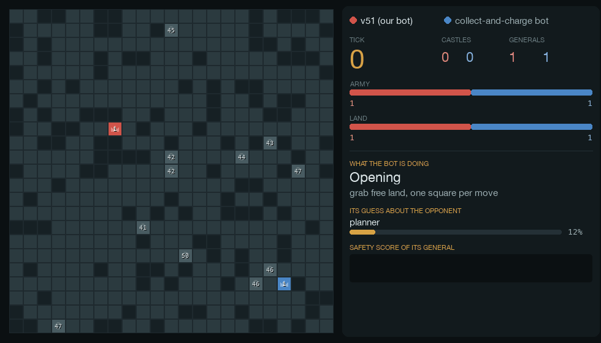
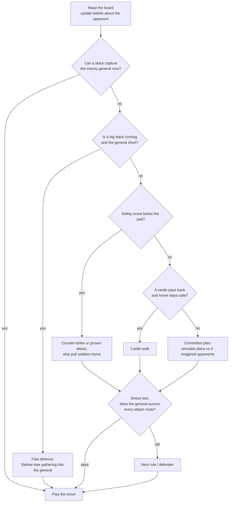
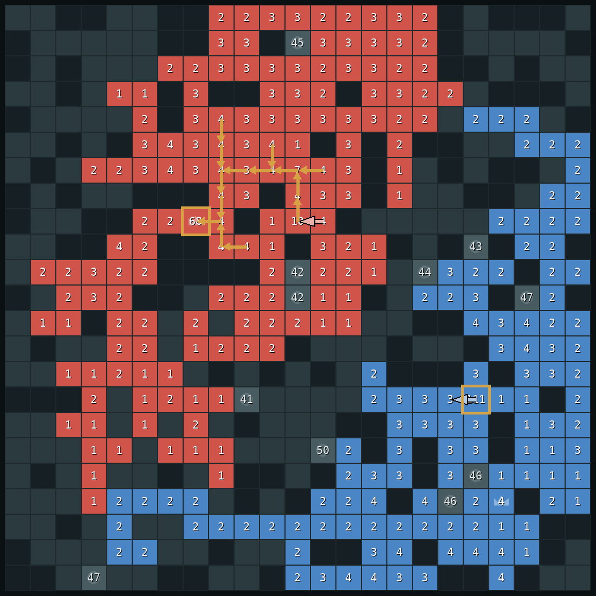
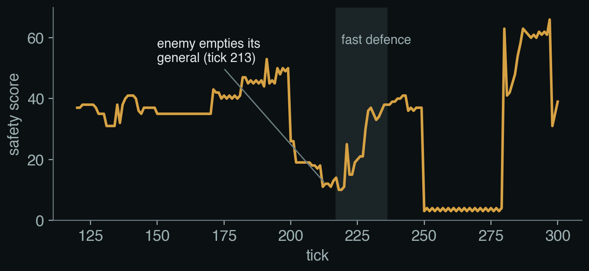
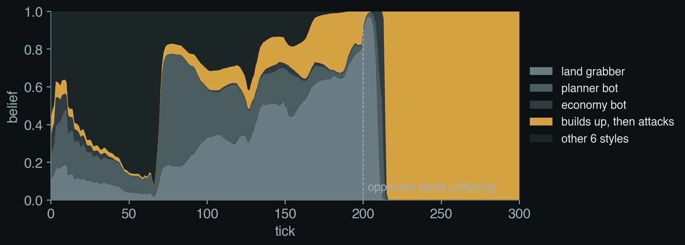
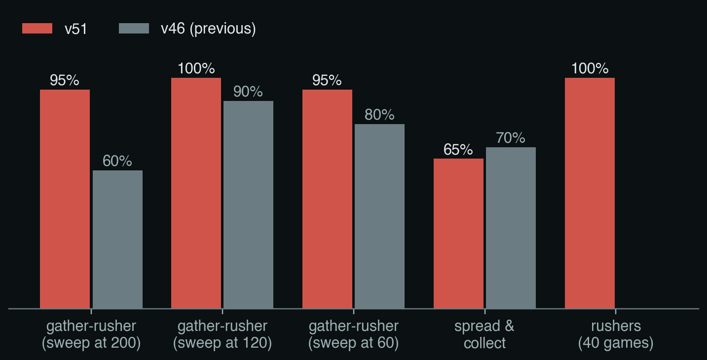

<div align="center">

# Generals.io Bot

**An interpretable game AI for Generals.io: it never leaves its general open, reads its opponent,
and attacks only when the attack is proven.**




<sub>A real game, rendered from the simulator. Our bot is <b>red</b>. At tick 213 the opponent empties its general
into one big stack and charges; the bot pulls its army into the general (gold arrows), absorbs the attack,
takes castles, and captures the enemy general once the attack is proven.</sub>

</div>

---

## About

[Generals.io](https://generals.io) is a real-time strategy game on a grid: every turn both players move one stack
of soldiers **at the same time**, soldiers grow by themselves, and you win by capturing the other player's
general. The catch is that **walking costs soldiers while waiting earns them**: an attacking stack loses one
soldier on every square it crosses while the defending general keeps growing. So a general falls only when its
owner moves the soldiers away, or when several stacks arrive one after another.

This bot is built around that fact, from classic AI rather than large-scale reinforcement learning:

- **AND-OR safety search.** A move is played only if the general survives every enemy attack route.
- **Plans, not moves.** It picks among a handful of scripted plans by simulating each 24–60 ticks ahead
  against four imagined opponents, scored by a learned win-probability model (half expected value, half worst case).
- **Reading the opponent.** A Bayesian filter and a small neural network (14 → 64 → 64 → 10) estimate which of
  ten playing styles it faces.
- **Committed defence.** When a big stack is coming, it gathers its army into the general along a
  prize-collecting Steiner tree, farthest stacks first, until the attack is over.
- **Proven attacks only.** It attacks the enemy general only when the arriving force beats the general, its
  growth and its reinforcements, and the attack wins against every simulated reply.

Every decision can be explained by a formula or a short search, and the whole pipeline runs in about
**10 ms per move** on a laptop CPU.

## Highlights

| | |
|---|---|
| **vs people** | won **14 of 17** recorded games against human players (11 by capturing the general) |
| **vs a collect-and-charge bot** | **95%** wins, up from 60% for the previous version |
| **vs rush bots** | **40 / 40** |
| **Safety rule** | won 24 of the 25 games our earlier search-only bot lost to rushers |
| **Simulator** | pure-Python replica of the game rules, identical on 10,400 random joint transitions |
| **History** | 50+ versions kept in [`models/`](models), from weighted A* to the final bot |

## How it thinks

Every tick the bot runs the same steps; the first step that produces a move decides the turn.



<table>
<tr>
<td width="33%"><br><sub><b>Committed defence.</b> The 14-move Steiner-tree plan (gold) that pulls soldiers into the general.</sub></td>
<td width="33%"><br><sub><b>Safety score.</b> What each side can gather at the general within T moves; it drops the moment the opponent empties its general.</sub></td>
<td width="33%"><br><sub><b>Reading the opponent.</b> The belief flips to "builds up, then attacks" as soon as the enemy collects.</sub></td>
</tr>
</table>

The full write-up, with every formula, the papers behind each idea and the experiments, is in the
[**project report**](project_report/report.pdf) ([Markdown version](project_report/report.md)); the talk is in
[`presentation/v51-talk.pdf`](presentation/v51-talk.pdf).

## Results

<p align="center"></p>

### Simulator experiments

| Experiment | Result |
|---|---|
| Fast defence vs the bot that collects and charges at tick 200 | **95%** (previous version: 60%) |
| … charges at tick 120 / tick 60 | 100% / 95% (previous: 90% / 80%) |
| … vs a bot that spreads out and takes castles | 65% (previous: 70%) |
| … vs rushers | 40 / 40 |
| Final bot (v51) vs previous final bot (v46), 60 games | 32–28 (±1 game between runs) |
| Early search-only bot (v11) vs two rush bots, 60 games | lost its general in 25 |
| First bot with the safety rule (v36), on those 25 maps | won 24 |
| Learned win estimate, held-out accuracy | opening 75% (land alone 71%), end game 98% |
| Opponent classifier, belief on unseen maps | 39% / 66% / 70% at ticks 100 / 200 / 300 (chance 10%) |

### Against human players

Games played against the final bot in the arena, recorded automatically in
[`arena_results/games.jsonl`](arena_results/games.jsonl) (replays in `arena_results/replays/`). 23×23 board,
one tick every 350–500 ms, humans played both seats.

| | Games | Bot won | Humans won |
|---|---|---|---|
| **All completed games** | 17 | **14** (11 by capture, 3 on land at the tick limit) | 3 (all by capture) |
| Player A | 10 | 7 | 3 |
| Player B | 2 | 2 | 0 |
| Player C | 2 | 2 | 0 |
| Player D | 3 | 3 | 0 |

The bot captured the human general between ticks 268 and 655. All three human wins came from one player
(3 of their 10 games). Two further games ended when the human quit and are not counted.

## Quick start

```bash
git clone https://github.com/SwaritThakkar/generals-io-bot.git
cd generals-io-bot
pip install -r requirements.txt        # Python 3.12; jax runs on the CPU
python play_arena.py                   # play against the bot
```

In the arena, type a name, pick **Final · champion (v51 fast defence)** (listed first; every other version
is playable too), choose side, length and speed, and press Enter. Each match is a pair of games on the same map
with the seats swapped. **F1** explains the rules, **F2** the controls.

**Controls:** click one of your tiles, arrow keys / WASD queue moves, **Shift + arrow** sends half the stack,
`c` clears the queue, `p` pauses, `[` / `]` change speed, Esc leaves. More in
[`docs/ARENA.md`](docs/ARENA.md) and [`docs/PLAYING.md`](docs/PLAYING.md).

### Use the bot from code

`final.act(state, player) -> int` takes the full board for one tick and returns one action: `0` = pass,
otherwise `cell * 9 + k` with `k = 1..4` moving the stack up / down / left / right (leaving one soldier) and
`k = 5..8` sending half.

```python
import sys
sys.path[:0] = [".", "models", "models/tools36"]
import final
from arena.bots import bot_state
from arena36 import start                  # a harness map as a simulator state

ctx, sim = start(93001, 600)
for tick in range(5):
    a0 = final.act(bot_state(sim), 0)      # the bot plays seat 0
    a1 = final.act(bot_state(sim), 1)      # ... and seat 1
    sim.step2(a0, a1)
```

The bot keeps its memory (plan, beliefs) between calls and starts fresh when the tick goes backwards.

## Reproduce the results

All experiments run in [`models/sim36.py`](models/sim36.py), the exact pure-Python copy of the rules.
`models/tools36/h2h42.py CAND OPP...` plays every seed from both seats in parallel and prints wins / draws /
losses, the per-seat split and the time per move. Timings are wall-clock on an Apple Silicon laptop.

<details>
<summary><b>Simulator check and tests</b></summary>

```bash
python models/tools36/check_sim36.py      # "ok: 40 games, 10400 joint transitions identical" (~2 s)
python -m pytest -q tests                 # 17 passed (~7 s)
```
</details>

<details>
<summary><b>Fast defence vs collect-and-charge bots (95% vs 60%)</b></summary>

The defence table was measured on v52 (`models/v52_fast_defence_only.py`), which is the final bot without the
opponent classifier; the defence code is the same.

```bash
python models/tools36/h2h42.py models/v52_fast_defence_only.py gather200 --cap 600   # 19-1 (~12 s)
python models/tools36/h2h42.py models/v46_opponent_learner.py  gather200 --cap 600   # 12-8 (~9 s)

# the full table (a few minutes)
python models/tools36/h2h42.py models/v52_fast_defence_only.py \
    gather200 gather120 gather60 spread spread_late rusher castle_rusher --cap 600
```

Opponent names: `gather60`, `gather120`, `gather200` (collect, then charge at that tick), `spread`,
`spread_late`, `expand`, `rusher`, `castle_rusher`, `econ`, `siege`, `siege2`, or any bot file.
</details>

<details>
<summary><b>Final bot vs the previous final bot (32–28)</b></summary>

```bash
python models/tools36/h2h42.py models/v51_fast_defence.py models/v46_opponent_learner.py \
    --seeds 93001 93030 --cap 500                                                    # ~64 s
```

Re-running reproduces 32–28; one other run gave 33–27, because a single game can flip between runs.
`final.py` is a copy of v51 and plays identically.
</details>

<details>
<summary><b>Retrain the learned win estimate (logistic regression)</b></summary>

```bash
python models/train_value37.py            # ~3 min on one CPU core; overwrites models/value37.json
```

Plays 200 self-play games between seven scripted policies (train seeds 95000–95159, held-out 95160–95199,
caps 300/500/800), records features every 5 ticks and fits one logistic model per phase by Newton's method.
The scripted policies were improved after this model was trained, so a re-run today plays slightly different
games (28,140 / 7,084 rows instead of 27,208 / 6,986) and gives slightly different weights; the qualitative
result is the same. Keep a copy of the shipped `models/value37.json` for the exact weights the bot uses.
</details>

<details>
<summary><b>Retrain the opponent classifier (Apple GPU)</b></summary>

```bash
python models/train_v51_classifier.py --train 93101 93125 --test 93126 93133    # overwrites models/v51_classifier.json
```

The previous bot plays each of the 10 opponent styles on 33 maps from both seats, then a 14-64-64-10 MLP is
trained with Adam for 60 epochs on MPS (`torch` required). Expected: 99,437 training rows and 33,318 test
rows; per-board accuracy 24.6% / 53.3% / 69.9% / 67.2% for ticks 0–100 / 100–200 / 200–300 / 300–500;
filtered belief 38.8% / 66.2% / 70.2% at ticks 100 / 200 / 300.
</details>

<details>
<summary><b>Count the human results, rebuild the demo GIF</b></summary>

```bash
python -c "import json; g=[json.loads(l) for l in open('arena_results/games.jsonl')]; v=[d for d in g if d['bot_id'].endswith('v51_fast_defence') and d['end']!='quit']; print(len(v), sum(d['winner']=='bot' for d in v))"   # 17 14
python docs/media/make_demo_gif.py        # replays the demo game and writes docs/media/demo.gif (~10 s)
```
</details>

## Repository layout

<details>
<summary><b>Show the layout</b></summary>

```
final.py            the final bot (v51); entry point act(state, player)
play_arena.py       the pygame arena: play any bot, tutorial, leaderboard
viewer.py           older pygame viewer on the JAX engine (watch / play / rewind)
arena/              the arena app: screens, bot registry, cached maps, tutorial videos, results store
arena_results/      human-vs-bot games recorded with the arena (games.jsonl + replays)
genmod/             the game engine in JAX (reference rules, map generator, renderer)
models/             every bot version v1–v53, shared cores (sim36, core36, core37), training scripts, fitted models
models/tools36/     evaluation harness: head-to-head runner, simulator check, game analysis
models/tournaments/ recorded tournaments and the human games used for analysis
server/             local match server and the bot protocol (BotState)
strategies/         early search agents (weighted A*, greedy) used by the first versions
tests/              pytest suite for the game rules
project_report/     the project report: LaTeX source, figures, PDF, Markdown
presentation/       slides (pptx/pdf), write-ups and their build scripts; earlier/ holds the first two decks
docs/               how-to-play notes, arena guide, research ledger, explainers, demo GIF
papers/             reference list with links (arXiv papers included)
legacy/             early figure tools and demos, and an optional Next.js web app
```

Every version is a single file `models/vNN_name.py` exposing `act(state, player)`; later versions load their
predecessors by file name, so `models/` stays flat. [`models/README.md`](models/README.md) has one line per
version with its idea and measured result, and [`docs/RESEARCH_IDEAS.md`](docs/RESEARCH_IDEAS.md) records every
idea we tried and what happened.
</details>

## Limitations

- **Late attacker.** It attacks only proven attacks, which in practice means an emptied enemy general.
- **Weak against spreading and castles.** Defence has priority over castles.
- **Hand-set constants.** Pad, reserve fractions, thresholds and horizons were set from lost games, not tuned
  systematically.
- **Narrow opponent model.** Four scripts and ten styles.
- **Full board.** The bot reads the whole board; the original game's fog of war would need an extra inference layer.
- **Rare slow ticks.** Verifying an attack can take much longer than the average move (the worst we measured
  was about 1.7 s); in the arena the board keeps ticking while the bot thinks.

## References

- S. Russell and P. Norvig. *Artificial Intelligence: A Modern Approach*, 4th ed. Pearson, 2020.
- M. Straka, V. Lisý and M. Schmid. Superhuman AI for Generals.io using self-play reinforcement learning. arXiv:2606.23348, 2026.
- N. A. Barriga, M. Stanescu and M. Buro. Puppet Search: Enhancing scripted behavior by look-ahead search with applications to real-time strategy games. AIIDE 2015.
- G. Synnaeve and P. Bessière. A Bayesian model for plan recognition in RTS games applied to StarCraft. AIIDE 2011.
- B. G. Weber and M. Mateas. A data mining approach to strategy prediction. IEEE CIG 2009.
- D. Churchill and M. Buro. Build order optimization in StarCraft. AIIDE 2011.

More papers, including the search papers we started from (ARA\*, RTAA\*, depression avoidance, ProbCut,
metareasoning), are listed with links in [`papers/README.md`](papers/README.md).
