# How v46 works

v46 is the current `final.py`. This document explains it from the ground up: what it looks at, what it computes, and how it picks one move per tick. Every number below comes from the code in `models/` or from real games it played. The diagrams are in `img/`.

**The idea in one paragraph.** v46 never searches raw moves deeply. Every tick it does three things:
1. It asks one safety question: *if the enemy collected everything it can and walked it onto my general, would my general (plus what I can bring home in time) still hold?* The answer is a number, the **race margin**.
2. It proposes moves from a short list of plans: expand, take a castle, gather, strike, defend.
3. It plays the first proposal that keeps the race margin positive.

On top of that, it watches the opponent and switches parts of itself on or off: castle play, the size of its home reserve, counter-attacks.

---

## Contents

1. [The game, in the terms v46 uses](#1-the-game-in-the-terms-v46-uses)
2. [The shape of v46: five layers](#2-the-shape-of-v46-five-layers)
3. [One tick, top to bottom](#3-one-tick-top-to-bottom)
4. [Layer 1: the simulator](#4-layer-1-the-simulator)
5. [Layer 2: safety, the general must hold](#5-layer-2-safety-the-general-must-hold)
6. [Layer 3: the collection race](#6-layer-3-the-collection-race)
7. [Layer 3: the general reserve and the counter-strike](#7-layer-3-the-general-reserve-and-the-counter-strike)
8. [Layer 3: the castle layer](#8-layer-3-the-castle-layer)
9. [Layer 4: the macro planner](#9-layer-4-the-macro-planner)
10. [Layer 5: learning the opponent](#10-layer-5-learning-the-opponent)
11. [Attacking: when v46 goes for the general](#11-attacking-when-v46-goes-for-the-general)
12. [A whole game, tick by tick](#12-a-whole-game-tick-by-tick)
13. [How well it plays](#13-how-well-it-plays)
14. [Where it lives in the code](#14-where-it-lives-in-the-code)
15. [How to present this](#15-how-to-present-this)

---

## 1. The game, in the terms v46 uses

- **Moves.** Each tick each player makes one move. A move picks a tile you own with at least 2 army and a direction. You send either all but one unit or half, or you pass. Both players move at the same time.
- **Combat** is subtraction: the bigger stack survives with the difference.
- **Production.** Your general and every castle you own make +1 every 2 ticks. Every tile you own makes +1 every 50 ticks.
- **Castles** start neutral with a 40–50 garrison. Beat the garrison and the castle produces for you.
- **Winning.** Take the enemy general. Otherwise the game ends at the tick cap and is decided on land, then army.

Two consequences drive the whole design:

- **A walk shrinks.** A stack walking d steps leaves one unit on every tile, so it loses about d units. It gains the army of your own tiles it passes over and loses the army of every tile it captures.
- **The defender grows during the walk.** A general gains about d/2 while an attacker walks d steps. So two players who both keep their army at home cannot rush each other. Only a general that has been **drained**, or that faces **many stacks collected together**, falls.

v46 is built around the second point.

---

## 2. The shape of v46: five layers

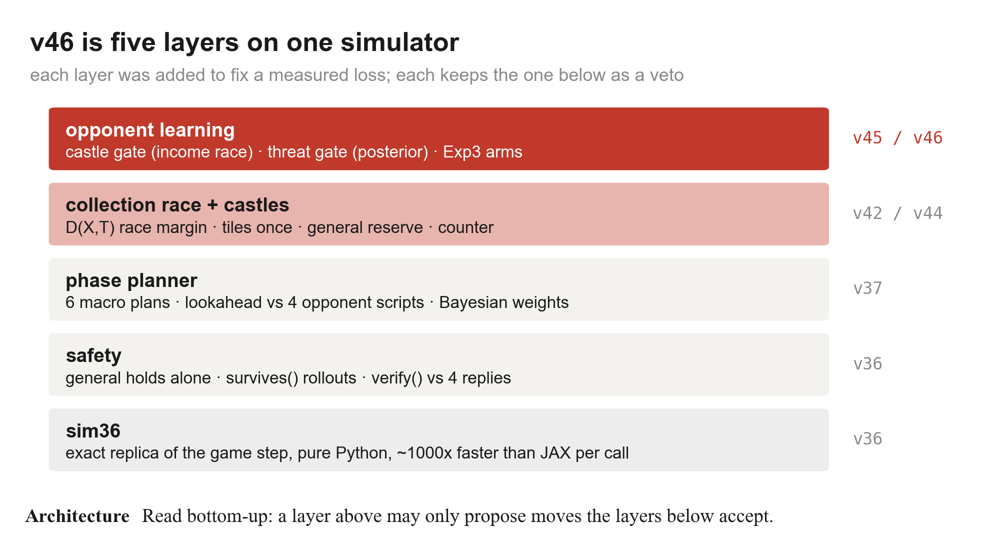

Each layer was added to fix a loss we measured. A layer above can only **propose** moves; the layers below can **veto** them. The opponent model at the top can make v46 greedier, but it can never make a move that the safety layer rejects.

In code, the layers are a chain of subclasses. Each file loads the previous one and overrides a few methods:

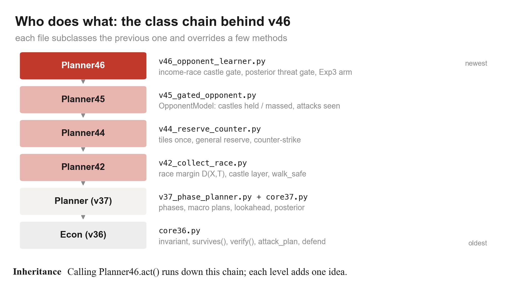

| Class | File | What it adds |
|---|---|---|
| `Econ` | `core36.py` | the safety invariant, `survives()`, `verify()`, attack plans, defence, expansion |
| `Planner` (v37) | `v37_phase_planner.py`, `core37.py` | phases, macro plans, lookahead against 4 opponent scripts, Bayesian opponent weights |
| `Planner42` / `Econ42` | `v42_collect_race.py` | the race margin D(X, T), the castle layer, `walk_safe` |
| `Planner44` / `Econ44` | `v44_reserve_counter.py` | tiles counted once, the general reserve, the counter-strike |
| `Planner45` | `v45_gated_opponent.py` | `OpponentModel`: castles held or massed on, attacks seen |
| `Planner46` | `v46_opponent_learner.py` | income-race castle gate, posterior threat gate, Exp3 parameter arms |

`final.py` is a copy of `v46_opponent_learner.py`.

---

## 3. One tick, top to bottom

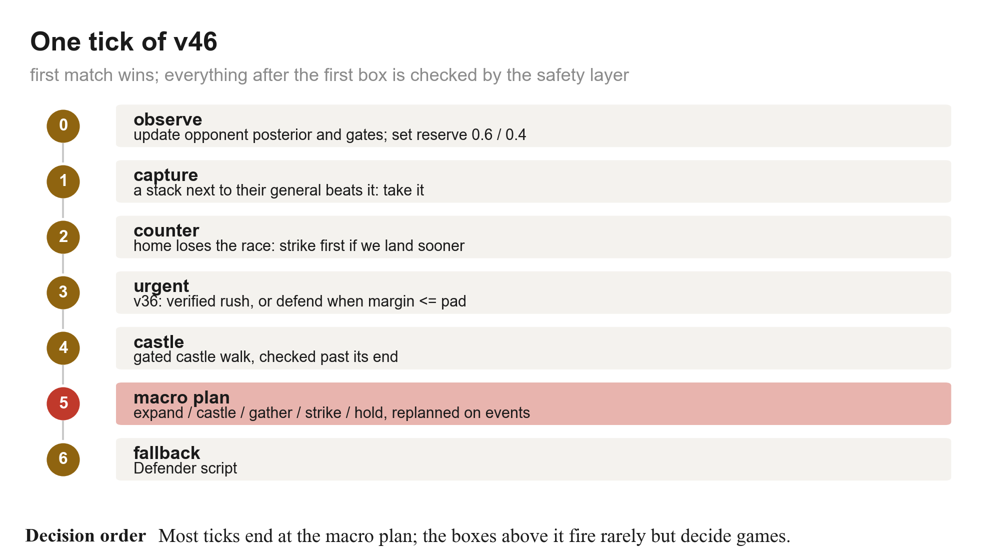

This is what happens when the game calls `act(state, player)`:

0. **Observe.** Rebuild the board in the simulator. Then:
   - update the opponent posterior and the `OpponentModel` facts;
   - recompute the two gates;
   - set the reserve factor R to 0.6 if the threat gate is open, 0.4 if shut.
1. **Capture.** If one of our stacks next to the enemy general beats it, take it.
2. **Counter.** If our home is losing the race (margin ≤ pad), look for a stack that can hit their general *before* ours falls. Launch it only if a rollout check confirms it ([section 7](#7-layer-3-the-general-reserve-and-the-counter-strike)).
3. **Urgent play (v36).** The v36 layer takes over if any of these hold:
   - the margin is at or below the pad;
   - we are in the middle of a rush;
   - a verified attack exists.
   It then rushes, defends or consolidates.
4. **Castles.** Continue a castle walk in progress, or launch a new one. The castle gate decides which castles are allowed ([section 8](#8-layer-3-the-castle-layer)).
5. **Macro plan (v37).** Play the committed plan's move: expand, hold, take castle X, gather home, strike or rush. Replan when the commit runs out or something happens ([section 9](#9-layer-4-the-macro-planner)).
6. **Fallback.** If the plan's move was vetoed, the v36 `Econ` policy picks a safe move. If that finds nothing, the `Defender` script moves.

Every move from step 3 on goes through `safe_after()`: the move is tried on a copy of the board and the race margin is recomputed. If the margin drops below the pad, the move is refused, or sent to the exact rollout check.

---

## 4. Layer 1: the simulator

`sim36.py` is a pure-Python copy of the game's `step` function. It updates only the cells a tick changes, so copying the board and playing 40–60 ticks ahead is cheap. That is what lets v46 run rollouts *inside* a single decision.

- It was checked against the original JAX game step on thousands of random move pairs (`tools36/check_sim36.py`).
- v37 replayed all 780 recorded moves of two human games exactly.
- Average decision time for v46 is about 10 ms. The slowest one we measured was 1.28 s, during heavy rollouts.

---

## 5. Layer 2: safety, the general must hold

### The original rule (v36)

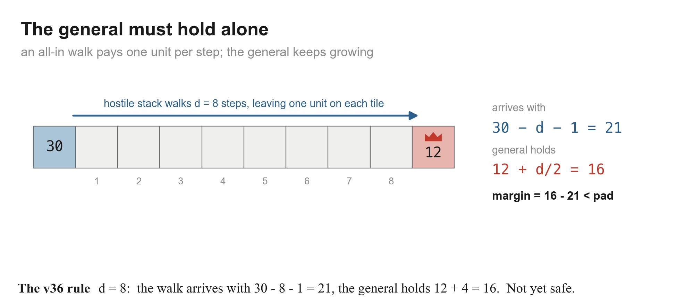

> The general **alone** must beat every enemy all-in walk, after the growth it gets while the walk is under way.

For one enemy stack of size x at distance d, its walk arrives with about x − d − 1, minus whatever it has to fight through. Meanwhile our general holds G + d/2. The **home margin** is the worst case over all enemy walks of (general + growth) − (arrival).

Three details that each came from a lost game:
- **Routes are re-planned on the board after our move.** Taking a castle can open a shortcut.
- **Our own stacks are not walls.** An enemy walk through our land assumes each of our tiles holds at most 3, because stacks can step aside.
- **The general never relies on being refilled.** If it did, it could step out, look safe because another stack "will come back", and oscillate.

### The pad

v46 keeps the margin above a **pad**, not just above 0:

pad = 3 + 0.08 × (largest enemy stack not sitting on a producer)

Inside the v36 policy, the pad also grows when the margin has been shrinking over the last 8+ ticks (+16 × the rate of decline). That buys lead time against an opponent who is banking faster than we grow.

### `survives()`: the exact check

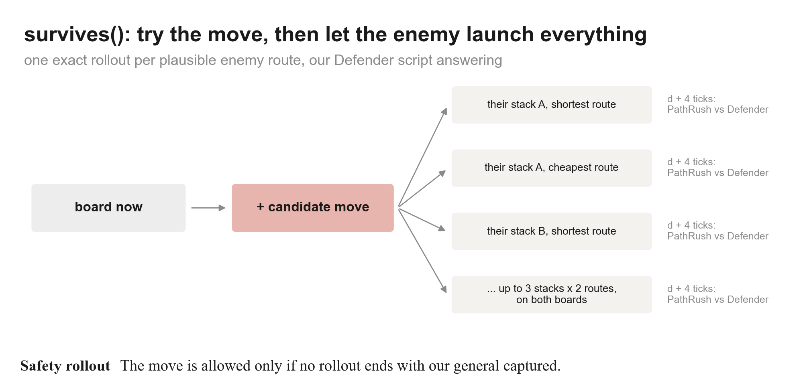

Any move that lowers the margin below the pad goes to `survives(move)`:
- play the move on a copy;
- take the enemy's plausible all-in routes: their top 3 stacks, each by its shortest and its cheapest route, judged on both the old and the new board;
- for each route, play the enemy walking it, with our `Defender` script answering, for d + 4 ticks;
- if any rollout ends with our general captured, the move is refused.

### `verify()`: checking our own plans

Before v46 commits to an attack, the attack is played out against four scripted replies, for d + 4 ticks:
- `Rusher`: all-in on our general;
- `CastleRusher`: takes a castle, then all-in;
- `Pass`: does nothing;
- a turtle `Econ`: pulls everything home and defends.

The attack is taken only if it wins against **all four**.

### Swap-safe defence (v39)

Moves are simultaneous. If our general steps toward an adjacent enemy stack, the two stacks can pass each other, and the attacker lands on the now-empty general. We found this by replaying a human win. v46 therefore never moves the general toward an adjacent enemy stack.

---

## 6. Layer 3: the collection race

### Why v36's rule was not enough

v36 only looked at **one** enemy walk at a time. Humans beat that with one pattern:
- spread out over many small stacks and castles, keeping the general light;
- in the last 30–40 ticks, collect everything into one stack and strike.

No single stack ever looked dangerous, until it was too late.

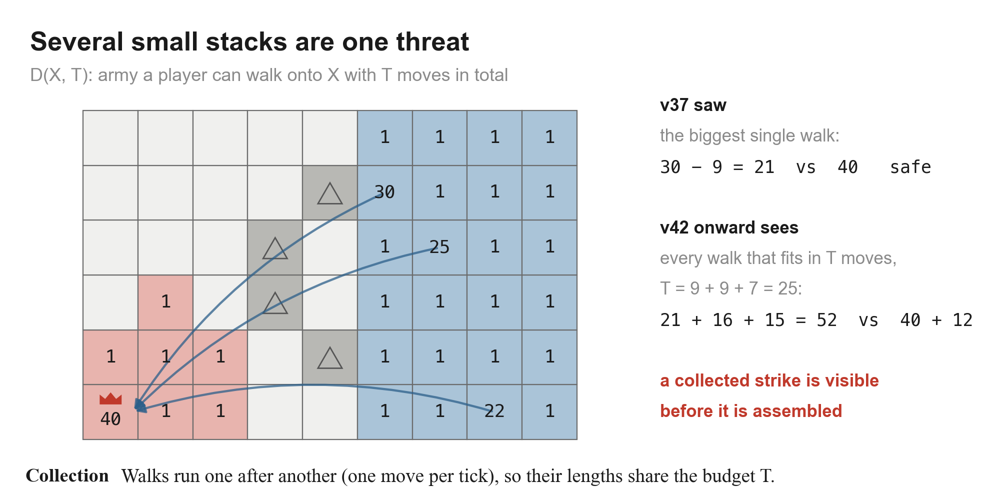

### D(X, T): how much army can a side bring onto X in T moves

One move per tick means walks happen **one after another**, so their lengths share a budget:

D_p(X, T) = the most army player p can deliver onto cell X using walks whose lengths add up to at most T.

This is a simplified version of the "prize-collecting Steiner tree" gathering used by the Human.exe bot (Straka, Lisý & Schmid 2026). v46 computes it greedily:

1. **Items.** For each of a side's 10 largest stacks, find its best walk to X and the army that walk would deliver (`walk()`, which adds our tiles' army and subtracts what it fights through).
   - Our walks home only count if they stay on our own land. A walk across the enemy's land can be cut.
   - Enemy walks onto our general treat each of our tiles as at most 3 (stacks step aside), so they are counted generously in the enemy's favour.
2. **Greedy pick.** Take the biggest walks first while the total length stays ≤ T. Skip a walk that starts on a tile another chosen walk passes through, so no stack is counted twice.
3. **Each tile once (v44).** If two walks run down the same corridor, the land army on that corridor is counted only for the first one.

### The race margin

For every horizon T:

margin(T) = G + growth(T) + D_us(g, T − 2 − T/10) − D_them(g, T)

- G + growth(T) is our general's army after T ticks.
- D_us is what our stacks bring home. It gets a shorter budget: defence has to start while there is still time, so our walks must land 2 + T/10 ticks early.
- D_them is what the enemy can collect onto our general.

The **race margin** is the minimum over all T. The T values checked are every enemy walk length and every sum of two of them, up to 60.

Here is the race profile from a real v46 position (tick 300 against the spread-collector bot):

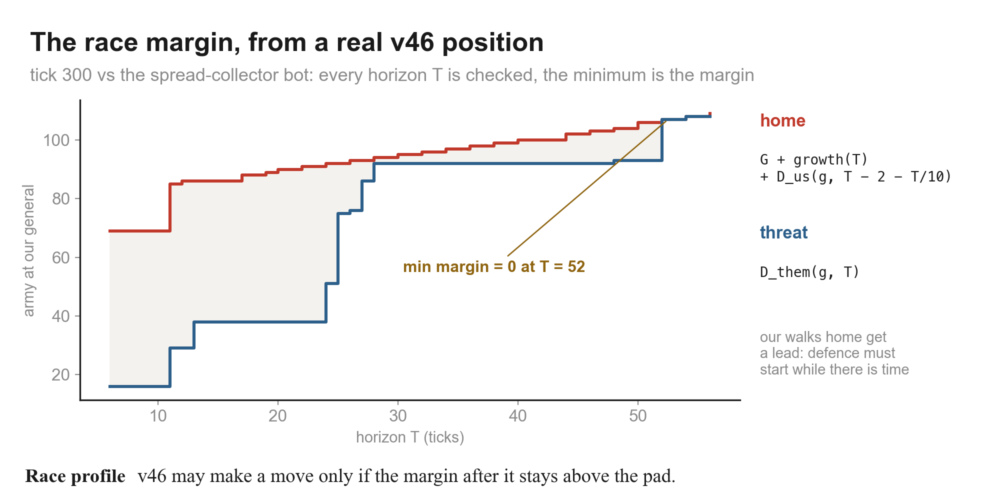

And here is what v46 was looking at on the board at that same tick:

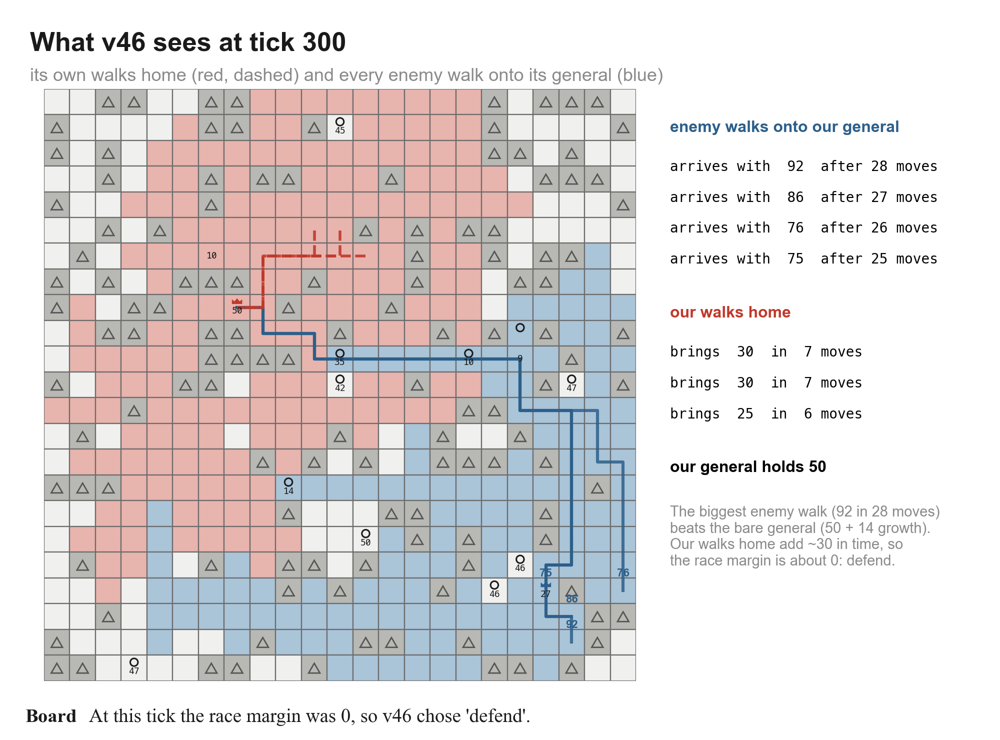

At tick 300:
- the biggest enemy walk was 92 units, arriving in 28 moves;
- our general was 50, plus 14 growth over those 28 ticks;
- our own walks home could add about 30 in time.

The margin came out at 0, so v46 switched to **defend**. The biggest single walk alone would already break the bare general; it is our own walks home, counted with their 2 + T/10 lead, that keep the margin from going negative. The margin falls while the enemy's army is still spread out, before it is collected.

### How the margin is used

The margin is not a move. It is the test that every other layer's moves must pass:
- `safe_after(move)`: play the move on a copy, recompute the margin, and accept it if the margin stays above the pad;
- if it doesn't, use `survives()` (section 5);
- a move **out of the general** additionally has to pass the reserve check (section 7);
- the counter-strike (section 7) uses the T at which the margin first goes ≤ 0.

---

## 7. Layer 3: the general reserve and the counter-strike

### The general reserve (v44)

A human beat v42 by making it drain its general to 2–15 units on castles and a strike. Their own general then walked out and collected 84 → 137. So a move that sends army **out of the general** must also leave a reserve:

G_keep + growth(H + d) ≥ R × threat(H), for H = 0, 30 and 60

- G_keep is what stays in the general: half if it sends half, 1 if it sends all but one.
- threat(H) is what each enemy walk will carry if the enemy waits H ticks first. Their producers grow, and so does the land on the walk's path.
- The same check is run against the army the enemy could **gather** in 30 or 60 moves: their best 30 or 60 tiles, collected into one stack and walked over.
- R = 0.6 when the threat gate is open, 0.4 when it is shut (section 10).

On top of that, the race margin after the move must stay above the pad, with the departing stack **not** counted as coming back.

### The counter-strike (v44)

If our home is losing the race anyway, the best defence can be to hit first. v46 looks for a stack that can do it:

1. Find t_hit, the first T at which our margin goes ≤ 0.
2. For each of our 8 largest stacks, take the walk to the enemy general. Its length d must be **less than t_hit**.
3. The walk must beat (their general) + growth(d) + (everything they can collect home in d − 1 moves) + 3.
4. It must pass `verify()` against the four replies.

The shortest such walk is launched. This only runs while the threat gate is open.

---

## 8. Layer 3: the castle layer

A castle produces as much as 25 plain tiles, so castles win long games. They cost army, though, and v42's early versions lost generals by spending them on garrisons. The castle layer is careful about both.

**Options.** v46 considers every castle not owned by us, within 30 steps of our general. Possible sources:
- our general, sending half or all but one;
- our own castles holding at least 4;
- our 4 largest stacks of at least 10.

**Pays back.** A castle is only considered if 2 × (garrison + walk length) ≤ min(ticks left − walk length, 400). In other words, it must earn its cost back before the game ends.

**Ranking.** Cheapest first:

key = garrison + walk length − 0.6 × (steps it brings us closer to their general) − 15 if they own it

So forward castles, and taking castles away from the enemy, come first.

**Safety.** v46 tries the best 4 options. A send is accepted only if all of these hold:
- from the general, it passes the reserve check (section 7);
- `walk_safe`: the board is played forward to the end of the castle walk (our stack is *spent* on the garrison), every enemy walk is advanced by the same number of ticks, and the race margin is still above pad + 0.2 × their largest stack;
- from anywhere else, it passes `safe_after()`.

**The castle gate** (section 10) can shut. Then only cheap castles are allowed: garrison plus walk at most 30, and never sent from the general.

---

## 9. Layer 4: the macro planner

When nothing urgent is happening and no castle walk is running, v46 follows a **macro plan**. This is the v37 planner, inspired by Puppet Search (Barriga, Stanescu & Buro, AIIDE 2015). Instead of searching ~2,000 raw moves, it chooses between a handful of plans and simulates each one.

### Phases, read from the board

- **opening**: no enemy walk reaches our general yet and more than 35% of the land is still neutral;
- **end**: the tick cap is within 60 ticks, or one side has a decisive lead (land ≥ 2× + 20 **and** army ≥ 2× + 40);
- **mid**: everything else.

### The plan set

- `expand`, `hold`;
- `take castle X` for the 2–3 nearest castles (nearest by distance + half the garrison);
- outside the opening, also `strike` and `rush`;
- `gather home` only when the margin is low (≤ 3 × pad + 10).

### Scoring a plan

Each plan is played forward **H ticks** in the simulator: 24 in the opening, 40 in mid, 60 in the end (or to the cap if that is closer). It is played against **each of four opponent scripts**: rusher, castle rusher, expander, hold.

The board at the end is scored by a small logistic model. Its 9 features are:
- bias;
- land difference and army difference;
- producer difference;
- income difference × ticks left;
- (our general − their largest stack), i.e. can we absorb their best stack;
- (our largest stack − their general), i.e. can we break their general;
- largest-stack difference;
- ticks left.

The model was fitted offline on self-play games, one set of weights per phase.

The plan's score blends the expected and the worst case:

score = 0.5 × (posterior-weighted mean over the 4 scripts) + 0.5 × (worst of the 4)

The posterior is section 10's opponent model. Plans whose rollouts end in identical boards are merged. In the opening, most plans just take neutral tiles, so this cuts about 6.1 candidate plans to 4.6.

**A real decision** (tick 180 of the game in section 12, mid phase, H = 40). The posterior put 97% on "expander":

| plan | vs rusher | vs castle rusher | vs expander | vs hold | weighted mean | worst | **score** |
|---|---|---|---|---|---|---|---|
| expand / hold / strike / rush | 0.847 | 0.847 | 0.555 | 0.847 | 0.565 | 0.555 | 0.560 |
| **take castle 241** | 0.811 | 0.811 | 0.601 | 0.811 | 0.607 | 0.601 | **0.604** |
| take castle 264 | 0.806 | 0.806 | 0.586 | 0.806 | 0.593 | 0.586 | 0.589 |
| take castle 354 | 0.769 | 0.769 | 0.506 | 0.769 | 0.515 | 0.506 | 0.510 |

Against an expanding opponent, taking castle 241 wins: it is the best answer to the opponent v46 believes it faces. A castle costs army now, so it looks slightly worse against a rush. v46 started that castle walk shortly after, and took its first castle at tick ~195.

### Commitment

A chosen plan runs for K ticks: 6 in the opening, 10 in mid, 8 in the end. It is replanned early if:
- the phase changes;
- a castle changes hands;
- the enemy general drops below half its previous size;
- the plan finishes.

Every move the plan makes still has to pass `safe_after()`.

---

## 10. Layer 5: learning the opponent

### The posterior over opponent types

v46 keeps a belief over four opponent scripts: **rusher, castle rusher, expander, hold**. This is the Bayesian opponent typing of Synnaeve & Bessière (AIIDE 2011) and Weber & Mateas (CIG 2009).

Every tick:
1. Each script predicts what the opponent would have done on the previous board.
2. v46 checks whether the new board is consistent with that prediction.
3. Each weight is updated:

   w ← 0.95 × w × (0.8 if consistent, 0.2 if not) / 0.5 + 0.05, then normalised.

The 0.95 forgets old evidence, so the belief can change when the opponent changes style. The + 0.05 keeps every type possible.

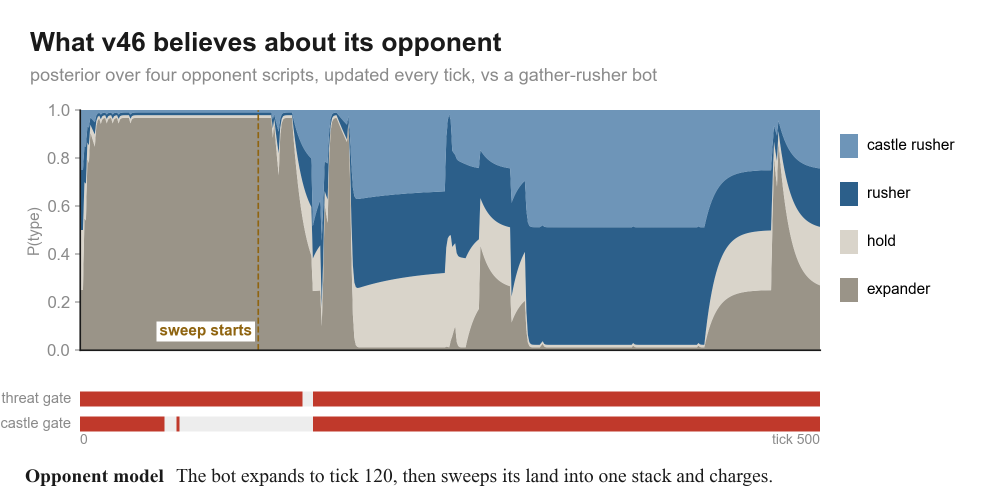

Against a bot that expands until tick 120 and then sweeps its land into one stack and charges, the posterior reads "expander" for the whole expansion. During the sweep it moves to "rusher" and "castle rusher".

### Observed facts (v45's OpponentModel)

Next to the posterior, v46 tracks hard facts:
- **castle play**: they own a castle, or one of their stacks next to a neutral castle holds at least 70% of its garrison. This expires after 150 ticks without it.
- **aggression**: one of their stacks came within 8 steps of our general holding at least 25% of it, or their general (20+) dropped below half, meaning it walked out.

### The two gates

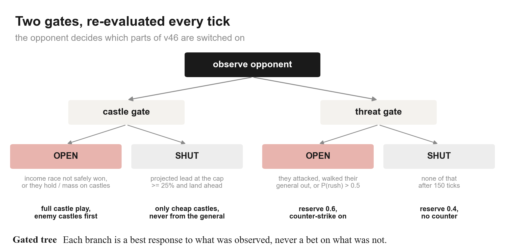

**Castle gate.** This one is an *income race* (Churchill & Buro, AIIDE 2011):
- income per tick = 0.5 × producers + land / 50;
- projected lead at the cap = (our army − theirs) + (our income − theirs) × ticks left.

If the lead is above 25% of their army, our income is at least theirs and we have more land, the race is safely won. The gate **shuts**, and only cheap castles are allowed. Otherwise, or if they play castles themselves, it stays **open**: full castle play, enemy-held castles first.

**Threat gate.** **Open** if they have attacked or walked their general out, or (after tick 150) if P(rusher) + P(castle rusher) > 0.5. Open means reserve R = 0.6 and counter-strikes on. **Shut** means R = 0.4 and no counter-strike. Before tick 150 it starts open.

The gates are a *safe best response* (Ganzfried & Sandholm, AAMAS 2011 and ACM TEAC 2015). v46 exploits what it has seen, for example by skipping castles against a pure expander. But every exploit still runs inside the safety layer, so a wrong belief costs some efficiency, never the general.

### Across games: Exp3 (off by default)

If the environment variable `V46_MEMORY` points to a file, v46 keeps an Exp3 bandit (Auer et al. 2002) over four parameter "arms" between games:

| arm | reserve shift | cheap-castle limit |
|---|---|---|
| base | 0 | 30 |
| greedy | −0.1 | 60 |
| safe | +0.1 | 20 |
| castles | 0 | 90 |

The reward is 1 for a capture win, 0 for a loss, and 0.25 + 0.5 × land share for a timeout. In matches and the arena this is **off**, so v46 always plays the "base" arm. It has not been tested.

---

## 11. Attacking: when v46 goes for the general

v46 attacks in three ways. All three are checked before any army moves.

1. **Immediate capture.** A stack next to their general that beats it takes it.
2. **Verified rush (v36 `attack_plan`).** For each of our 12 largest stacks, it takes the best walk to their general. A walk qualifies only if all of these hold:
   - its arrival force beats their general + growth over the walk + the best single stack they can bring home, by more than 2;
   - our own race margin still holds with that stack gone (`race_safe`);
   - it wins against all four replies in `verify()`.
3. **Counter-strike** when home is losing the race (section 7).

The `strike` macro also gathers army toward a forward castle and charges when one walk beats the garrison.

This is why v46 attacks late against a careful opponent: a guaranteed kill rarely exists while their general keeps growing. It attacks at once when their general is **drained**. That is exactly what happened in the game below.

---

## 12. A whole game, tick by tick

v46 (red) against the spread-collector bot (blue), which spreads to castles and then collects and strikes. Seed 93003, 500-tick cap. v46 won by capture at tick 399.

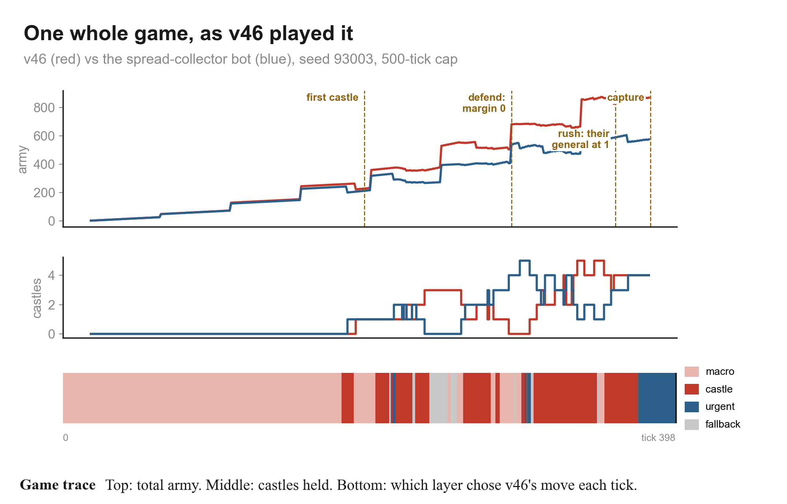

**Ticks 0–119, opening.** Every move comes from the `expand` macro. The posterior quickly settles on "expander" (97%). Both sides grow evenly.

**Ticks 120–180, mid.** Contact begins: the race margin appears, at about 35. The income race is not safely won, so the castle gate stays open. At tick 180 the planner chooses `take castle 241` (the table in section 9), and v46 takes its first castle at about tick 195.

**Ticks 195–295, castles.** The castle layer and the castle macros take turns. Castles change hands several times as both sides fight over them. The grey "fallback" stretches are ticks where the plan's move was vetoed by the safety check and the v36 policy chose instead.

**Tick 300, defence.** The opponent's spread army can now be collected onto our general. The race margin drops 25 → 23 → 16 → **0** in four ticks, and v46 switches to `defend` for several ticks. This is the board in section 6.

**Ticks 315–372, castles again.** With home safe, the castle layer takes most moves and v46 rises to 4–5 castles. Its army pulls ahead: 680 against 480.

**Tick 373.** The opponent's general drops to **1**: it had sent its army out.

**Tick 374, rush.** The next tick, v36's `attack_plan` finds a walk from our general (88) that beats their general plus growth. The walk wins against all four replies in `verify()`, so v46 commits.

**Tick 399, capture.**

---

## 13. How well it plays

Simulator matches, seats swapped on every map:

| opponent | result | setting |
|---|---|---|
| v37 (the final.py before v42) | 17–3 | cap 1000, seeds 93001–93010 |
| v42 | 14–6 | same |
| v44 | 11–9 | same (level within noise) |
| five scripted bots (rusher, castle rusher, expander, gather rusher, spread collector) | 81/100 | cap 500, seeds 93011–93020 |
| humans, recorded games | 1 win, 1 loss | arena / viewer |

**Known weaknesses:**
- **It attacks late against careful opponents.** The verified-rush rule only fires when one walk beats a growing general. v49 is the experiment that addresses this.
- **It cannot see a collection the race model does not cover.** The race model counts each side's 10 largest stacks and walks up to T = 60.

---

## 14. Where it lives in the code

| What | Function | File |
|---|---|---|
| entry point | `act(state, player)` | `v46_opponent_learner.py` |
| gates, income race | `Planner46.update_gates` | `v46_opponent_learner.py` |
| opponent facts | `OpponentModel.update` | `v45_gated_opponent.py` |
| reserve, counter, tiles once | `reserve_ok`, `mass_threat`, `general_move_ok`, `Planner44.counter`, `deliver_once` | `v44_reserve_counter.py` |
| race margin, castle layer | `race_margin`, `_items_us`, `_items_them`, `walk_safe`, `Planner42.castle_options` | `v42_collect_race.py` (race function replaced by v44's) |
| plan choice | `plan39` | `v39_counter_planner.py` |
| macros, phases, value model | `plan_set`, `detect_phase`, `rollout`, `ValueModel` | `core37.py` |
| posterior | `Planner.observe` | `v37_phase_planner.py` |
| safety, attacks, defence | `safe_after`, `survives`, `verify`, `attack_plan`, `defend` | `core36.py` |
| simulator | `Sim.step2` | `sim36.py` |

---

## 15. How to present this

Don't present the code chain. Present **one question and four answers**, in this order. Each step has one picture from `img/`.

1. **The game in one picture** (part I's board figure). Production is slow and walks shrink, so two players who bank at home cannot rush each other. *"So the real question every tick is: can they collect enough to break my general before I can react?"*
2. **The rule: the general must hold** (`invariant.png`). v36's single-stack rule. It made us unbeatable by simple rushers: 20/20.
3. **Humans broke it** (`collect.png`). Many small stacks are one threat once collected. So we compute D(X, T), what each side can collect in T moves, and race them (`race.png`).
4. **Show it live** (`board300.png`). Point at the blue walks and the general's 50. *"That's why it defended here."*
5. **Then let it be greedy safely.** Castles only if they pay back and the margin holds past the walk. The reserve keeps the general from being drained.
6. **Plans, not moves** (the table in section 9). Six plans, four imagined opponents, 40 ticks ahead, blend of average and worst case.
7. **Learn the opponent** (`posterior.png`, `gates.png`). Beliefs switch castle play and the reserve, never safety.
8. **One game end to end** (`game.png`). Opening, castles, the defence at tick 300, the rush when their general hits 1.
9. **Results and the honest weakness:** it attacks late.

That is about 9–10 slides, roughly 12–15 minutes. Every figure is already made. If you want, the next step is a short deck built exactly on this outline, replacing the 36-slide one.
