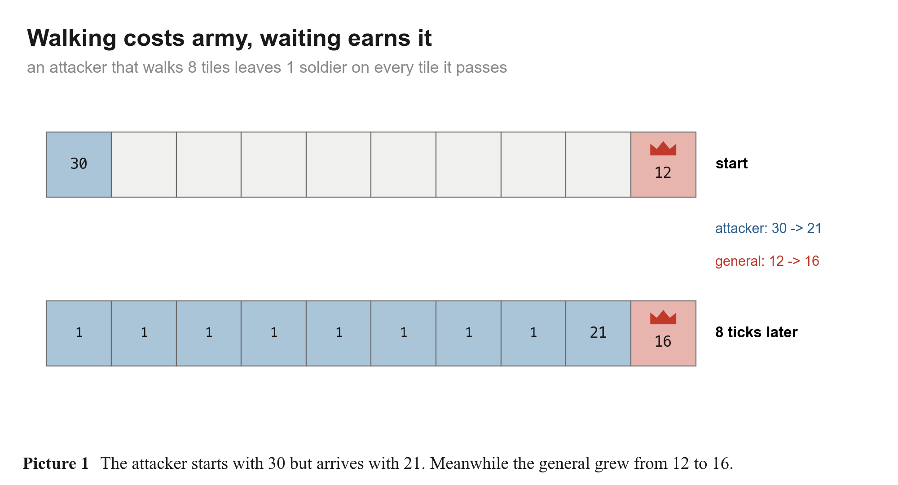
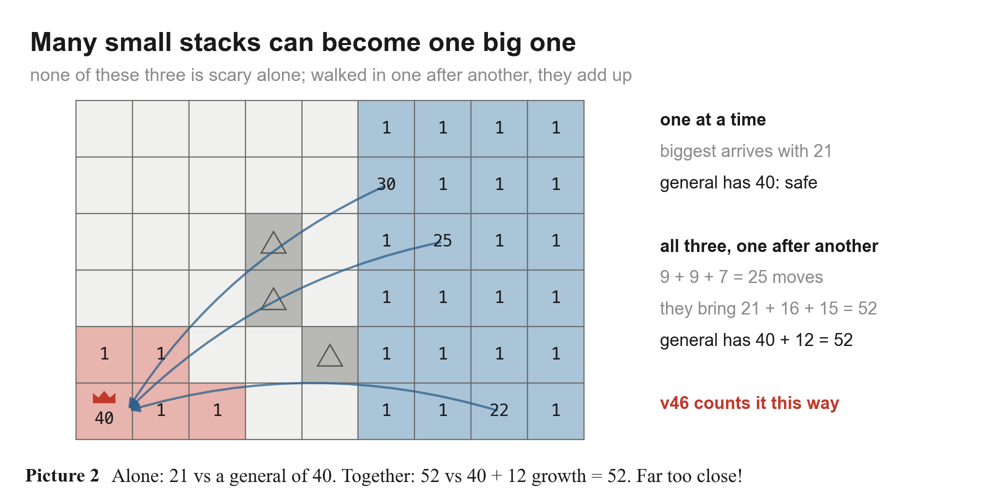
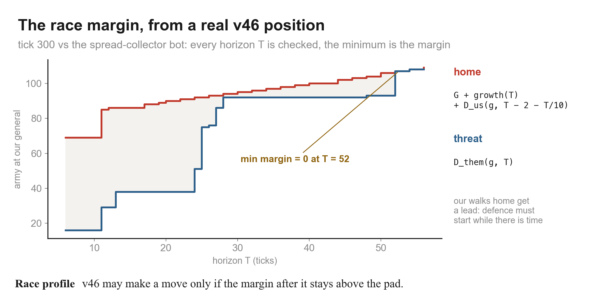
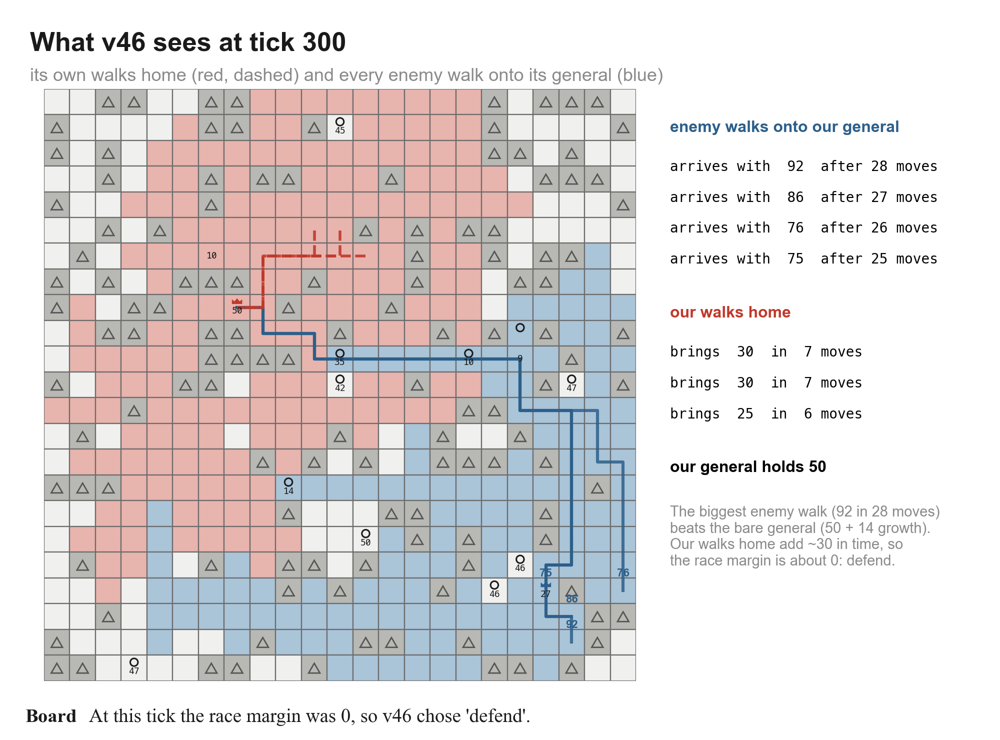
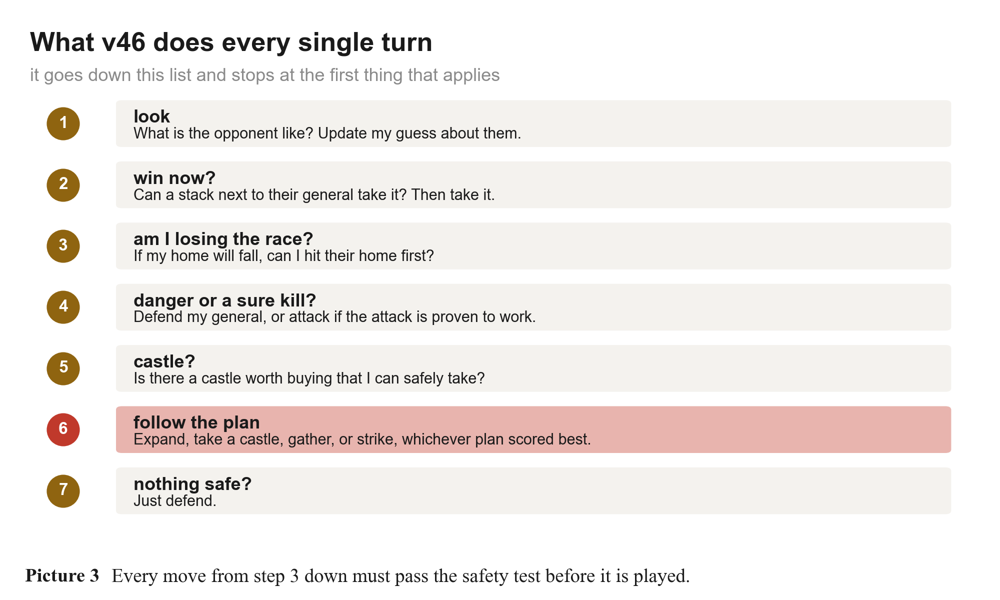
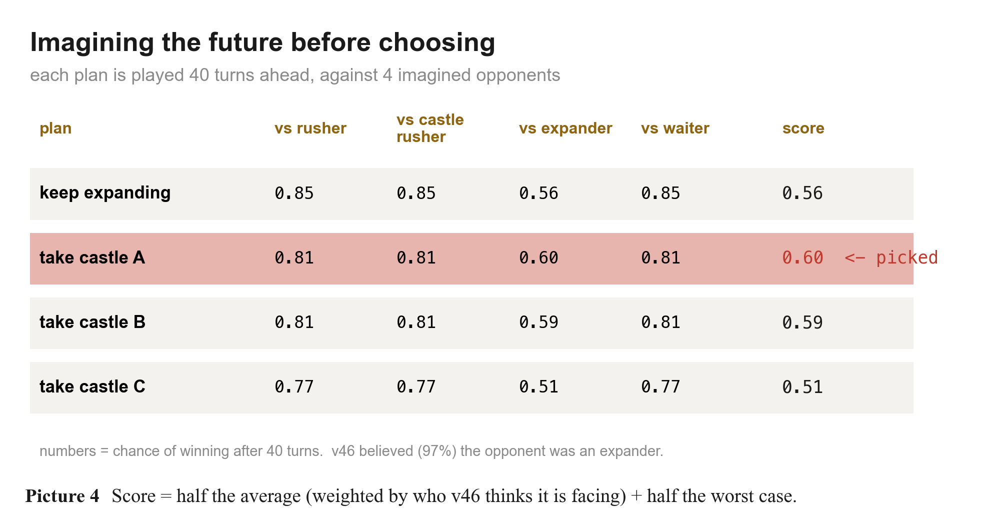
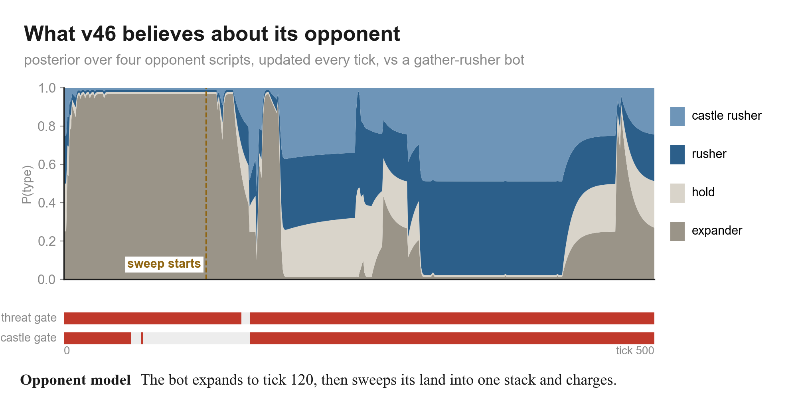
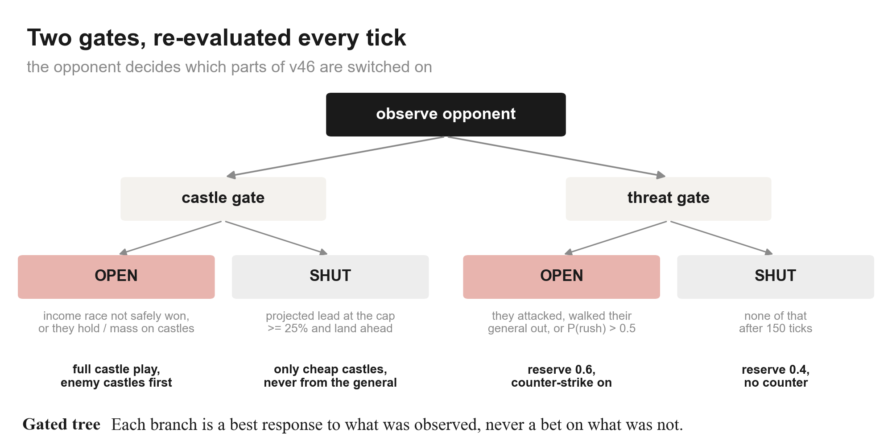
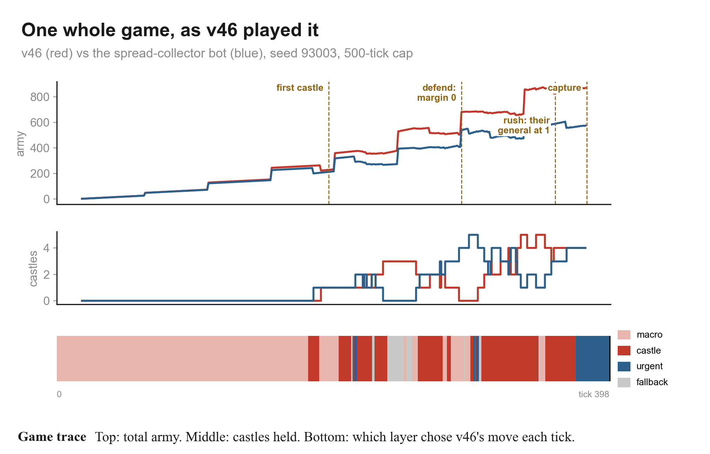

# How our bot (v46) thinks, explained simply

This explains our Generals.io bot, called **v46**, from zero. You don't need to know anything about other bots or about programming. Pictures are in the `img/` folder.

---

## Part 1: The game

Picture a big board of 23 × 23 squares, like a chessboard but bigger.

- **You own some squares.** Each square you own has a number on it: how many **soldiers** are standing there.
- **One of your squares is your general** (the crown). If the enemy captures it, you lose. If you capture theirs, you win.
- **Grey triangles are mountains.** Nobody can walk through them.
- **Circles are castles.** They start with 40–50 soldiers guarding them. Beat the guards and the castle is yours.

**Every turn, you make one move.** You pick one of your squares and push its soldiers to a square next door: either all of them except one, or half of them. Both players move **at the same time**, so you never get to see the other player's move first.

**Fighting is subtraction.** If 10 of your soldiers walk onto a square with 7 enemy soldiers, 3 of yours survive and the square becomes yours.

**Soldiers appear by themselves:**
- your general makes +1 soldier every 2 turns;
- every castle you own also makes +1 every 2 turns;
- every ordinary square you own makes +1 every 50 turns.

So castles are very valuable. One castle makes as many soldiers as 25 ordinary squares.

If nobody captures a general before the time limit, whoever owns more land wins.

---

## Part 2: The most important fact about this game

**When a group of soldiers walks, it shrinks.** Every time it leaves a square, it must leave 1 soldier behind to keep owning that square. In the picture, a group of 30 walks 8 squares and arrives with only 21.

**Meanwhile, the general keeps growing.** It gets +1 every 2 turns, so while the attacker walked 8 squares, the general grew from 12 to 16.

This means **a single attack on a general that keeps its soldiers at home usually fails.** The attacker gets weaker as it walks, and the defender gets stronger as it waits.

So how does anyone ever win? Two ways:

1. **The general is empty.** If a player sends their general's soldiers away (to take a castle, for example), their general is weak for a while. Hit it then.
2. **Many groups attack one after another.** Each group alone is too small. But if several groups walk in one after another, each one knocks soldiers off the general, and together they can break it.

In this picture, the biggest enemy group alone arrives with 21, which does nothing against a general of 40. But all three, walked in one after another, bring 52. By then the general has grown to 52 too. That's far too close.

**v46's whole brain is built around this second danger.**

---

## Part 3: v46's one big question

Every single turn, before doing anything else, v46 asks:

> **"If the enemy gathered all the soldiers it could and walked them onto my general, one group after another, would my general survive? Even counting the soldiers I could rush home in time?"**

It answers with a number called the **safety score** (in the code it is called the *race margin*). Think of it as a race between two teams:

- **Team Attack:** everything the enemy can bring to my general.
- **Team Defend:** my general's soldiers, plus what it grows, plus what my other groups can bring home in time.

**Safety score = Team Defend − Team Attack.**

v46 doesn't check just one moment. It checks every possible amount of time: "what if they attack over the next 5 turns? 10? 20? ... 60?" The safety score is the **worst** of all of these.

Here is the real race from one of v46's games, at turn 300:

The red line is Team Defend and the blue line is Team Attack, for each amount of time T. (The formulas on the right are just the code's names for the two teams.) Where the two lines touch, the race is a tie. That's the danger point.

And here is what the board looked like at that moment:

The blue lines are all the paths the enemy could use to walk soldiers onto v46's general.
- The biggest one could bring 92 soldiers in 28 turns.
- v46's general had 50, and would grow by 14 in that time.
- v46's own groups (the red dashed lines) could bring about 30 home.

So the score came out at about **0**: a tie. That's too close, and v46 switched to defending.

### The golden rule

> **v46 is only allowed to make a move if, after the move, the safety score is still comfortably above zero.**

"Comfortably" means it keeps a small cushion of a few soldiers, bigger when the enemy has big groups. Every move v46 wants to make is first tried on a **pretend copy of the board**. If the safety score after the move is too low, the move is thrown away.

When a move is borderline, v46 plays it out in its head. It makes the move on the pretend board, then imagines the enemy launching an all-out attack along every likely path, with v46 defending. If the general falls in even one of those imaginary games, the move is not allowed.

This is why v46 is hard to beat with a sneak attack: it notices the danger while the enemy's soldiers are still spread out, before they are gathered.

---

## Part 4: What v46 does every turn

Every turn, v46 goes down this checklist and stops at the first thing that applies:

1. **Look at the opponent.** Update its guess about what kind of player it is facing (Part 7).
2. **Can I win right now?** If one of my groups is next to the enemy general and is bigger than it, attack. Game over.
3. **Am I losing the race?** If my safety score says my general will fall, can one of my groups reach *their* general **first** and win? If yes, and it's proven to work, go. (The best defence is sometimes a faster attack.)
4. **Danger, or a sure kill?**
   - If the safety score is too low: defend. Bring soldiers home, or hit the enemy group that is coming.
   - If there is an attack on the enemy general that is **proven** to win: launch it. "Proven" is explained in Part 8.
5. **Is there a castle worth buying?** (Part 5)
6. **Follow the plan.** (Part 6)
7. **Nothing safe to do?** Just defend.

From step 3 onward, every move still has to pass the golden rule.

---

## Part 5: Buying castles, without getting robbed

Castles make lots of soldiers, so v46 wants them. But taking a castle means sending a big group away to fight 40–50 guards, and that leaves home weaker. v46 checks three things before buying a castle.

**1. Is it worth it?** v46 only takes a castle if it will earn its cost back before the game ends. It also prefers:
- cheap castles (few guards, short walk);
- castles in the direction of the enemy general, which are useful later for attacking;
- castles the enemy owns, because taking one makes us stronger *and* them weaker.

**2. Will I still be safe after the walk?** v46 imagines the board **at the end of the walk**, when the group has used up its soldiers on the castle guards. It moves every enemy group forward by the same number of turns, and checks the safety score again, with an extra cushion. If home would be unsafe at that moment, it doesn't go.

**3. Am I leaving the general too empty?** If the soldiers come from the general itself, v46 checks that what stays behind could hold off every enemy group:
- right now;
- if the enemy waits 30 turns first;
- if the enemy waits 60 turns first.

(The enemy grows while it waits, so a group that is harmless now might not be in 60 turns.) It also checks against "the biggest group the enemy could gather in 30 or 60 turns."

---

## Part 6: Making a plan by imagining the future

When nothing urgent is happening, v46 follows a **plan**. It has a short menu:

- **expand**: grab empty land;
- **hold**: let soldiers build up;
- **take castle A** (or B, or C): the nearest castles;
- **gather home**: bring soldiers back to the general;
- **strike**: collect soldiers near the front and attack;
- **rush**: go straight for the enemy general.

To choose, v46 **imagines the future**. It plays each plan forward 40 turns on a pretend board. And because it doesn't know exactly what the enemy will do, it imagines **four different kinds of enemy**:

| imaginary enemy | what it does |
|---|---|
| rusher | attacks my general as fast as it can |
| castle rusher | takes a castle first, then attacks |
| expander | just grabs land |
| waiter | does nothing, saves up soldiers |

That's 4 imaginary games per plan. At the end of each, v46 looks at the board and estimates its chance of winning from it. It looks at things like:
- who has more land and soldiers;
- who has more castles;
- who is earning faster;
- whether my general could absorb their biggest group;
- whether my biggest group could break their general.

Here is a real decision v46 made at turn 180:

How the score works:
- **Half of the score is the average** over the four imaginary enemies. The average is weighted by **which kind of enemy v46 thinks it is really facing**. Here it was 97% sure the enemy was an expander, so the "vs expander" column counts the most.
- **The other half is the worst case.** That way v46 never picks a plan that would be a disaster if its guess is wrong.

"Take castle A" scored best, so v46 went for it. It captured its first castle a few turns later.

v46 sticks to the chosen plan for about 10 turns, then thinks again. It also thinks again straight away if something big happens:
- a castle changes hands;
- the enemy general suddenly drops a lot;
- the plan is finished.

---

## Part 7: Learning who the opponent is

v46 keeps a guess about what kind of player it's facing, as percentages over the four types:

- "rusher 10%, castle rusher 10%, expander 70%, waiter 10%".

**How the guess changes, every single turn:**
1. v46 asks each of the four types: "what would *you* have done last turn?"
2. It compares their answers with what the enemy **really** did.
3. A type that guessed right gets more believable; a type that guessed wrong gets less.
4. Old evidence slowly fades. That way, if the enemy changes style halfway through, v46 notices.

In this real game, the enemy grabbed land until about turn 120, so v46 was almost sure it was an **expander** (the big grey area). Then the enemy started sweeping its soldiers together to attack, and v46's guess moved to **rusher** and **castle rusher** (the blue areas).

v46 also watches for hard facts:
- Does the enemy own castles, or have a big group standing next to one?
- Has an enemy group come close to my general?
- Did the enemy just empty out its general?

### Two switches

The guess and the facts control **two switches**:

(In the picture, "castle gate" is the castle switch and "threat gate" is the danger switch. OPEN means ON.)

**The castle switch:**
- **ON** (go for castles, even the expensive ones, and take the enemy's castles first) when v46 is *not yet safely winning the economy race*, or when the enemy plays with castles.
- **OFF** (only cheap castles, and never send soldiers from the general) when v46 is clearly ahead.

"Economy race" means: if both sides keep earning soldiers at their current speed until the game ends, who will have more?

**The danger switch:**
- **ON** when the enemy has attacked, emptied its general to go somewhere, or looks like a rusher. Then v46 keeps **more soldiers at home** (60% of every threat) and is allowed to **counter-attack**.
- **OFF** when the enemy has been peaceful for 150 turns. Then v46 keeps fewer soldiers home (40%), so more of them can grab land and castles.

**The important part:** the switches only make v46 *greedier or more careful*. They can never switch off the golden rule. If v46 guesses the opponent wrong, it plays a bit less efficiently, but it doesn't lose its general because of the guess.

---

## Part 8: When does v46 attack?

v46 attacks the enemy general in three situations:

1. **It's right there.** One of its groups is next to the enemy general and bigger than it.
2. **A proven attack exists.** A group can walk to the enemy general and arrive bigger than all of these together:
   - the enemy general, plus what it grows during the walk;
   - the biggest group the enemy could bring home in time;
   - a few extra soldiers to spare.

   Before going, v46 checks two more things:
   - home must stay safe while the group is away;
   - the attack must win in 4 imaginary games, against an enemy that rushes, rushes with a castle, does nothing, or pulls everything home to defend.

   Only if it wins all 4 does v46 commit.
3. **Counter-attack.** Its own general is going to fall, but it can hit theirs first.

Because of the first rule in Part 2 (walking shrinks you, waiting grows the general), a proven attack usually only exists when the **enemy general is weak**. That is when v46 strikes.

---

## Part 9: One whole game, start to finish

This is a real game: v46 (red) against a bot that spreads out to castles and then gathers and attacks (blue). The coloured strip at the bottom shows which part of v46's checklist chose each move.

- **Turns 0–120: grab land.** Every move is "expand" (light pink). Both sides grow evenly. v46 decides the enemy is an expander.
- **Turn 180: plan a castle.** v46 imagines the future (the table in Part 6) and picks "take castle A". It gets its first castle around turn 195.
- **Turns 195–295: fight over castles.** Castles change hands back and forth (middle chart). Grey moments are turns where the plan's move failed the golden rule, so v46 picked a safer move.
- **Turn 300: danger!** The enemy's spread-out soldiers are now close enough to be gathered and walked onto v46's general. The safety score drops 25 → 23 → 16 → 0 in four turns. v46 switches to defending (blue). This is the board in Part 3.
- **Turns 315–372: castles again.** Home is safe, so v46 collects castles and gets well ahead: 680 soldiers against 480.
- **Turn 373: the enemy general is empty.** The enemy sends its general's soldiers off somewhere, and the general drops to **1**.
- **Turn 374: attack.** v46 finds a proven attack straight from its own general (88 soldiers), checks it against the 4 imaginary enemies, and goes.
- **Turn 399: v46 captures the enemy general and wins.**

---

## Part 10: How good is it?

In test games against our other bots and five practice bots:
- it beat the older champion bot 17 games to 3;
- it beat the practice bots in 81 out of 100 games;
- against people, it's the hardest of our bots to beat so far.

**Its weakness:** against a careful player who keeps their general full, a proven attack almost never shows up. So v46 waits a long time before attacking, and a good player can use that time.

---

## The whole bot in five sentences

1. Walking shrinks an army and waiting grows a general, so the real danger is **many groups gathered together**, not one big one.
2. Every turn, v46 computes a **safety score**: can my general survive everything the enemy could gather, counting what I can bring home in time?
3. It only makes moves that keep that score above zero, and it tests risky moves by **playing them out in its head**.
4. When nothing is urgent, it **imagines the future** for a few plans against four kinds of enemy and picks the plan that is best on average *and* not terrible in the worst case.
5. It **learns what kind of player the enemy is**, and uses that to decide how many castles to buy and how many soldiers to keep at home, but never to break the safety rule.
