# Search agents for perfect-information Generals.io

Companion text for the DAC-203 final presentation (`Generals-AI-Final.pptx`). It follows the slide order, gives the reasoning behind each slide, and can be read on its own. Figures are in `img/`. All results come from games played in our simulator, with seats swapped on every map, or from recorded games against people.

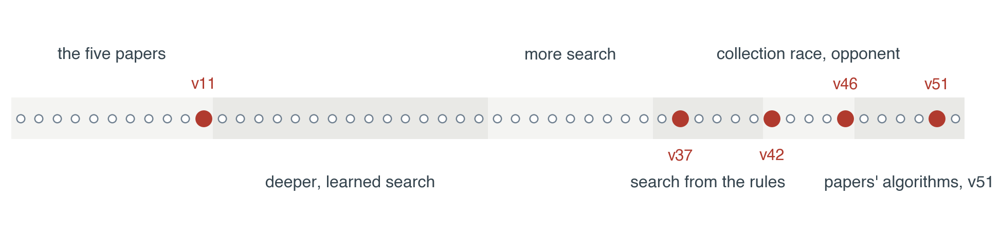

## 1. The problem in AIMA's terms

Generals.io is played on a 23 x 23 grid. Each player owns tiles that hold armies. A player's general and every castle they own add one army every two ticks, and every owned tile adds one every fifty ticks. Each tick, each player moves once: a tile and a direction, sending all but one army or half. Fighting subtracts. A player wins by taking the enemy general, or, at the tick cap, by having more land and then more army.

In the terms of AIMA chapter 2, our version is fully observable (nothing is hidden), two-agent and zero-sum, deterministic once the map is drawn, sequential, dynamic (one decision per half-second tick), discrete, and its rules are known. We wrote an exact simulator of them.

Formally it is a deterministic simultaneous-move game

$$\mathcal{G}=(S, A_0, A_1, T, U),\qquad s_{t+1}=T(s_t, a^0_t, a^1_t),\qquad U\in\{-1,+1\}.$$

Each owned tile with two or more army offers eight moves, so the branching factor is about eight times the number of such tiles. In one measured mid-game position it was 204 for one player, about 41,600 joint actions per tick. The reward arrives once, after hundreds of ticks. Two consequences shape everything that follows. First, almost all decisions are judged by an evaluation function, so the quality of that function matters more than the depth of the search. Second, because both players commit at once, a node is a matrix game (AIMA ch. 18), and ordinary minimax, which assumes the reply is seen first, does not describe it.

## 2. The five papers, as built

Part I picked one paper per search chapter. We built bots for all of them except RTAA* and depression avoidance.

**ARA\*** (Likhachev, Gordon & Thrun, NIPS 2003). Weighted A* expands nodes by $f(n)=g(n)+\varepsilon h(n)$ and returns a path whose cost is at most $\varepsilon C^*$. ARA* lowers ε step by step and reuses the previous search, so it always has an answer. We used it to route stacks in v1, and later bots (v33 to v35) replaced it with a time-dependent A* that also tracks garrisons and enemy growth. That cut node expansions from 31.6 to 22.6 and still won only 3 of 6 games against the direct rusher. Routing was solved early; the losses came from elsewhere.

**RTAA\* and depression avoidance** (Koenig & Likhachev, AAMAS 2006; Hernández & Baier, AAAI 2012). RTAA* updates $h(s)\leftarrow g(\bar s)+h(\bar s)-g(s)$ for every state a bounded A* expanded; depression avoidance prefers states whose heuristic has not been raised. Both assume the agent does not know true distances and must learn them while moving. Our map is static and visible, and a breadth-first search over 529 cells takes well under a millisecond, so every bot uses exact distances recomputed each tick. There was nothing for these algorithms to learn, and we did not build them.

**ProbCut** (Buro 1995; AIMA ch. 6, forward pruning). ProbCut models the deep value as $v\approx av'+b+e$ with $e\sim\mathcal N(0,\sigma^2)$ and skips the deep search when the shallow value $v'$ is outside the window by more than $t\sigma$. Our fit on producer-wait positions was very good: $a=0.955$, $b=2.04$, $\sigma=2.77$, correlation 0.974 over 105 positions. The depth it bought did not help. v17 searched four plies and split 1–1 with v11 while running much slower. v20 learned a nonlinear correction that lowered held-out error from 2.02 to 1.79, and then lost 7 of 8 games when combined with castle-first play. Games were being decided by economy and by when the general was left thin, over hundreds of ticks, which no four-ply tree sees.

**Metareasoning** (Russell & Wefald 1990; O'Ceallaigh & Ruml 2015). The value of a computation is the expected improvement in the chosen action minus its cost. Part I proposed spending the move queue as thinking time and pre-computing the next tick. We measured that 57% of ticks had many moves tied at one ply, so the idea had room to work. v18 queued up to six safe moves and searched the predicted endpoint in a background worker, and lost both games of its seed. Forecasts were invalidated whenever stacks met, and the bot was never short of time: later bots decide in about 10 ms.

The common thread: each paper solves a real problem, and none of those problems was the one losing us games. Our early bots searched a model that did not represent a general left too thin when an attack arrived.

## 3. Searching the joint move

With simultaneous moves the value of a node is the value of a zero-sum matrix game, $v^*=\max_{x\in\Delta}\min_j\sum_i x_i M_{ij}$, reached by a mixed strategy. v3 solved a small matrix at every state and was slower and weaker than plain search. v4 and v5 solved it only when moves could collide; v11 added an option to capture the enemy's launch source and stayed the final bot until v37. Stacks interact on a small fraction of ticks, and the matrix only matters there.

ABCD (Churchill, Saffidine & Buro, AIIDE 2012) serializes the joint move so alpha-beta applies: moving first gives the pessimistic bound and moving second the optimistic one, $\max_a\min_b V\le v^*\le\min_b\max_a V$, and alternating the order evens out the bias. Puppet Search (Barriga, Stanescu & Buro, AIIDE 2015) runs ABCD over the choice points of scripts instead of raw moves. v22 to v26 searched hold, castle, charge and expand scripts through 96 exact ticks; v23 split 6–6 with v11, and v24's waits oscillated because the target was re-chosen every replan. v27 to v35 added live matrices, a second reply ply, learned branch pruning, time-aware A* and scenario rollouts. Against the direct rusher none of them did better than 5 of 6, and several did worse.

The diagnosis came from arithmetic, not search. A stack walking $d$ tiles leaves one army on each, so it arrives with about $x-d-1$ minus whatever it fights through, while the defending general gains $\lfloor d/2\rfloor$:

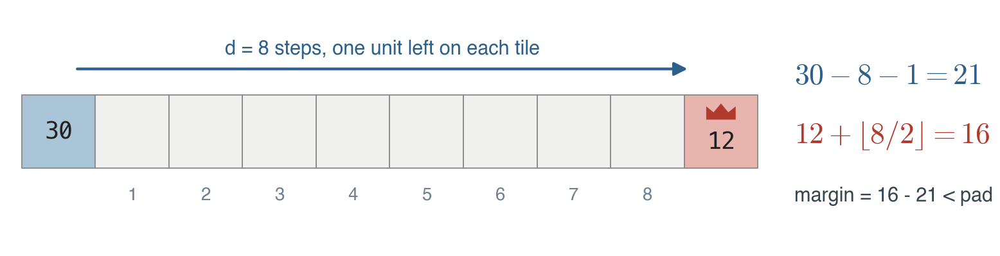

Two players who keep army at home therefore cannot rush each other; a general falls only when it is drained or when several stacks arrive one after another. The early bots lost that way and no part of their evaluation measured it. We also found that many earlier "wins" against the rusher were land tiebreaks at short caps, so from v36 on every result is reported with seats swapped and captures counted separately.

## 4. Three learned components

Three times we trained a model to make search cheaper or better. v20's ProbCut correction lowered error and lost 7 of 8. v32's branch rejector reached 92.3% precision, and the ablation without it scored the same 5 of 6, so the gain came from the action buckets, not the learning. v40's CNN plan ranker, trained on 8,071 positions labelled by regret matching over rollouts, ranked plans better than random and lost 4–16 to v37. In each case the model imitated the output of a search that did not model home safety, so learning it well did not help.

## 5. Search from the rules

v36 started over from the rules. sim36 is an exact Python copy of the game step; it agreed with the JAX environment on random joint actions and reproduced all 780 recorded moves of two human games. A decision with its safety checks costs 1 to 2 ms.

The invariant: for every hostile all-in walk $k$ of length $d_k$ arriving with $x_k$, our general alone must keep

$$m=\min_k\bigl[G+\mathrm{growth}(d_k)-x_k\bigr]>\mathrm{pad},\qquad \mathrm{pad}=3+0.08\,x_{\max}.$$

Moves that do not lower $m$ are always allowed, so expansion never stops. Any other move goes to an exact check. These checks are AND-OR search in the sense of AIMA chapter 4: our choice is the OR node, the enemy's possible launches are the AND node, and the plan is valid only if it survives all of them. `survives()` plays the candidate move and then each plausible enemy launch against our Defender script; `verify()` plays a planned attack against four scripted replies and accepts it only if it wins against all four. v36 beat the direct rusher and the castle rusher 20 of 20 each, and the old final bot 12 of 12.

v37 put plans back on top. Each decision chooses among about six macros (expand, hold, take a castle, gather home, strike, rush), rolls each out 24 to 60 ticks against four opponent scripts, and scores the final board with a nine-feature logistic model $V(s)=\sigma(w^\top\phi(s))$. The plan score blends the belief-weighted mean and the worst case,

$$S(a)=\tfrac12\sum_b P(b)\,V(a,b)+\tfrac12\min_b V(a,b),$$

which is the Hurwicz criterion with weight one half. The value model beat a land-only baseline in the opening (log-loss 0.473 against 0.522) and the end, but not in the mid-game (0.372 against 0.359). v37 beat the expander 19 of 20 and v11 20–0, and became the final bot.

## 6. The collection race

People beat v37 with one pattern: spread out, take castles, keep the general light, then gather everything into one stack and strike. In a recorded 887-tick game the human took four castles to v37's none and broke a general that held about 90% of v37's army.

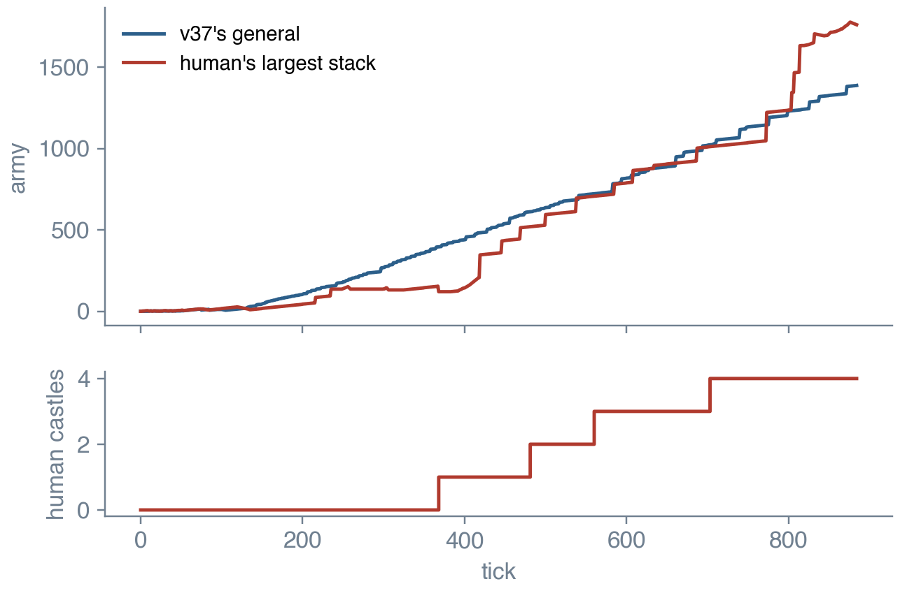

v37's threat model looked at one walking stack at a time. v42 counts collections instead. $D_p(X,T)$ is the most army player $p$ can walk onto cell $X$ with walks whose lengths add up to at most $T$, since only one move happens per tick, with each tile counted once. Choosing the walks is a knapsack; choosing a gathering tree is a rooted prize-collecting Steiner tree, which is how Human.exe, the strongest non-learning Generals.io bot, gathers army (Straka, Lisý & Schmid 2026). Both problems are NP-hard, and we use a greedy approximation.

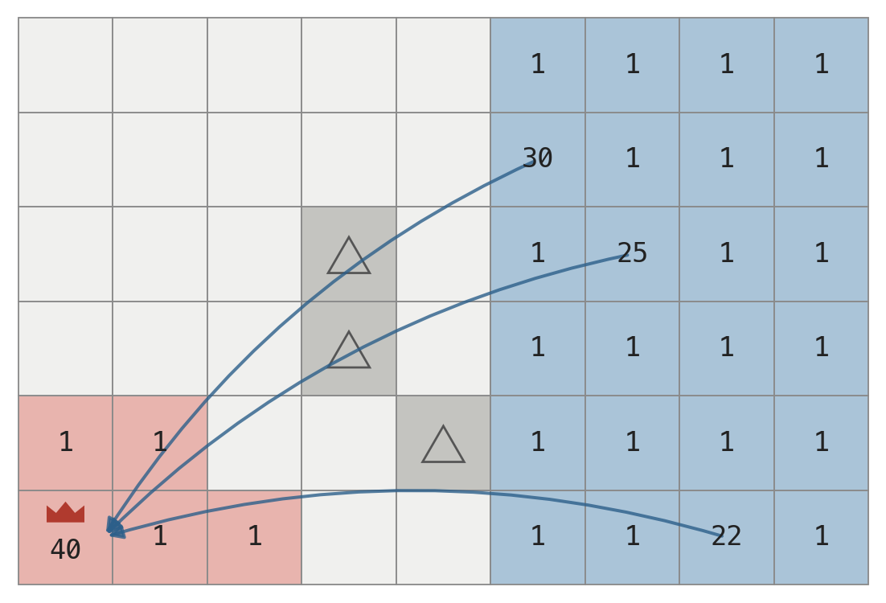

Safety becomes a race over every horizon $T$:

$$m=\min_T\Bigl[G+\mathrm{growth}(T)+D_{\mathrm{us}}\bigl(g,\,T-2-\lfloor T/10\rfloor\bigr)-D_{\mathrm{them}}(g,T)\Bigr].$$

Our walks home get a lead of $2+\lfloor T/10\rfloor$ ticks because defence has to start in time. The chart below is a real position at tick 300, where the two curves meet at $T=52$ and the bot switched to defence.

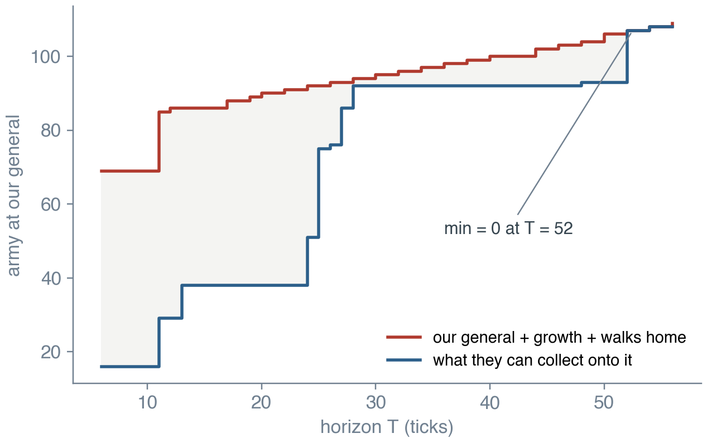

v42 beat v37 19–1. A person then beat v42 by making it spend its general on castles and a strike. v44 counts tiles once, keeps a reserve in the general against every enemy walk now and after 30 and 60 ticks of enemy growth, $G_{\mathrm{keep}}+\mathrm{growth}(H+d)\ge R\cdot x(H)$, and takes a castle only if $2(\mathrm{garrison}+d)\le\min(L-d,400)$ and the race margin still holds on the board projected to the end of the walk. v44 beat v42 13–7 and v37 19–1.

## 7. Learning the opponent

v46 keeps a belief over four opponent scripts and updates it every tick by how well each script predicted the opponent's last move: $w_b\leftarrow0.95\,w_b L_b/0.5+0.05$ with $L_b\in\{0.8,0.2\}$. The forgetting factor makes this a filter in the sense of AIMA chapter 14, so the belief follows an opponent that changes style.

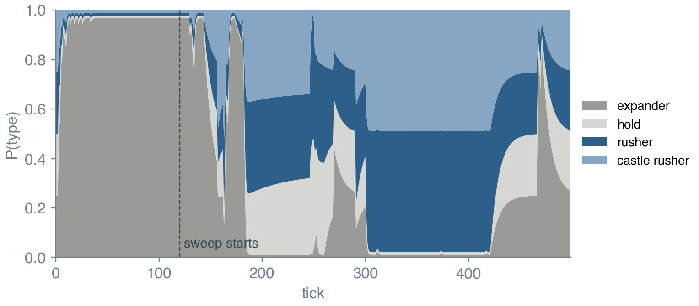

The belief drives two gates. The castle gate is an income race, $\Delta=(A_{\mathrm{us}}-A_{\mathrm{them}})+(\iota_{\mathrm{us}}-\iota_{\mathrm{them}})L$; castles are bought until the projected lead is safe. The threat gate opens on observed attacks or when the rush types dominate, raising the reserve factor from 0.4 to 0.6 and enabling counter-strikes. Both gates follow Ganzfried and Sandholm's principle of safe exploitation: the bot may lean toward its model of the opponent, but only inside the safety layer, so a wrong belief costs efficiency and never the general. Exp3 can also choose parameter settings across games (off in matches). v46 beat v37 17–3, v42 14–6 and v44 11–9.

v50 implemented the cited papers' actual algorithms on top of v46 and tested each alone against v46 over 20 games. The Steiner-tree gather and the Bayesian timing plus k-nearest-neighbour typing each scored 13–7. Puppet ABCD with SES, the local matrix game and the Nash arm selection were level. Human.exe's min-cost-flow expansion scored 5–15 and stayed below v46 after three fixes, because on this small board the greedy rule of capturing one tile per move gains land faster. With that expansion switched off, the full v50 beat v46 35–25 over 60 games.

## 8. v51 in depth

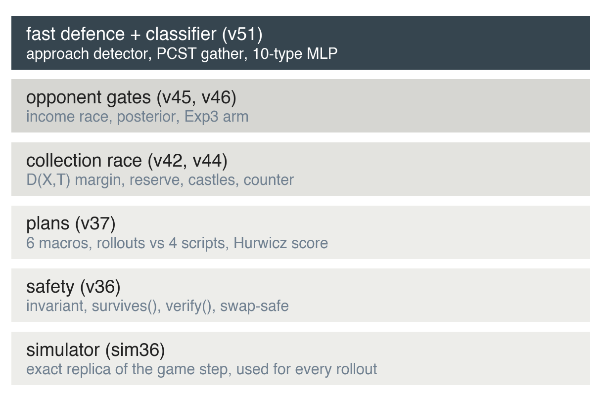

v51 is v46 plus one layer: a committed fast defence and a learned opponent classifier. Everything below the top layer is v46 unchanged.

**The loss that motivated it.** Against a bot that expands until tick 200, sweeps its land into one stack and charges, v46 lost 8 of 20 games by capture. In the traced game a 103-army stack walked from 22 tiles to the general over about 20 ticks. v46 kept expanding with two-army tiles, defended only on single ticks when its margin dipped, and began gathering at distance 4, one stack per tick. It held 400 army across the board and lost its 77-army general to 82. With v51 in the same seat on the same map, the general holds 124 when the attacker arrives with 90.

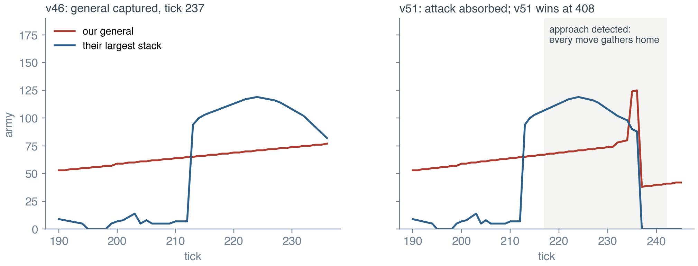

**Step 1, detect the approach.** Each large enemy stack is tracked from tick to tick (same cell or a neighbour). It is incoming when

$$d_{t-k}(s)-d_t(s)\ge 2,\quad k\le5,\quad x_s\ge\max(15,\,0.2\,G),$$

and its distance is the estimated time of arrival. The state persists for six ticks after the last approaching observation, which removes v46's tick-by-tick indecision. Against collector types the thresholds drop to 12 and 15%.

**Step 2, estimate the shortfall.** For horizons up to ETA plus 5,

$$\mathrm{need}=\max_{T\le\mathrm{ETA}+5}\bigl[D_{\mathrm{them}}(g,T)-G-\mathrm{growth}(T)\bigr]+0.15\,x_{\mathrm{att}}.$$

Only the general itself counts as defence here; stacks parked beside it do not, because the attacker can land first. While the need is positive, every move goes to defence.

**Step 3, gather into the general.** The gather solves a rooted prize-collecting Steiner tree with the general as root. Each own tile is a prize of $a_v-1$, each tree edge one move:

$$\max_{\mathcal T\ni g}\sum_{v\in\mathcal T}(a_v-1)-\lambda|E(\mathcal T)|,\qquad \lambda^*=\min\{\lambda:|E(\mathcal T_\lambda)|\le\mathrm{ETA}-2\}.$$

For a given λ the tree grows greedily: one breadth-first search over our land from the current tree, then add the path whose collected army minus λ times its length is largest. Seven bisection steps find the λ that fits the move budget, as in Human.exe. Moves are played leaf-first so army accumulates on the way in. Any stack of 10 or more next to the general steps in at once, and within six ticks of impact any stack of 2 or more does.

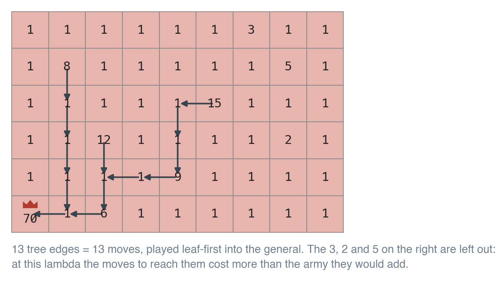

**The classifier.** Fourteen board features describe the opponent each tick: tick, land, total army, the share of army in its general and in its top stack, castles, the top stack's distance to our general and its change over five ticks, land and army gained over twenty ticks, top-stack growth, the number of cells with five or more army, how often its general was drained, and whether its top stack is within ten tiles. A 14–64–64–10 network,

$$P(y\mid x)=\mathrm{softmax}\bigl(W_3\,\mathrm{ReLU}(W_2\,\mathrm{ReLU}(W_1\tilde x+b_1)+b_2)+b_3\bigr),$$

was trained on 99,437 rows from 25 maps with Adam on the Mac GPU (PyTorch MPS) and tested on 33,318 rows from 8 unseen maps. The ten types are the direct and castle rushers, an expander, a turtle, gather-rushers that sweep at ticks 60, 120 and 200, a spread-and-collect bot, an economy bot and a planner. Per-tick accuracy is 25% before tick 100, 53% at 100–200, 70% at 200–300 and 67% after; chance is 10%.

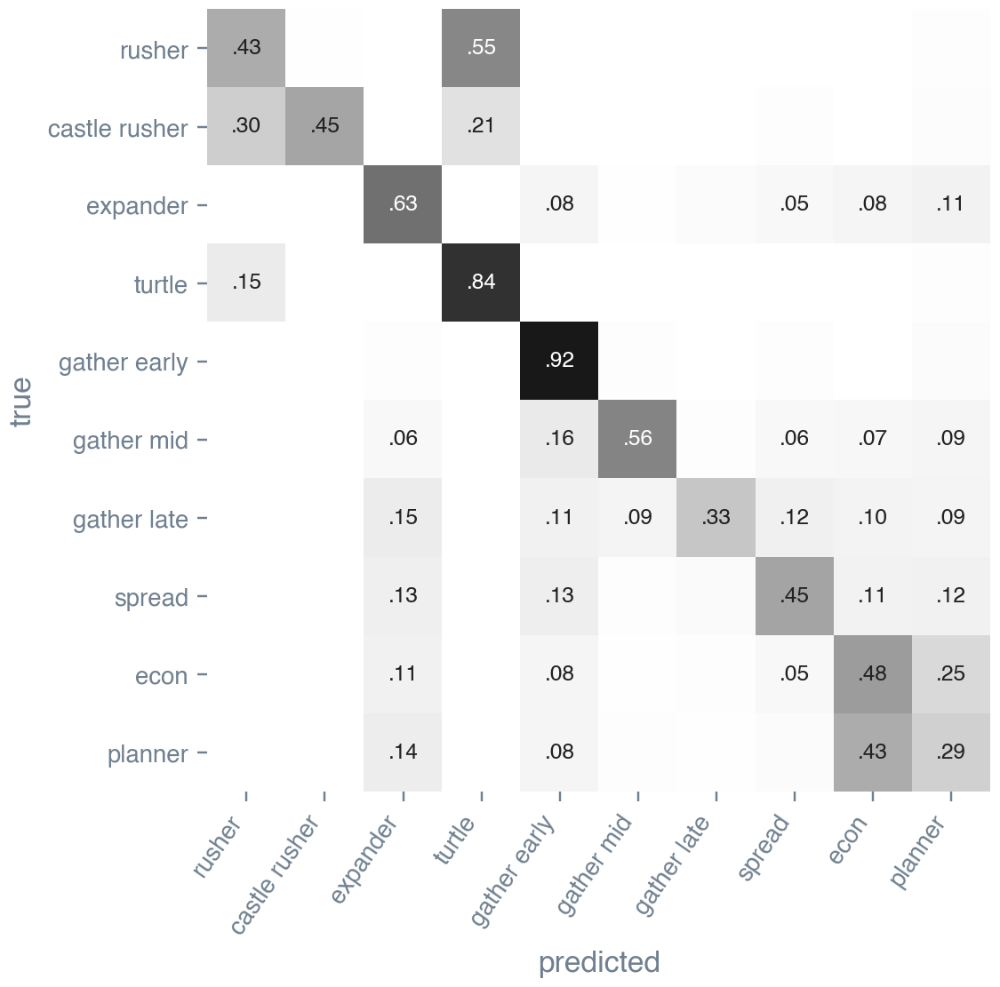

The confusions follow from the game. A rusher banks at home before it charges, so it looks like a turtle until it launches. A late gather-rusher is an expander until its sweep. The economy bot and the planner play nearly the same game. The early gather-rusher sweeps almost at once and is recognised 92% of the time.

The bot accumulates evidence with forgetting, $\ell_t(y)=0.95\,\ell_{t-1}(y)+0.4\log P(y\mid x_t)$, which is right on held-out maps 39% of the time at tick 100, 66% at tick 200 and 70% at tick 300. In the traced game it settles on the late gather-rusher at tick 215, as the sweep finishes. The ten types map onto v46's four lookahead scripts, aggressive types open the threat gate from tick 60 instead of 150, and collector types lower the approach threshold.

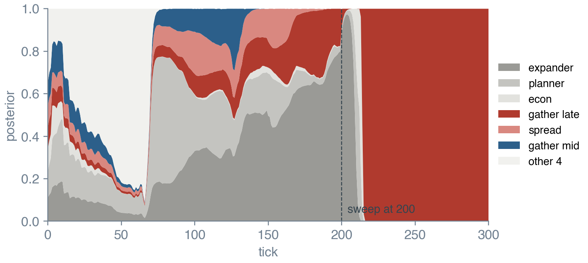

**One tick of v51.** Classify the opponent; if a stack is incoming and the need is positive, make the next defence move (merge a large adjacent stack, else the next Steiner-tree move); otherwise run v46's order: capture, counter-strike, v36's urgent play, the gated castle layer, the committed macro plan, and the Defender fallback. Every move outside the defence passes the safety check.

**Results.** Head to head with v46 over 60 games, v51 scored 32–28, with two captures each way; v52, which is v51 without the classifier, also scored 32–28. The fast defence matters against collectors, measured on v52 at cap 600: 19–1 against the gather-rusher that sweeps at 200 (v46: 12–8), 20–0 at 120 (18–2), 19–1 at 60 (16–4), and 40 of 40 against the two rushers. Spread collectors are slightly harder for it than for v46 (13–7 and 12–8 against 14–6), because the committed defence lets them collect castles. The classifier has not been shown to win extra games, and v51 still attacks late against careful opponents. All samples are 20 to 60 games, so differences of two or three games are noise.

## 9. What the course material bought us

| AIMA idea (chapter) | Where in v51 | Verdict |
|---|---|---|
| Task environments (2) | the framing of every design choice | essential |
| Informed search, A* (3) | routing, exact BFS distances | solved early |
| AND-OR search (4) | `survives()` and `verify()` | the safety layer |
| Constraints (5) | safety margin as a hard constraint on every move | essential |
| Alpha-beta and pruning (6) | ABCD over plans in v50, ProbCut in v12–v21 | little gain |
| Bayes' rule, filtering (12, 14) | opponent posterior, classifier belief | useful, not decisive |
| Decisions, value of information (16) | Hurwicz plan score; metareasoning in v18 | score kept, VOI not |
| Bandits (17) | Exp3 across games | untested in matches |
| Game theory (18) | matrix games, maximin, safe exploitation | local fights only |
| Learning, neural networks (19, 21) | logistic value model, 10-type classifier | modest |

Five lessons, each paid for with at least one failed bot. Measure the right thing: swap seats, count captures apart from tiebreaks, and play long enough for captures to happen. Model the event that loses games: twenty bots of deeper and learned search moved nothing, and one rule about the general took the rusher from 3 of 6 to 20 of 20. Treat safety as a constraint and preference as the objective, so later layers cannot undo earlier ones. Use people as the test set: every large step after v37 came from replaying a game a person had won. And learn the opponent inside the safety layer, so beliefs change what the bot prefers and never what it is allowed to do.

## References

- Russell, S. & Norvig, P. *Artificial Intelligence: A Modern Approach*, 4th ed. Pearson, 2020.
- Likhachev, M., Gordon, G. & Thrun, S. ARA*: Anytime A* with provable bounds on sub-optimality. NIPS 2003.
- Koenig, S. & Likhachev, M. Real-time adaptive A*. AAMAS 2006.
- Hernández, C. & Baier, J. Real-time adaptive A* with depression avoidance. AAAI 2012.
- Buro, M. ProbCut: an effective selective extension of the alpha-beta algorithm. ICCA Journal, 1995.
- Russell, S. & Wefald, E. Principles of metareasoning. *Artificial Intelligence*, 1991; UAI 1990.
- Churchill, D., Saffidine, A. & Buro, M. Fast heuristic search for RTS game combat scenarios. AIIDE 2012.
- Barriga, N., Stanescu, M. & Buro, M. Puppet Search: enhancing scripted behavior by look-ahead search with applications to RTS games. AIIDE 2015.
- Straka, M., Lisý, V. & Schmid, M. Superhuman AI for Generals.io using self-play reinforcement learning. arXiv 2606.23348, 2026.
- Synnaeve, G. & Bessière, P. A Bayesian model for opening prediction in RTS games with application to StarCraft. AIIDE 2011.
- Weber, B. & Mateas, M. A data mining approach to strategy prediction. CIG 2009.
- Ganzfried, S. & Sandholm, T. Safe opponent exploitation. *ACM TEAC*, 2015.
- Churchill, D. & Buro, M. Build order optimization in StarCraft. AIIDE 2011.
- Tavares, A., Azpurua, H., Santos, A. & Chaimowicz, L. Rock, Paper, StarCraft: strategy selection in real-time strategy games. AIIDE 2016.
- Auer, P., Cesa-Bianchi, N., Freund, Y. & Schapire, R. The nonstochastic multiarmed bandit problem. *SIAM J. Comput.*, 2002.
- Lisý, V., Kovařík, V., Lanctot, M. & Bošanský, B. Convergence of Monte Carlo tree search in simultaneous move games. NeurIPS 2013.
