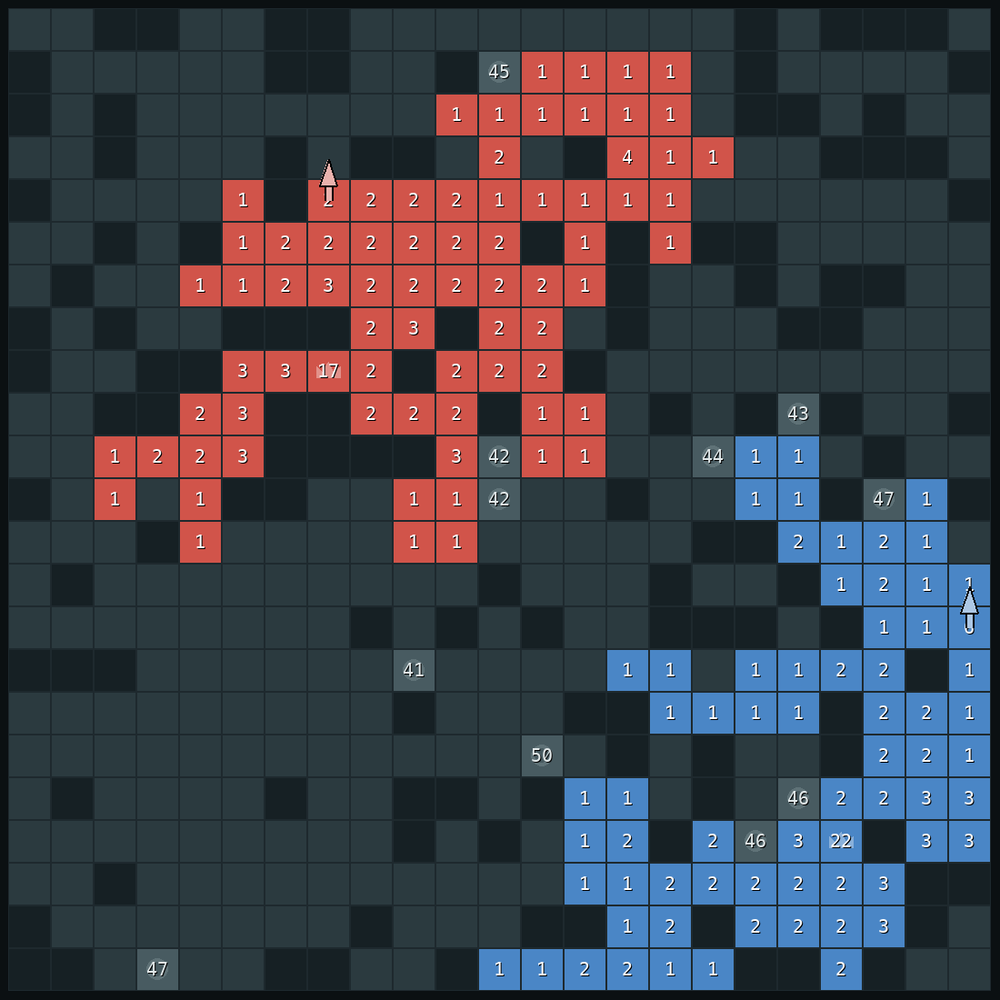
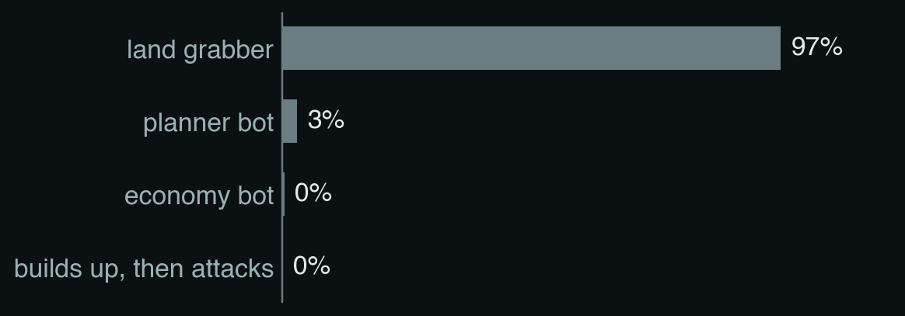
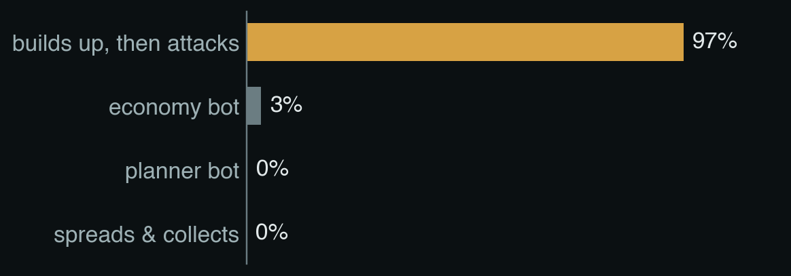
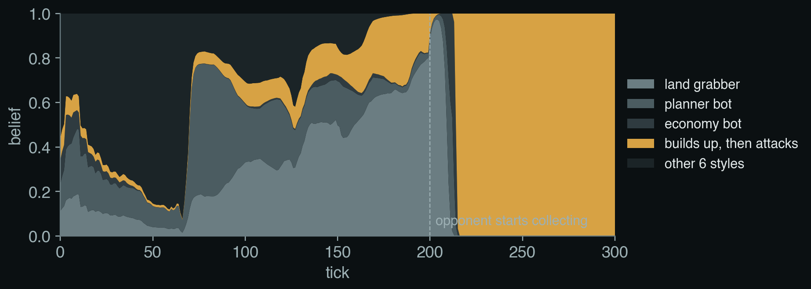
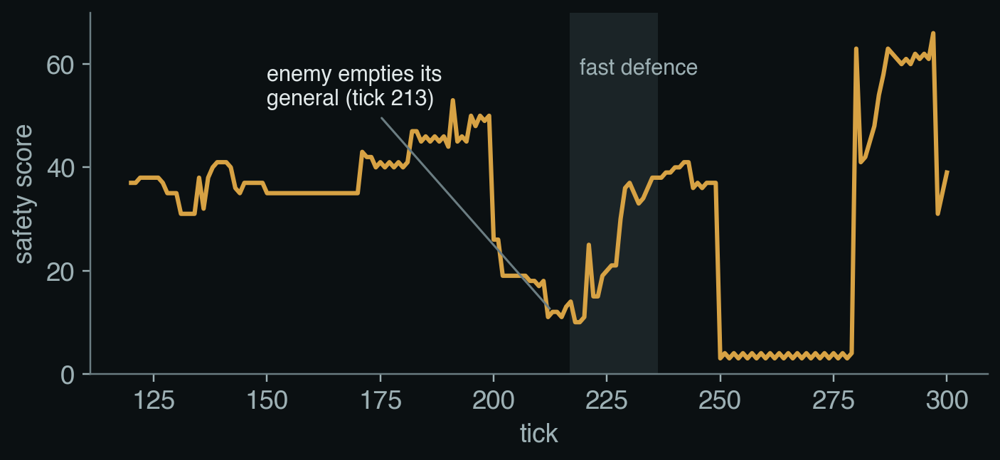
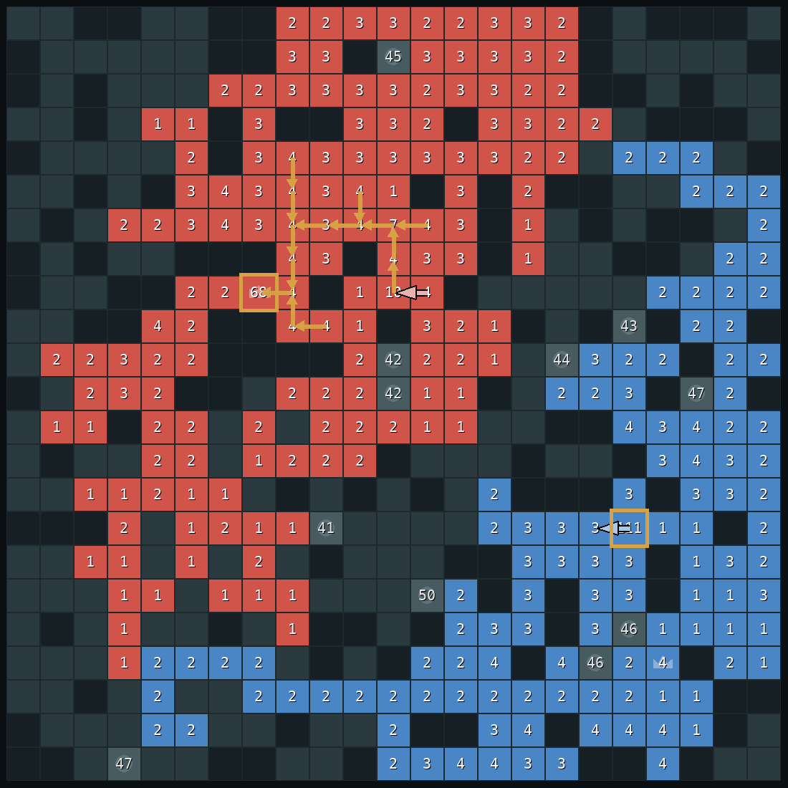
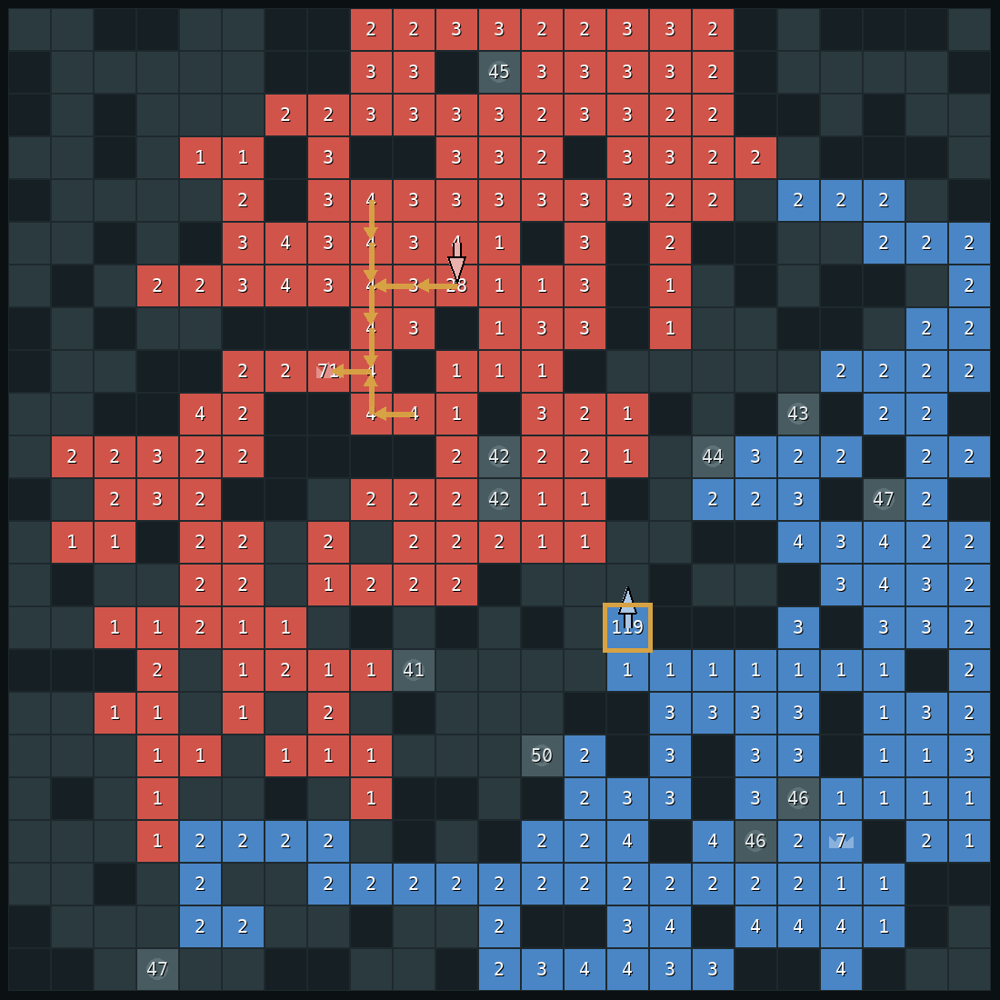
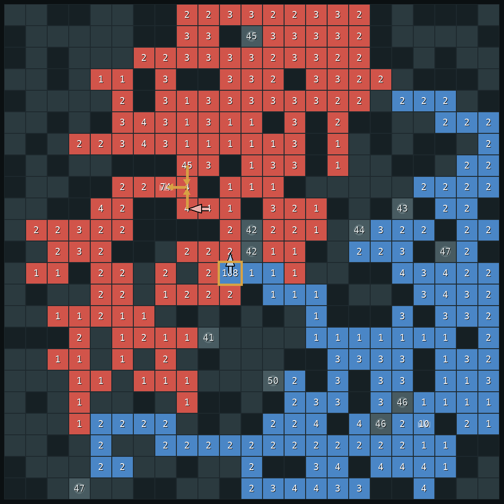
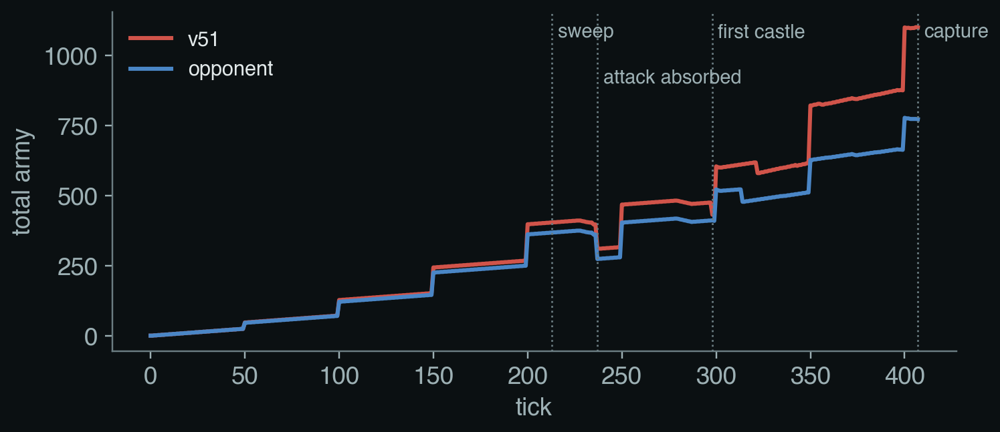
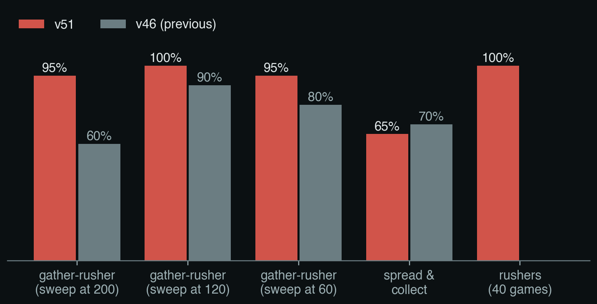

# Building a game agent from the textbook: v51

Writeup for the DAC-203 final presentation. This is the script the slides are built from. Part 1 sets up the task in the book's terms. Part 2 explains how v51 decides a move, one idea at a time, each tied to a chapter of *Artificial Intelligence: A Modern Approach* (AIMA, 4th edition) and to the paper we borrowed from. Part 3 replays one real game with screenshots. Part 4 gives the results and sets up the live game against the professor.

Every screenshot comes from one recorded game: v51 (red) against a bot that plays the way our human testers beat earlier versions (blue). It grabs land until tick 200, sweeps its whole army into one stack, and charges. Seed 93003, v51 in seat 0. v51 wins by capture at tick 407.

---

## Part 1. The task

### 1.1 What we were asked to build

An agent that plays a game well, using the methods taught in the course: search, adversarial search, probabilistic reasoning, decision making and learning. The game is a variant of Generals.io with no fog of war.

### 1.2 The game in one minute

The board is a 23 x 23 grid. Each player owns some tiles, and the number on a tile is the army standing on it. One tile is the player's **general** (the crown). Grey tiles are mountains. Circles are **castles**, which start neutral with 40 to 50 army.

- Each tick, each player makes one move: pick a tile with at least 2 army and push all but one of it (or half of it) to a neighbouring tile. Both players move at the same moment.
- Fighting is subtraction: 10 army walking onto 7 enemy army leaves 3 and takes the tile.
- Army grows by itself: the general and each owned castle add 1 every 2 ticks, and every owned tile adds 1 every 50 ticks.
- Taking the enemy general wins. Otherwise, at the tick limit, more land wins.

### 1.3 The agent in AIMA's terms

AIMA chapter 2 starts any agent design with PEAS and the properties of the environment.

| PEAS | Our game |
|---|---|
| Performance | win (take the enemy general), else more land at the limit |
| Environment | 23 x 23 board, one opponent |
| Actuators | one move per tick: a tile, a direction, all-but-one or half |
| Sensors | the whole board: every tile's owner and army |

The environment is fully observable, deterministic, sequential, dynamic (a decision every half second), discrete, and has two competitive agents who move simultaneously.

These properties fix the kind of agent we need. Full observability means no belief about the *board* is needed; the only hidden thing is what the opponent intends, so the agent keeps a belief about the *opponent*. Because results arrive hundreds of ticks later, the agent must judge positions with an estimate of how good they are: in AIMA's terms a **utility-based agent**. Simultaneous moves mean each decision is a small game in the sense of chapter 18, not a plain minimax tree.

### 1.4 The fact the whole design rests on

A stack that walks loses one army for every tile it leaves, because it must leave one behind to keep the tile. A stack of 30 that walks 8 tiles arrives with about 21. In the same 8 ticks a general grows by 4. So:

- one stack attacking a general that keeps its army at home usually fails;
- a general falls when it has been **emptied**, or when **several stacks arrive one after another** and each knocks some army off.

Almost every part of v51 follows from these two sentences.

---

## Part 2. How we got here

### 2.1 The five papers we started with

Our first two presentations planned the bot around five search papers. Each makes search faster or deeper, and each assumes something that turned out not to hold in our game.

| Paper | What it is for | What it assumes | What we measured |
|---|---|---|---|
| ARA* (Likhachev, Gordon & Thrun 2003) | find a path fast, improve it while time remains | finding the path is the hard part | an exact distance map over all 529 squares takes 0.042 ms |
| RTAA* (Koenig & Likhachev 2006) | learn distance estimates while moving | distances are unknown | the map is visible, so distances are exact from turn one |
| Depression avoidance (Hernández & Baier 2012) | escape dead ends of a wrong estimate | estimates can be wrong | exact distances have no dead ends |
| ProbCut (Buro 1995) | search deeper by skipping branches a shallow search rules out | deeper search wins more | deeper search won no more games |
| Metareasoning (Russell & Wefald 1991) | decide how long to think | thinking time is scarce | v51 decides in about 10 ms of the 500 ms allowed |

### 2.2 Evidence 1: searching deeper did not help

ProbCut models the deep value as $v \approx a v' + b + e$, $e \sim \mathcal N(0,\sigma^2)$, and skips the deep search when $(a v' + b - \beta)/\sigma \ge t$. On the 160 positions saved in `probcut_charge_fit_v19.json` the fit is $v = 0.955\,v' + 1.97$, $\sigma = 2.18$, $r = 0.996$. The shallow search already predicts the deep one almost exactly, so searching deeper rarely changes the move. Against v11, our best bot of that period, the ProbCut variants (v12, v14, v16), four-ply search (v17), learned ProbCut (v20) and macro scripts (v23) won at most half their games; v18 (queued moves with background forecasts) won none. v36, built on a safety rule, won every game.

### 2.3 Evidence 2: we were never short of time

RTAA* updates $h(s) \leftarrow g(\bar s) + h(\bar s) - g(s)$. When $h = h^*$, the update returns $h^*(s)$ and changes nothing, and with no wrong estimates there are no depressions to escape. Metareasoning thinks more only when $\mathrm{VOC}(c) = \mathbb E[U\text{ after}] - \mathbb E[U\text{ now}] - \mathrm{cost}(c) > 0$. Here the cost was close to zero and, as section 2.2 shows, deeper thinking rarely changed the decision, so VOC was close to zero as well.

### 2.4 Evidence 3: how the search-era bot lost

We played v11 against two simple rush bots on 30 maps each (seeds 1 to 15, both seats). It lost its general in 25 of the 60 games; v36 won 24 of those 25 on the same maps. In the clearest one (castle rusher, seed 2), v11 moved all 40 soldiers out of its general at turn 81. For 16 turns that stack circled the same four squares while the rusher walked 17 squares straight in, and at turn 99 it captured a general holding 10 against 21. On the same map v36 kept 39 soldiers in the general and won.

### 2.5 The three changes of direction

1. **v36, a safety rule.** For every enemy stack $s$: $G + \mathrm{growth}(d_s) > x_{\mathrm{arrive}}(s)$. v11's move at turn 81 leaves $1 + \lfloor 18/2 \rfloor = 10 < 42 - 18 = 24$, so v36 refuses it. Against the direct rusher, search-era bots scored 25 to 83 percent on small sets; v36 won 20 of 20.
2. **v42, counting collected armies.** In a recorded human win against v37, at turn 520 the human's biggest single stack (605) was smaller than v37's general (672), so the one-stack-at-a-time rule read safe. The human held more land and castles (4 to 0) and by turn 845 had collected 1,694 against 1,323. v42 replaced $\min_s[G + \mathrm{growth}(d_s) - x_s]$ with the collection race $\min_T[G + \mathrm{growth}(T) + D_{\mathrm{us}}(T) - D_{\mathrm{them}}(T)]$, after Human.exe.
3. **v51, committed defence.** v46 lost the gather-and-charge game at turn 237 (77 against 82) because it defended only on turns when the margin was under the pad and went back to expanding when it recovered. v51 keeps defending while an attack is incoming and the general is short.

| Version | What changed | The game that forced it |
|---|---|---|
| v1–v35 | faster, deeper search (the five papers) | no better than a coin flip against v11 |
| v36 | safety rule | v11 lost 25 of 60 to rush bots |
| v37 | plans, 40-turn lookahead, learned win estimate | v36 won only 16 of 20 against a land grabber |
| v39 | never swap places with an attacker | replays of human wins |
| v42–v44 | collection race, reserve, counter-strike | a human collected 1,694 against 1,323 |
| v46 | opponent style guess | 17–3 against v37 |
| v51 | committed defence, trained classifier | v46 lost the gather-and-charge game |

## Part 3. How v51 decides a move

### 3.1 The agent loop

Look at the board → update the belief about the opponent → is an attack coming? → defend fast, or choose a plan by looking ahead → safety-test the move → move.

Every tick v51 runs the same loop:

1. Look at the board and update its belief about what kind of opponent it faces.
2. Ask whether an attack is coming, and how short its general would be.
3. If it is short, spend every move pulling army into the general.
4. Otherwise pick a plan by imagining the next 40 ticks, and play the plan's next move, but only if that move passes a safety test.

The next sections take these one at a time.

### 3.2 Knowing the opponent: a belief that updates every tick

**Book:** Bayes' rule (ch. 12), filtering over time (ch. 14), neural networks (ch. 21).
**Papers:** Synnaeve & Bessière (AIIDE 2011), Weber & Mateas (CIG 2009).

v51 cannot see the opponent's plan, so it keeps a probability for each of ten opponent styles: rushers, an expander, a turtle, three "gather-rushers" that sweep at different times, a spread-and-collect player, and two economy-style bots.

Each tick it measures 14 things about the opponent from the board: how much land and army it has, what share of its army sits in its general, how big its largest stack is and how far that stack is from our general, whether that distance is shrinking, how fast its land is growing, and similar. A small neural network turns these 14 numbers into a probability for each style. It was trained on our own games against all ten styles, on the Mac GPU.

One board is weak evidence, so v51 accumulates the evidence over time and lets old evidence fade. In words: today's belief is mostly yesterday's belief, nudged toward what today's board suggests. As a formula, with $\ell_t(y)$ the accumulated log-probability of style $y$ at tick $t$ and $P(y\mid x_t)$ the network's output for today's board $x_t$:

$$\ell_t(y)=0.95\,\ell_{t-1}(y)+0.4\,\log P(y\mid x_t).$$

The 0.95 makes old evidence fade, so the belief can follow an opponent that changes style. This is the "predict, observe, update" filter of chapter 14.

What we took from the papers: Synnaeve and Bessière showed that a Bayesian model over a few opponent "openings", updated from what is observed, predicts StarCraft strategies well. Weber and Mateas showed that a classifier trained on features of what the opponent has built so far can name its strategy early. We combined the two ideas: a learned classifier as the observation model inside a Bayesian filter. On maps it never saw, the belief names the right style 66% of the time by tick 200 and 70% by tick 300 (random guessing would be 10%).

Belief at tick 205:

Belief at tick 215, after the opponent empties its general:

### 3.3 Is my general safe? The safety score

**Book:** breadth-first search for distances (ch. 3); greedy approximation of a hard optimisation problem.
**Paper:** Straka, Lisý & Schmid (2026), the description of the Human.exe bot.

The danger from section 1.4 is several enemy stacks arriving one after another. v51 measures it directly. For a number of ticks $T$ (from a few up to 60), it asks:

- how much enemy army could reach my general within $T$ ticks, if the enemy spends those $T$ moves walking its stacks in, one after another;
- how much my general will hold by then, plus what my own stacks could walk home in time.

The **safety score** is the second number minus the first, at the worst value of $T$. If it is small, an attack is possible soon.

Written out, with $G$ the general's army, $\mathrm{growth}(T)$ what it gains in $T$ ticks, and $D_{\text{us}}$ and $D_{\text{them}}$ the army each side can deliver to our general:

$$m=\min_T\Bigl[\,G+\mathrm{growth}(T)+D_{\text{us}}(T-\text{lead})-D_{\text{them}}(T)\,\Bigr].$$

Our own walks get a short lead (2 ticks plus a tenth of $T$) because defence has to start early to arrive in time.

Computing $D$ exactly means choosing which stacks to walk and in what order under a move budget, which is a knapsack-like problem and NP-hard. Human.exe, the strongest hand-written Generals.io bot, solves its own gathering as a "prize-collecting Steiner tree" (explained in 2.5). We use a greedy version: take the biggest walk first, then the next, until the move budget runs out, and count each tile only once.

What we extrapolated from the paper: Human.exe uses this gathering to collect its *own* army. We use the same calculation twice: on the enemy's army, to estimate the threat to our general, and on ours, to estimate our defence.

### 3.4 Never make an unsafe move: play it out first

**Book:** AND-OR search (ch. 4).

Every move v51 wants to make is first tried on a copy of the board. If the safety score after the move is still above a small cushion, the move is allowed. If not, v51 plays the move out in its head: it makes the move, then lets the enemy launch an all-out attack along each of its likely routes, with v51 defending. If the general falls in any of those imagined games, the move is thrown away.

This is the AND-OR search of chapter 4. Our choice is an OR node (we pick one move). The enemy's possible attacks are an AND node (the move must survive all of them). A move is accepted only if every branch below it ends safely.

The cushion grows with the size of the biggest enemy stack, so the bot is more careful when the enemy can hit harder.

### 3.5 Defending fast: pulling army into the general

**Book:** greedy algorithms, binary search, problem formulation (ch. 3).
**Paper:** Straka, Lisý & Schmid (2026), Human.exe's gathering.

When a large enemy stack is clearly heading for the general, v51 stops everything else and defends. Three steps:

**Notice it.** v51 follows each large enemy stack from tick to tick. If a stack has come at least 2 tiles closer within the last 5 ticks and is big enough to matter (at least 15 army, or a fifth of our general), it is "incoming", and its distance is the number of ticks until it arrives.

**Work out the shortfall.** Using the same delivery estimate as the safety score: how much will they bring, minus what the general alone will hold, plus a margin of 15% of the attacker. Stacks parked next to the general do not count, because the attacker can land before they step in.

**Gather.** Now v51 needs to move as much army as possible *into the general* within the moves it has left. Think of every tile we own as holding a prize (its army minus the one that must stay behind), and every step as costing one move. We want a tree of paths, all leading into the general, that collects the most prize for the moves we can afford. That is a **rooted prize-collecting Steiner tree**, the same structure Human.exe uses.

The exact problem is NP-hard. We solve it the way Human.exe does: put a price $\lambda$ on each move, grow the tree greedily by adding the path that collects the most prize minus $\lambda$ times its length, and adjust $\lambda$ by binary search until the tree needs no more moves than we have. A high price gives a small tree near the general; a low price gives a big tree that would take too long. Then the moves are played from the outer leaves inward, so army snowballs on its way to the general. Any stack of 10 or more that is already next to the general steps in at once.

### 3.6 Choosing what to do: imagining the next 40 ticks

**Book:** adversarial search with playouts (ch. 6), decisions under uncertainty (ch. 16).
**Paper:** Barriga, Stanescu & Buro, *Puppet Search* (AIIDE 2015).

When nothing urgent is happening, v51 does not search individual moves; there are tens of thousands of joint moves per tick. It chooses between about six **plans**: keep expanding, hold, take castle A / B / C, gather home, strike, rush.

For each plan it plays the next 40 ticks forward on a copy of the board, four times, against four imagined opponents: a rusher, a castle rusher, an expander and a passive player. At the end it scores the board with a small learned model of "chance of winning from here" (logistic regression, ch. 19).

To pick a plan it averages two things: the expected score, weighted by its belief about the real opponent, and the worst of the four scores. In words, it prefers plans that do well against the opponent it thinks it faces, but not plans that would be a disaster if it is wrong. The half-and-half mix of average and worst case is known in decision theory as the Hurwicz criterion.

What we took from Puppet Search: keep a small library of scripts with choice points, and search over the choices instead of over raw moves. That cuts thousands of options down to six, and makes a 40-tick lookahead affordable.

### 3.7 Castles and the economy

**Book:** utility and decisions (ch. 16).
**Paper:** Churchill & Buro, *Build order optimization in StarCraft* (AIIDE 2011).

A castle produces as much army as 25 ordinary tiles, but taking one costs its garrison and drains the stack that walks there. v51 takes a castle only if:

- it will earn its cost back before the game ends (twice the garrison plus the walk must be less than the ticks left); and
- the safety score still holds on the board as it will be *after* the walk, with the enemy also moved forward.

Whether to take castles at all is decided by an income race, an idea from Churchill and Buro's build-order planning: project both players' army to the end of the game at their current income. While v51 is not yet safely ahead, castles are worth buying. Once it is clearly ahead, only cheap ones are.

### 3.8 Using the belief without trusting it too much

**Book:** game theory, maximin and best response (ch. 18).
**Paper:** Ganzfried & Sandholm, *Safe opponent exploitation* (ACM TEAC 2015).

The belief from 2.2 switches parts of v51 on and off. Against an aggressive style, v51 keeps more army at home (60% of each threat instead of 40%) and is allowed to counter-attack. Against a passive style it keeps less at home and expands more.

Ganzfried and Sandholm studied when it is safe to play the best response to a guessed opponent instead of a safe strategy. Their answer: exploit only as much as you can afford to be wrong. We apply that by construction: the belief can make v51 greedier or more careful, but it can never switch off the safety test of 2.4. A wrong guess costs some efficiency, never the general.

### 3.9 Attacking: only when it is proven

**Book:** AND-OR search again (ch. 4).

From 1.4, attacking a full general rarely works, so v51 attacks only when it can prove the attack works. For each of its large stacks it takes the best path to the enemy general. The attack must arrive bigger than the enemy general plus its growth plus the biggest stack the enemy could bring home, and our own general must stay safe while the stack is away. Then the attack is played out against four replies (rush us, rush with a castle, do nothing, pull everything home) and launched only if it wins against all four.

In practice this fires when the enemy general has been emptied. Against a careful opponent it fires rarely, and that is v51's main weakness.

### 3.10 The papers, in one table

| Paper | Its idea | What we took | Where in v51 |
|---|---|---|---|
| Straka, Lisý & Schmid 2026 (Human.exe) | gather army with a prize-collecting Steiner tree, binary search on the price per move | the same tree, rooted at our general, to defend; the delivery estimate for both sides | safety score, fast defence |
| Barriga, Stanescu & Buro 2015 (Puppet Search) | search over the choices of scripts, not raw moves | six plans, each played 40 ticks ahead against four imagined opponents | plan choice |
| Synnaeve & Bessière 2011 | Bayesian prediction of the opponent's strategy, updated from observations | a belief over ten styles, updated every tick with fading memory | opponent model |
| Weber & Mateas 2009 | a classifier trained on game features predicts strategy early | a neural network over 14 board features as the observation model | opponent model |
| Ganzfried & Sandholm 2015 | exploit a guessed opponent only as far as is safe | the belief changes preferences; the safety test is never switched off | gates |
| Churchill & Buro 2011 | plan the economy by projecting income forward | income race decides whether castles are worth buying | castles |

---

## Part 4. Every part of v51

### 4.1 The full turn

Checks run in this order and the first that applies decides the move: (1) update the opponent belief; (2) capture the enemy general if a neighbouring stack beats it; (3) fast defence if a stack is incoming and the need is positive; (4) update the castle and threat gates, which set the reserve $R$; (5) counter-strike if home is losing the race and a strike passes `verify()`; (6) if urgent (margin at or under the pad, or a proven attack), v36's rule list; (7) a castle move that passes payback, reserve and walk safety; (8) otherwise the committed plan. Plan and castle moves must pass the safety test; if none passes, the Defender script moves.

### 4.2 The simulator

`sim36.py` is an exact pure-Python copy of the JAX game step, checked by `tools36/check_sim36.py` on thousands of random joint moves. A move sends a whole stack less one, or half. Generals and castles grow by one every 2 turns, every owned square by one every 50. One turn changes at most four squares, so the state is updated in place. In AIMA terms it is the transition model RESULT(s, a), with a = both players' moves.

### 4.3 Phases, horizon and commitment

The phase is read from the board. It is the end game if $L \le 60$ or one side holds $n \ge 2n' + 20$ and $A \ge 2A' + 40$. It is the opening if there is no threat and free land $f > 0.35(f + n + n')$. Otherwise it is the mid-game. Horizon and commit interval are 24/6, 40/10 and 60/8 turns; near the cap the rollout runs to the end and the tiebreak decides. A new plan is chosen early if the phase changes, a castle changes hands, the enemy general drops below half its previous value, or the plan finishes.

### 4.4 The plan menu

The plans are expand, hold, take castle (the 2 nearest in the opening and 3 later, ranked by $d + \tfrac12$ garrison), gather home (only when the margin is at most $3\cdot\mathrm{pad} + 10$), strike and rush. The imagined opponents are rusher, castle rusher, land grabber and waiter. Up to 8 × 4 = 32 rollouts of 40 turns are run, and plans whose boards match against all four opponents are merged (6.1 → 4.6 on average).

### 4.5 The learned win estimate (logistic regression)

$V(s) = \sigma(w^\top\phi(s))$, with nine features, all us-minus-them:

| Feature | Definition |
|---|---|
| land | land lead / 50 |
| army | army lead / 100 |
| producers | producer lead |
| income × turns left | income lead × turns left / 100 |
| defence | (our general − their biggest stack) / 50 |
| attack | (our biggest stack − their general) / 50 |
| biggest stack | biggest-stack lead / 50 |
| turns left | turns left / 500 |
| constant | 1 |

Income is $\tfrac12$ per producer plus land/50 per turn. The data come from 7 scripted policies on 200 maps with caps of 300, 500 or 800 turns. Features are recorded every 5 turns from both sides, labelled with the winner, and draws are dropped. Maps 95000–95159 are used for training (27,208 positions) and 95160–95199 are held out (6,986). Each phase is fitted separately by Newton's method on the L2-regularised log-loss ($\lambda = 0.01$): $w \leftarrow w - H^{-1}\nabla\mathcal L$, with $\nabla\mathcal L = \tfrac1n X^\top(p-y) + \lambda w$ and $H = \tfrac1n X^\top S X + \lambda I$. This ran in numpy on the CPU.

Weights, opening / mid / end:

| Feature | Opening | Mid | End |
|---|---|---|---|
| land | 1.13 | 2.05 | 1.41 |
| army | 0.72 | 0.03 | 0.60 |
| producers | −0.17 | 0.32 | −0.05 |
| income × turns left | 0.95 | −0.17 | 0.68 |
| defence | −0.12 | −0.18 | −0.11 |
| attack | −0.12 | −0.18 | −0.11 |
| biggest stack | 0.28 | 0.24 | 0.18 |

The constant and turns left get weight 0. Every position appears from both sides, so the model cannot favour either; for the same reason defence and attack get identical weights.

Held-out log-loss against a land-only model:

| Phase | 9 features | Land only | Accuracy (land only) |
|---|---|---|---|
| Opening | 0.473 | 0.522 | 75% (71%) |
| Mid | 0.372 | 0.359 | 85% (86%), no better than land alone |
| End | 0.088 | 0.111 | 98% |

### 4.6 Opponent weights

Each imagined opponent is scored on whether it predicts the opponent's last move: $w_m \leftarrow 0.95\,w_m\,P/0.5 + 0.05$, with $P = 0.8$ for a match and $0.2$ otherwise. The classifier's ten styles map onto the four scripts:
- rusher and early/mid gatherers → rusher;
- castle rusher → castle rusher;
- land grabber, late gatherer, spreader, economy bot and planner bot → land grabber;
- turtle → waiter.

The two are combined as $w'_m \propto \sqrt{w_m/\sum w}\,(0.02 + \sum_{y\to m}P(y))$.

### 4.7 The style classifier

There are 14 opponent features:
- turn;
- land and total army;
- share of the army in the general, and in the biggest stack;
- castles held;
- the biggest stack's distance to our general, and how much it closed in 5 turns;
- land gained and army gained over 20 turns;
- the biggest stack's growth over 5 turns;
- stacks of 5 or more;
- times the general was emptied;
- whether the biggest stack is within 10 squares.

The network is a 14-64-64-10 MLP with ReLU activations and a softmax output (5,770 weights), trained with cross-entropy using Adam (learning rate 0.002, weight decay $10^{-4}$, batch size 512, 60 epochs) on the Mac GPU (MPS). The data are v46 against each of the 10 styles on 33 maps, both seats, sampled every 2nd turn: 25 maps for training (99,437 rows) and 8 unseen maps for testing (33,318 rows).

Per-board accuracy is 25%, 53%, 70% and 67% for turns 0–100, 100–200, 200–300 and 300–500. The online belief is right 39%, 66% and 70% of the time at turns 100, 200 and 300.

The main confusion is rusher read as turtle (55%), because both sit at home until the rusher launches. Economy bot and planner bot are also confused with each other, which costs nothing since both map to the same script.

### 4.8 Safety details

- **Reserve.** $G_{\mathrm{keep}} + \mathrm{growth}(H + d_s) \ge R\,x_s(H)$ for $H \in \{0, 30, 60\}$, with $R = 0.6$ when the threat gate is open and 0.4 when it is shut. The reserve also has to cover the mass threat $M(H) = \sum_{H\text{ biggest}}(a_c - 1) + 1 + \mathrm{growth}(H) - \mathrm{cost}$.
- **Pad.** $3 + 0.08\,x_{\mathrm{top}} + \max(0, -16\,\Delta m/\Delta t)$, with the slope measured over 8 or more turns.
- **Lead.** Our walks are counted with $T - 2 - \lfloor T/10 \rfloor$ moves.
- **Each square once.** A walk loses the $(a_v - 1)$ already collected by earlier chosen walks.
- **Swap-safe.** The general never steps toward an adjacent enemy stack, because in a simultaneous move the two stacks pass each other.
- **Counter-strike.** Launch if $d < T_{\mathrm{fall}}$ and $x_{\mathrm{arrive}} > G' + \mathrm{growth}(d) + D'_{\mathrm{home}}(d-1) + 3$, the strike passes `verify()`, and the threat gate is open.

### 4.9 Castles, expansion and the rule list

**Castles.**
- Candidates are castles within 30 squares of the general, with a walk of at most 25.
- Sources are the general (half, or all but one), an owned castle with at least 4, or a big stack.
- A castle is taken only if it pays back: $2(g + d) \le \min(L - d, 400)$.
- Options are ranked by $g + d - 0.6\,\mathrm{fwd} - 15[\text{enemy's}] + 2[\text{full send}]$, and the best 4 are checked each turn.
- Walk safety: the margin after the walk, with the enemy $d$ steps closer, must exceed $\mathrm{pad} + 0.2\,x_{\mathrm{top}}$.
- Castle gate: lead $= (A - A') + (\iota - \iota')L$. The race counts as won if lead $> 0.25\max(50, A')$, $\iota \ge \iota'$ and $n > n'$. When it is won, only cheap castles are taken (garrison + walk ≤ 30, never from the general), unless the opponent holds or masses on castles.

**Expansion score.** $10\,\mathrm{gain} + 0.1\,a_c + 0.5\,\mathrm{free}(v) - 0.05\,d_{\mathrm{enemy}}(v) - 5[\mathrm{producer}] + 4[\mathrm{threat\ route}]$.

**Rule list.** In order: proven attack; under attack (hit an adjacent attacker or pull home); short (pull home); castle walk; far ahead (concentrate); expand; walk to the frontier; build up forward; general expands (half if it holds more than 12); gather home. At most 6 expensive tests run per turn, then the Defender script.

### 4.10 Built but switched off: Exp3

The bot can select one of four arms per game (base, greedy, safe, castles) with $p_a = (1-\gamma)w_a/\sum w + \gamma/K$, $\gamma = 0.2$, and update $w_a \leftarrow w_a\exp(\gamma r/(p_a K))$. The reward is 1 for a win, 0 for a loss, and otherwise $0.25 + 0.5 \times$ land share. It is active only when `V46_MEMORY` names a file, so the final bot always plays the base arm.

## Part 5. One game, step by step

Red is v51, blue is the opponent. Screenshots: [40](v51-img/t40.png), [205](v51-img/t205.png), [213](v51-img/t213.png), [215](v51-img/t215.png), [219](v51-img/t219_plan.png), [224](v51-img/t224.png), [235](v51-img/t235.png), [237](v51-img/t237.png), [298](v51-img/t298.png), [405](v51-img/t405.png), [407](v51-img/t407.png).

**Tick 40. Opening.** Both sides expand one tile per move. v51's plan is "expand"; there is no threat, so there is nothing to defend.

**Tick 120. Mid-game.** The two territories meet. The safety score appears for the first time (37: our general could absorb any attack that is possible now, with 37 to spare). The belief is split between expander and planner.

**Tick 205. The sweep starts.** The opponent's general holds 79 and climbing; it is pulling its land in. To v51 this still looks like an expander (97%), because before its sweep this bot *is* an expander.

**Tick 213. The opponent empties its general.** Its general drops from 93 to 1 and a 94-army stack appears. The safety score falls to 12.

**Tick 215. The belief changes.** The board now matches the late gather-rusher: belief 97%. The safety score is 11, and v51 takes one defensive move.

**Tick 219. The approach is confirmed.** The 111-army stack is 18 tiles away and closing. v51 computes the shortfall, builds a gather tree of 14 moves into the general, and from now on every move is a gather move. Our general holds 68.

**Ticks 224 to 234. Gathering.** Army flows inward leaf-first. The attacker shrinks as it walks (119, 116, 108, 98). Our general grows: 71, 74, 80.

**Tick 235. Merged.** The largest stack next to the general steps in. Our general holds 124. The attacker is 2 tiles away with 90.

**Tick 237. Impact.** The attack arrives with 88 and the general keeps 38. v46, the previous version, lost this exact position at tick 237 with 77 against 82.

**Tick 298. First castle.** With home safe, v51 goes back to its plan and takes a castle; its army climbs past the opponent's.

**Ticks 405 to 407. The proven attack.** The opponent's general is down to 2 army. v51 finds an attack that wins against all four replies and launches it; the general is captured at tick 407.

---

## Part 6. Results and the live game

### 6.1 Results

Simulator games, both seats on every map.

| Opponent | v51 | v46 (previous) |
|---|---|---|
| v46, 60 games | 32–28 | – |
| gather-rusher sweeping at tick 200 (the human-style bot) | 19–1 | 12–8 |
| gather-rusher sweeping at 120 | 20–0 | 18–2 |
| gather-rusher sweeping at 60 | 19–1 | 16–4 |
| spread-and-collect player | 13–7 | 14–6 |
| direct and castle rushers | 40 of 40 | – |

The gather-rusher and rusher rows were measured with the fast defence and without the classifier (v52); v51 has the same defence. Against v46 the two bots are level, because v46 rarely builds one big stack and walks it at the general. The fast defence matters against exactly the strategy people used to beat earlier versions. It is slightly worse against the spread player, which takes castles while v51 is busy defending.

### 6.2 The live game

The professor plays v51 in the arena (`python play_arena.py`, choose "Final · champion (v51 fast defence)"). Things to watch for:

- In the opening v51 expands one tile per move and leaves its general mostly alone.
- If you build one big stack and walk it toward v51's general, v51 stops expanding and pulls its army in, starting from the far edges.
- v51 does not attack a full general. It waits for your general to be emptied.
- If you spread out and take castles instead, v51 competes for castles and land; that is the game where it is weakest.

### References

- Russell, S. & Norvig, P. *Artificial Intelligence: A Modern Approach*, 4th ed. Pearson, 2020.
- Straka, M., Lisý, V. & Schmid, M. Superhuman AI for Generals.io using self-play reinforcement learning. arXiv 2606.23348, 2026.
- Barriga, N., Stanescu, M. & Buro, M. Puppet Search: enhancing scripted behavior by look-ahead search with applications to RTS games. AIIDE 2015.
- Synnaeve, G. & Bessière, P. A Bayesian model for opening prediction in RTS games with application to StarCraft. AIIDE 2011.
- Weber, B. & Mateas, M. A data mining approach to strategy prediction. CIG 2009.
- Ganzfried, S. & Sandholm, T. Safe opponent exploitation. ACM Transactions on Economics and Computation, 2015.
- Churchill, D. & Buro, M. Build order optimization in StarCraft. AIIDE 2011.
