# Making a Bot for Generals.io
## using Search Algorithms and Offline Learning

*Final Project Report*

DAC-203 – Artificial Intelligence

### Abstract

We build a game-playing agent for Generals.io, a real-time strategy game with simultaneous moves (in the original game also with hidden information). The agent is assembled from methods of the AI textbook (search, probabilistic reasoning, decision making under uncertainty, and supervised learning) together with ideas from four research papers on real-time strategy (RTS) games. This report describes the game, the aim of the project, the papers that form our baseline, and, in detail, what the bot does in each half-second turn.

## 1 Introduction

### 1.1 The game: Generals.io

Generals.io is a two-player (also 2v2 and free-for-all) real-time strategy game played on a rectangular grid of up to $23\times 23$ cells. Each cell is one of four types: *plain* (walkable), *mountain* (impassable), *general* (a player's base) and *castle* (an army-producing cell). A random $\approx 20\%$ of cells are mountains, and 9–11 neutral castles are placed, each starting with 40–50 neutral soldiers. The two generals start at least 17 steps apart [4].

The rules that matter for strategy are the following.

- **Numbers are soldiers.** Every owned cell holds a stack of soldiers. A player wins by capturing the opponent's general.
- **One move per turn, both players at once.** On each turn (0.5 s in the browser game, which we call a *tick*) a player picks one owned cell and a direction, and sends either all but one soldier or half of the stack to the neighbouring cell. Moves of both players are resolved simultaneously, so a player never gets to react to the opponent's move within a turn.
- **Combat is subtraction.** When two stacks meet they cancel one-for-one; the larger stack survives with the difference and takes the cell.
- **Soldiers grow by themselves.** The general and every owned castle produce one soldier every second turn; additionally, every 50 turns every owned cell gains one soldier.
- **Fog of war.** A player sees only the cells it owns and their 8-neighbourhood. A public scoreboard shows each player's total land and total army, from which the opponent's behaviour can partly be inferred. In the modified version used in this project there is no fog of war: both players see the whole board.

A consequence of these rules, and the central observation behind our bot, is that *walking costs soldiers while waiting earns them*: a stack walking towards a general leaves one soldier on every square it crosses, while the general keeps growing. A general with its soldiers at home is therefore very hard to take. It falls only if its owner moves the soldiers away, or if several stacks arrive one after another and together overwhelm it. This makes the game a mix of resource allocation, opponent modelling, deception under fog of war, and long-term investment (capturing a castle weakens you now but pays back later).

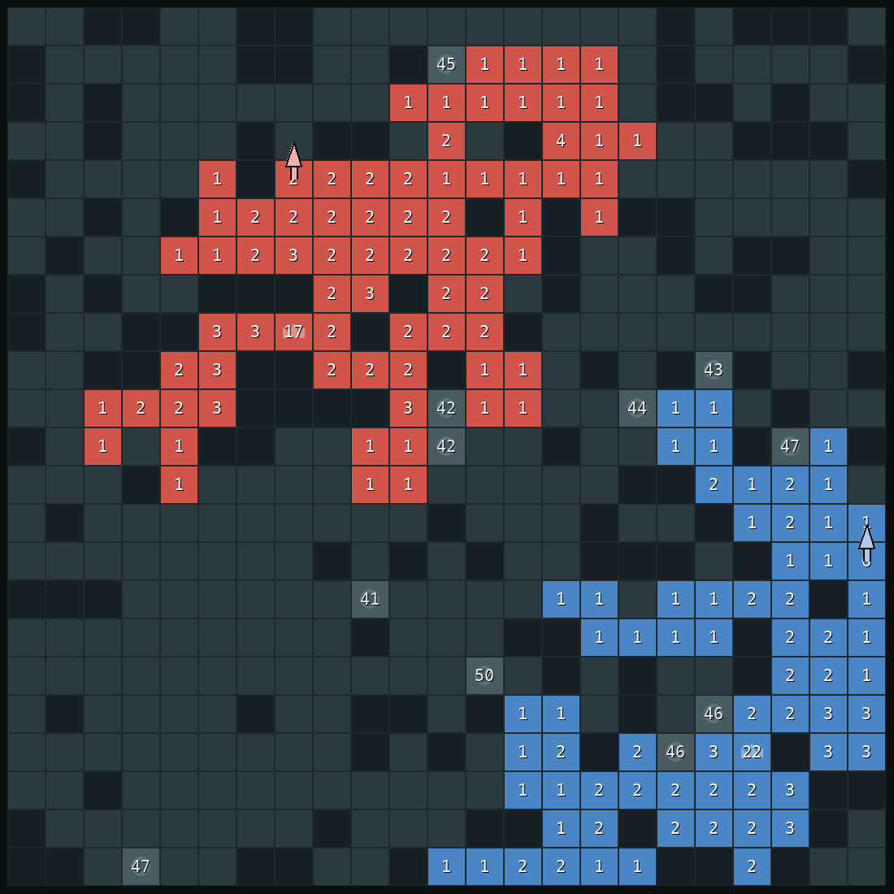
*(a) A real position at tick 120.*

*(b) Walking costs, waiting earns: a stack of 30 walks towards a general of 12 (top); 8 ticks later it has 22 and the general 16 (bottom).*

**Figure 1:** The game as our bot sees it (arena screenshots). Our bot is red, the opponent blue; numbers are soldiers, crowns mark the generals and grey numbered cells are neutral castles.

### 1.2 Aim of the project

The aim of this project is to build a strong Generals.io bot by applying the techniques taught in the course, namely *search*, *probability and belief updating*, *decision making under uncertainty* and *a small amount of offline learning*, together with ideas from the RTS literature, and to measure honestly what each idea contributes.

Concretely, we set the following goals.

1. Design a bot that decides in real time (well inside the 0.5 s turn budget) on an ordinary CPU, using search and hand-designed models rather than large-scale reinforcement learning.
2. Use *offline learning* only where it helps: a logistic-regression model that estimates the probability of winning from a board position, and a small neural network that classifies the opponent's playing style, both trained in advance on simulated games.
3. Keep the agent interpretable: every decision (defend, expand, take a castle, attack) should be explainable in terms of a formula or a search that we can write down.
4. Evaluate the bot against scripted opponents and against our own earlier versions, and learn from the games it loses.

The project went through about fifty versions. Our first plan was built on five classical search papers (Section 2.5); when games showed that deeper search was not the bottleneck, we changed direction towards a *safety-first* design and towards the ideas in the four RTS papers below. The final agent is called **v51**.

### 1.3 Organisation of this report

Section 2 summarises the papers we used as our baseline. Section 3 describes what the bot does on every tick and the mathematics behind each component. Section 4 describes our experiments, failures and the changes of direction that led to the final bot, starting with why we abandoned the five papers of our first plan.

## 2 Baseline: Papers We Reference

Four papers on real-time strategy games form our baseline; they are presented in the order in which their ideas enter our bot's decision process: first *understand the opponent*, then *choose among a few plans*, then *count what can be gathered in time*, and finally *judge economic investments*. For each paper we give the idea and what we take from it.

### 2.1 Bayesian inference of the opponent's strategy

*G. Synnaeve and P. Bessière, “A Bayesian model for plan recognition in RTS games applied to StarCraft”, 2011 [1].*

**Idea.** Under fog of war a player sees only part of what the opponent does, yet strong play requires knowing the opponent's plan. The paper keeps a probability for every plausible opponent plan and revises it with Bayes' rule whenever something is observed: plans that are consistent with the evidence and typical for the current time become more likely, and plans that contradict what has been seen are ruled out. The model is generative and is learned automatically from recorded games, with no hand-labelled data, and it remains useful even when most observations are missing. The same line of work [2] showed that classifiers trained on features of recorded games can recognise strategies.

**What we take.** Keeping a *distribution over the opponent's strategy* that is updated every turn from what the board shows, instead of committing to a single guess.

### 2.2 Search over a few scripted plans

*N. Barriga, M. Stanescu and M. Buro, “Puppet Search: Enhancing scripted behavior by look-ahead search”, 2015 [3].*

**Idea.** A strategy game has far too many possible moves to search move by move, while hand-written scripts act quickly but never look ahead. Puppet Search combines the two: each script exposes a few *choice points*, and a search algorithm looks ahead only over the combinations of those choices, simulating the game forward to compare them. The scripts remain in charge of the details, and the search decides the fundamental choices. The number of choice points can be tuned to the available time.

**What we take.** Search over a handful of high-level *plans* instead of raw moves, scoring each plan by simulating the game forward, and the result that such a search matches or outperforms every single script it uses.

### 2.3 Gathering resources in time: prize-collecting Steiner trees

*M. Straka, V. Lisý and M. Schmid, “Superhuman AI for Generals.io using self-play reinforcement learning”, 2026 [4].*

**Idea.** This paper trains a neural policy by self-play and also documents the rules of the game and the strongest hand-written Generals.io program. That program gathers its army by solving a *budgeted collection problem*: which stacks should be pulled together, along which routes, so that as many soldiers as possible arrive within the available number of moves. It does so with a *prize-collecting Steiner tree*, i.e. a tree of routes that earns a prize for every soldier collected and pays a cost for every move, together with knapsack-style optimisation to combine routes.

**What we take.** We do not use reinforcement learning. We take the *counting* idea: the number of soldiers that can be brought to one cell within $T$ moves. We use it on the enemy side to measure threats and on our own side to organise defence.

### 2.4 Planning the economy: simulating income forward

*D. Churchill and M. Buro, “Build order optimization in StarCraft”, 2011 [5].*

**Idea.** The paper asks in what order resources should be spent so that a goal is reached as early as possible. Its planner simulates each side's economy forward in time at its current income, jumps directly to the next moment when an action becomes affordable, and prunes hopeless branches with lower bounds, which makes the search fast enough for real time.

**What we take.** Judging an investment by *projecting income forward*: a purchase is worthwhile only if what it produces before the game ends exceeds what it costs. In Generals.io the investment is the capture of a castle.

### 2.5 Papers we started from

Our first two project presentations were based on five classical search papers. We implemented most of them, but games showed that they did not address why we lost (Section 4).

| **Paper** | **What it is for** | **What it assumes** |
|---|---|---|
| ARA\* [6] | find a path fast, then improve it while time remains | finding the path is the hard part |
| RTAA\* [7] | learn better distance estimates while moving | distances are unknown |
| Depression avoidance [8] | escape dead ends created by a wrong estimate | estimates can be wrong |
| ProbCut [9] | search deeper by skipping hopeless branches | deeper search wins more |
| Metareasoning [10] | decide how long to think | thinking time is scarce |

### 2.6 Summary: what each paper contributes

| **Paper** | **Idea we borrow** | **Used in** |
|---|---|---|
| Synnaeve, Bessière 2011 (and Weber, Mateas 2009) | probability distribution over the opponent's strategy | Sec. 3.2 |
| Barriga, Stanescu, Buro 2015 | search over a few scripted plans, not every move | Sec. 3.4 |
| Straka, Lisý, Schmid 2026 | counting soldiers that can be gathered in time; Steiner-tree gathering | Sec. 3.5, 3.6 |
| Churchill, Buro 2011 | judge investments by projecting income forward | Sec. 3.7 |

In addition, the project uses the AI textbook of Russell and Norvig [11]: Bayesian filtering (Ch. 14), AND-OR search (Ch. 4), depth-limited search with an evaluation function (Ch. 5), expected utility (Ch. 16), logistic regression and neural networks (Ch. 19, 21).

## 3 Our Work: What the Bot Does Every Tick

This section explains the final bot (v51) component by component. The components are presented in the order in which the bot reasons: understand the opponent (3.2), never play a move that can lose (3.3), choose among plans by expected value (3.4), watch the safety score (3.5), defend when an attack is coming (3.6), invest in castles (3.7) and attack when it is certain to work (3.8). Section 3.9 summarises the ideas in a table and Section 3.10 puts them together as the pipeline executed on every tick.

### 3.1 Common notation and building blocks

> **Key idea.** Everything the bot computes rests on three quantities and an exact copy of the game rules: how much a producer **grows**, how much force a stack **delivers** when it walks, and how much a side can **gather** within a move budget.

Each tick the bot reads the board state and copies it into an exact pure-Python replica of the game rules (our own simulator, checked against the reference implementation of the rules on thousands of random joint moves). All forward simulations below use this replica, so that a “simulated tick” follows the real rules including simultaneous moves.

**Growth.** Let $t$ be the current tick. The soldiers a producer (general or castle) gains in the next $T$ ticks are

$$
\gamma(T)=\Big(\big\lfloor\tfrac{t+T}{2}\big\rfloor-\big\lfloor\tfrac{t}{2}\big\rfloor\Big) +\Big(\big\lfloor\tfrac{t+T}{50}\big\rfloor-\big\lfloor\tfrac{t}{50}\big\rfloor\Big), \tag{1}
$$

that is, one soldier every second tick plus one per 50 ticks from the land tick.

**Walk.** If a stack walks all-in along a path $\pi=(c_0,c_1,\dots,c_k)$, it leaves one soldier on every square it leaves, picks up the soldiers on cells it already owns and fights those that are neutral or hostile. Starting from $x_0=a_{c_0}$ (the army on the first cell), for each intermediate cell $c_i$,

$$
x_i=x_{i-1}-1+\begin{cases}+a_{c_i} & c_i\text{ owned by the walker},\\ -a_{c_i} & \text{otherwise},\end{cases} \qquad A(\pi)=x_{k-1}-1, \tag{2}
$$

where the walk fails if $x_i\le 0$. $A(\pi)$ is the force that arrives on the target.

**Gathering within a move budget.** Only one stack moves per tick, so bringing several stacks to a cell $X$ is a budgeted selection. Each candidate walk $i$ has a length $d_i$ (its cost in moves) and an arriving force $A_i$ (its value). The best we can bring in $T$ moves is

$$
 D_p(X,T)=\max\Big\{\sum_i A_i z_i \;:\; \sum_i d_i z_i\le T,\ z_i\in\{0,1\},\ \text{walks do not share cells}\Big\}, \tag{3}
$$

a *knapsack* problem, which is NP-hard. We solve it *greedily*: take the walk with the largest $A_i$ first, skip those that would overlap an already selected one (and subtract the soldiers already counted on shared cells), and stop when the budget is used up. Our own walks run only over our land, since a walk across hostile or neutral cells can be cut; hostile walks use the cheapest route through our garrisons, assuming our mobile stacks may step aside.

### 3.2 Scripts for opponent strategies, and Bayesian belief over them

> **Key idea.** The bot cannot see the opponent's **plan**, so it keeps a probability for each way the opponent might be playing, and revises it every tick with Bayes' rule. The belief weights the plans (Sec. 3.4).

**Aim.** The bot sees everything on the board except the opponent's intention, so it keeps a **probability distribution** over **how the opponent plays**, and uses it to choose plans (Section 3.4).

**Opponent scripts.** We wrote four simple scripts that play a full game and represent the opponent archetypes:

- **Rusher**: bank soldiers, then walk the best of its three biggest stacks at our general whenever the arriving force $A(\pi)$ beats our general's current army;
- **Castle rusher**: take the nearest castle it can afford, then rush;
- **Expander**: only grab land;
- **Hold**: do nothing (the general keeps growing).

These scripts are used in three ways: (i) as the **imagined opponents** in look-ahead (Section 3.4), (ii) as the set of replies against which moves are stress-tested (Section 3.3), and (iii) as the explanations tested by the belief filter below.

**Filter 1: who explains the last move?** Each turn, every script predicts the opponent's last move from the previous board. If the predicted move explains how the board changed, the script is consistent ($\ell=0.8$), otherwise inconsistent ($\ell=0.2$). With weights $w_k$ for the four scripts,

$$
w_k\leftarrow 0.95\,w_k\,\frac{\ell_k}{0.5}+0.05,\qquad\text{then normalise so that }\textstyle\sum_k w_k=4. \tag{4}
$$

The factor 0.95 makes old evidence fade, so a change of behaviour is noticed.

**Filter 2: a learned classifier over ten playing styles.** A small neural network reads 14 measurements $x_t$ of the opponent, all computed from the board alone and scaled to roughly $[0,1]$: turn number, land, total army, share of the army in its general, share in its largest stack, castles held, distance of its largest stack to our general, how much closer that stack came in 5 ticks, land gained in 20 ticks, growth of the largest stack, number of stacks of $\ge 5$, number of times its general was emptied, army gained in 20 ticks, and whether its largest stack is within 10 squares. After standardisation $z$, the network is

$$
h_1=\mathrm{ReLU}(W_1z+b_1),\quad h_2=\mathrm{ReLU}(W_2h_1+b_2),\quad P_\theta(y\mid x)=\mathrm{softmax}(W_3h_2+b_3), \tag{5}
$$

with $14\to 64\to 64\to 10$ units (5,770 weights). The ten styles are: rusher, castle rusher, expander, turtle, gather-rusher (early, mid, late), spread collector, economy bot, planner bot. It was trained offline by cross-entropy loss with Adam (learning rate 0.002, weight decay $10^{-4}$, batch 512, 60 passes) on games in which our previous bot played each style on 33 maps (25 maps for training, 8 unseen maps for testing; about 99,000 and 33,000 samples).

**Belief over time.** A single board is weak evidence, so the bot keeps a running log-belief $\ell_t(y)$, a **decayed Bayesian filter**:

$$
\ell_t(y)=0.95\,\ell_{t-1}(y)+0.4\log P_\theta(y\mid x_t),\qquad P_t(y)=\frac{e^{\ell_t(y)}}{\sum_{y'}e^{\ell_t(y')}}. \tag{6}
$$

From one board the classifier alone is right about 25% of the time in the first 100 turns and about 70% later (random guessing: 10%); the filtered belief reaches about 39%, 66% and 70% by turns 100, 200 and 300. The main confusion is a rusher mistaken for a turtle, which is natural because a rusher looks like a turtle until it launches; the threat detectors below do not rely on the classifier alone.

**Figure 2:** The ten-style belief during the example game used throughout this report (opponent: a gather-rusher that grabs land until tick 200, then sweeps everything into one stack and charges). Until tick 200 the belief says “land grabber”, which is what the opponent does; at tick 215 it flips to “builds up, then attacks”.

**Fusing the two filters.** Each of the ten styles behaves like one of the four scripts (rusher, gather-rusher early/mid $\to$ rusher; castle rusher $\to$ castle rusher; turtle $\to$ hold; the others $\to$ expander). The final weight of script $k$ is

$$
\omega_k\;\propto\;\sqrt{\frac{w_k}{\sum_j w_j}}\,\Big(0.02+\sum_{y\to k}P_t(y)\Big), \tag{7}
$$

rescaled to $\sum_k\omega_k=4$, and used in Section 3.4. The belief therefore decides which plans look good, but it never overrides the safety layer of Sections 3.3–3.5.

### 3.3 Stress-testing every move for failure

> **Key idea.** A move is accepted only if the general survives **every** enemy reply. One losing reply is enough to reject the move; the general gets stricter rules than any other stack.

**Aim.** Whatever the planner proposes, the bot never plays a move after which the general can be taken. This follows the **AND-OR** idea of the textbook: our move is an OR choice, but it must work against **every** reply (AND) the opponent has. Moves are checked in increasing cost, and the first cheap test that passes is enough.

**Test 1: race margin after the move.** Apply the move $a$ in the simulator (opponent passing), giving $s'$, and compute the safety margin $M(s')$ of Section 3.5. If $M(s')>\text{pad}$ the move passes.

**Test 2: play it out against every attack.** If the margin is not clearly safe, we enumerate the **launch routes** of the three most dangerous hostile stacks (ranked by army minus distance to our general), each along the shortest path and along the route that minimises the garrisons crossed. For every route $\pi$ we simulate the enemy walking $\pi$ all-in while we play move $a$ followed by a cheap defender script (hit an adjacent attacker we can beat; else pull in the stack that reaches home soonest; else wait) for $|\pi|+4$ ticks. If the general falls in **any** of these simulated games, the move is rejected. **One loss is enough to reject.**

**Rules for moves out of the general.** The general is the only losing point, so it is treated more strictly: a move out of the general is rejected unless the general keeps enough soldiers. Let $G_{\text{keep}}$ be the army left on the general after the move. For every hostile walk with arrival force $x$ and length $d$, and for waiting times $H\in\{0,30,60\}$ (the enemy may wait and grow first), we require

$$
G_{\text{keep}}+\gamma(H+d)\;\ge\;\rho\,x_H,\qquad x_H=x+(\text{growth of the source over }H), \tag{8}
$$

with $\rho=0.6$ when an attack looks likely and $0.4$ otherwise. **The general never relies on being refilled later.** In addition, when defending, the general never steps onto an adjacent enemy stack: moves are simultaneous, so the two stacks can pass each other and the attacker lands on a general with one soldier (seen in lost games).

**Verification of committed plans.** Attacks and counter-strikes (Section 3.8) get a stricter test, `verify`: the plan is played in the simulator against four replies (rusher, castle rusher, hold, a turtle that only gathers home) for the length of the plan plus 4 ticks, and must win **all** of them.

**Fallback.** If the planned move fails, the next rule in the pipeline is tried; if nothing passes, the defender script moves (or the bot passes, so that the general keeps growing).

### 3.4 Expected values of a few plans, and move selection

> **Key idea.** Instead of searching thousands of single moves, search a **menu of $\le 8$ scripted plans**. Play each plan forward against four imagined opponents, score the end positions with a learned win probability, and choose by half average, half worst case.

**Aim.** Choose the long-term direction of the game (expand, bank soldiers, take a castle, strike) without searching tens of thousands of single moves. Following Puppet Search, we search over a small menu of scripted **plans** and simulate each forward.

**Plan menu.** At most 8 plans per decision:

- **expand**: grab free land with stacks that are not on the general or a castle;
- **hold**: keep soldiers banked on the general and castles, expand with the rest;
- **take castle**: one plan for each of the 2 (opening) or 3 nearest castles, ranked by distance plus half the garrison;
- **gather home**: pull everything into the general (offered only if the safety margin is low, $M\le 3\cdot 3+10=19$, using the base pad);
- **strike**: concentrate on our castle nearest the enemy general and charge when the walk wins;
- **rush**: attack now with any stack whose walk already wins.

Strike and rush are only offered after the opening; gather home is offered in any phase when the margin is low. A “breach” plan for boxed-in positions was also written but is switched off.

**Phases.** The planning horizon $H$, how long a plan is kept $K$, and the value model depend on the phase, which is read from the board, not from the clock:

| **Phase** | **Look ahead $H$** | **Keep plan $K$** | **Condition** |
|---|---|---|---|
| Opening | 24 ticks | 6 ticks | no contact and $>35\%$ of walkable land free |
| Mid-game | 40 ticks | 10 ticks | contact or a live threat |
| End game | 60 ticks | 8 ticks | $\le 60$ ticks left, or one side has $\ge 2\times$land$+20$ and $\ge 2\times$army$+40$ |

**Keeping a plan** for $K$ ticks prevents the bot from changing its mind every turn (the failure of an earlier version). A new plan is chosen earlier if the phase changes, a castle changes hands, the enemy general drops below half, or the plan is finished.

**Simulating a plan.** For each plan $\pi$ and each imagined opponent script $o$ (rusher, castle rusher, expander, hold), the simulator plays both scripts simultaneously for $H$ ticks and the final board is scored by a **learned win-probability model** $V$. Plans that lead to identical boards against all four opponents (typical in the opening, where most moves just take one free square) are merged and scored once; on average 6.1 plans shrink to 4.6.

**The learned value model.** The leaf is scored by logistic regression, one model per phase:

$$
V(s)=\sigma\big(w_{\text{phase}}^{\top}\varphi(s)\big),\qquad \sigma(z)=\frac{1}{1+e^{-z}}, \tag{9}
$$

where $\varphi$ contains nine differences between us and the opponent, so that the board is viewed from our side:

$$
\varphi=\Big(1,\ \tfrac{\Delta\text{land}}{50},\ \tfrac{\Delta\text{army}}{100},\ \Delta\text{producers},\ \tfrac{\Delta\text{income}\cdot\text{turns left}}{100}, \tfrac{G-\text{their top stack}}{50},\ \tfrac{\text{our top stack}-\text{their general}}{50},\ \tfrac{\Delta\text{top stack}}{50},\ \tfrac{\text{turns left}}{500}\Big),
$$

with income $=\tfrac12\cdot(\text{producers})+\tfrac{1}{50}\cdot\text{land}$ per tick. The weights are learned offline by minimising the regularised log-loss

$$
L(w)=-\frac{1}{n}\sum_i\Big[y_i\log\sigma(w^{\top}\varphi_i)+(1-y_i)\log\big(1-\sigma(w^{\top}\varphi_i)\big)\Big]+\frac{\lambda}{2}\|w\|^2,\qquad\lambda=0.01, \tag{10}
$$

using Newton's method, $w\leftarrow w-H_L^{-1}\nabla L$, which converges in a few steps because the loss is convex. Training data: seven scripted bots play each other on 200 maps with games of 300, 500 or 800 turns; every 5 turns both players' features are recorded and labelled with the winner (draws dropped); 160 maps (27,208 positions) for training and 40 held-out maps (6,986 positions) for testing. The model is right 75% of the time in the opening (land difference alone: 71%), no better than land alone in the mid-game, and 98% in the end game. (If the horizon reaches the end of the game, the rollout runs to the end and the exact tiebreak decides.)

**Choosing under uncertainty.** Let $V_{\pi,o}$ be the value of plan $\pi$ against opponent $o$, and $\omega_o$ the belief weights of Section 3.2. The score of the plan mixes the expected value under our belief with the worst case (a **Hurwicz criterion** with weight $\tfrac12$):

$$
S(\pi)=\frac12\sum_o\frac{\omega_o}{\sum_{o'}\omega_{o'}}V_{\pi,o}+\frac12\min_o V_{\pi,o},\qquad \pi^\star=\arg\max_\pi S(\pi). \tag{11}
$$

The first term makes the bot suit the opponent it believes it faces; the second makes it avoid disasters when the belief is wrong. **Illustrative example:** with belief $(0.1,0.1,0.6,0.2)$, a plan with values $(0.8,0.8,0.6,0.8)$ scores $\tfrac12\cdot0.68+\tfrac12\cdot0.6=0.64$, while a plan with values $(0.9,0.9,0.5,0.9)$ scores $\tfrac12\cdot0.66+\tfrac12\cdot0.5=0.58$, so the first is chosen even though the second is higher against three of the four opponents.

**From plan to move.** The chosen plan is a script that proposes **one** move per tick. That proposed move is then passed through the stress test of Section 3.3; if it fails, the next rule of the pipeline acts. The search runs only when a new plan is needed, so a typical tick costs only milliseconds.

### 3.5 Safety score: keeping the general safe at all times

> **Key idea.** Compare everything each side can **gather** at the general within $T$ moves. Danger is the smallest gap, over all $T$, between what we can have there and what the enemy can bring.

**Aim.** A general is lost when several stacks reach it one after another. The bot therefore does not compare our general with each enemy stack separately, but compares everything each side can **collect** at the general within $T$ moves. Counting soldiers that can be gathered within a move budget is the idea taken from the Steiner-tree paper.

**Definition.** With $G$ the army on our general, $D_{\text{us}}$ and $D_{\text{them}}$ the greedy gathering values of Section 3.1 for our walks home and the enemy's walks to our general,

$$
 M=\min_{T\in\mathcal{T}}\Big[\,G+\gamma(T)+D_{\text{us}}\big(g,\;T-2-\lfloor T/10\rfloor\big)-D_{\text{them}}(g,T)\Big], \tag{12}
$$

where $\mathcal{T}$ contains every enemy arrival time $d_i$ and every sum $d_i+d_j\le 60$ (two waves). The “$-2-\lfloor T/10\rfloor$” is a lead: our own stacks must arrive a little early, because defence has to start while there is time. The margin is compared to a pad that grows with the largest mobile enemy stack,

$$
\text{pad}=3+0.08\cdot(\text{largest enemy stack not banked on a producer}) \tag{13}
$$

(in the urgent rules, plus 16 times the rate at which $M$ has been falling).

**Trigger.** If $M\le\text{pad}$ the situation is **urgent**: the committed plan and castle moves are suspended and the urgent rules act (defence, counter-strike, or a proven attack). Otherwise the bot is free to expand and invest, as long as every move keeps $M$ above the pad (Section 3.3).

**Example.** Three enemy stacks would deliver 21, 16 and 15 soldiers in 25 moves in total, i.e. $D_{\text{them}}=52$; our general has 40 and grows by 12 in 25 ticks, so $G+\gamma=52$: $M=0$, which is a tie and counts as danger. The **greedy** rule is not exact, since the problem is NP-hard, but it is fast and close enough.

*(a) Tick 219: the enemy's routes to our general (light blue). Its big stack has 111 soldiers, 18 squares away.*

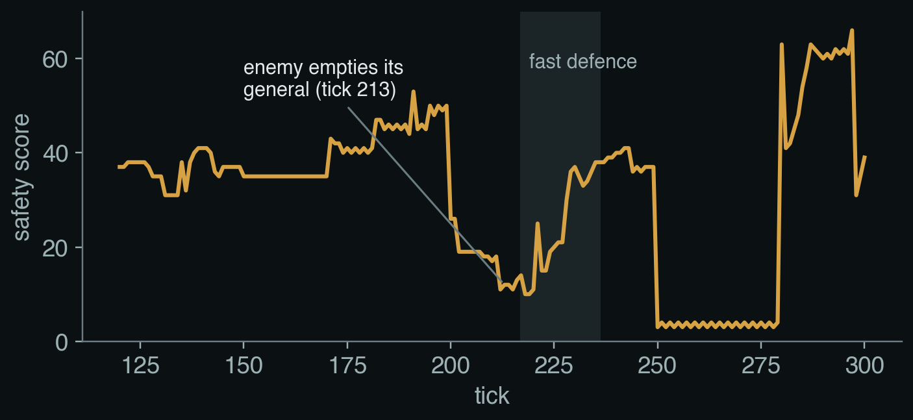
*(b) The safety score $M$ during the game. At tick 213 the opponent empties its general into one stack and $M$ falls from 26 to 12; the grey band is defence mode.*

**Figure 3:** The safety score in the example game.

### 3.6 Defence mode: Steiner-tree gathering

> **Key idea.** Once an attack is truly coming, **commit**: every move pulls soldiers into the general along a prize-collecting Steiner tree, farthest stacks first, until the attack is over.

**Aim.** The safety margin alone was not enough: an earlier version noticed danger, defended for a single tick, saw the margin recover, returned to expanding and lost the general (Section 4). Defence mode therefore **commits**: once a real attack is coming, every move pulls soldiers into the general until the attack is over.

**Step 1: notice the attack.** A hostile stack counts as **incoming** if it is not banked on a producer, has at least $\max(15,0.2G)$ soldiers (lower, $\max(12,0.15G)$, if the belief says the opponent is a collector), and its distance to our general fell by at least 2 during the last $\le 6$ ticks. Its distance is the arrival time $\eta$ (ETA). The state stays “incoming” until 6 ticks have passed without a new approach.

**Step 2: measure how short the general will be.** Using the same counting as the safety score,

$$
N=\max_{1\le T\le\eta+5}\Big[D_{\text{them}}(g,T)-G-\gamma(T)\Big]+0.15\,a_{\text{att}}, \tag{14}
$$

where $a_{\text{att}}$ is the size of the approaching stack. If $N\le 0$ the general holds on its own and the bot plays normally; if $N>0$, every move is defence.

**Step 3: gather with a prize-collecting Steiner tree.** Every owned stack $v$ holds a **prize** $a_v-1$ (one soldier must stay), and every move costs one unit of the move budget $B=\eta-2$ (the attacker must not arrive before we are done). We seek a tree rooted at the general that collects the most soldiers within the budget. The standard trick is to put a price $\lambda$ on each move and maximise

$$
\max_{\mathcal{T}\ni g}\ \sum_{v\in\mathcal{T}}(a_v-1)-\lambda\big(|\mathcal{T}|-1\big)\qquad\text{so that }|\mathcal{T}|-1\le B. \tag{15}
$$

For a fixed $\lambda$ the tree is built greedily: start from $\{g\}$, repeatedly add the stack (among the 30 largest) whose connecting path through our land has the largest positive net gain (prizes on the new cells minus $\lambda$ times their number). A high $\lambda$ gives a small, fast tree; a low $\lambda$ a large, slow one. We therefore find the smallest $\lambda$ whose tree fits the budget by **binary search** on $[0,a_{\max}]$:

$$
\lambda\leftarrow\tfrac12(\lambda_{\text{lo}}+\lambda_{\text{hi}}),\qquad\text{7 halvings are enough.} \tag{16}
$$

**Step 4: execute leaf-first, one move per tick.** The tree gives a list of moves (child cell $\to$ parent cell). They are played from the **farthest** cells inwards, so that soldiers snowball on the way in; the plan is recomputed every 4 ticks. Two details: a stack next to the general steps in immediately (if it holds at least 10 soldiers, or at least 2 once the attacker is within 6 squares), so nothing parks beside the general; and defence is skipped if one of our stacks next to the enemy general can capture it right now. Defence moves are played directly; only moves into the general or towards it are generated, so they cannot weaken it.

**Effect.** In the example game of our presentation, the general grew from 68 to 124 soldiers in 16 ticks and the attack failed, in a position that the previous version had lost.

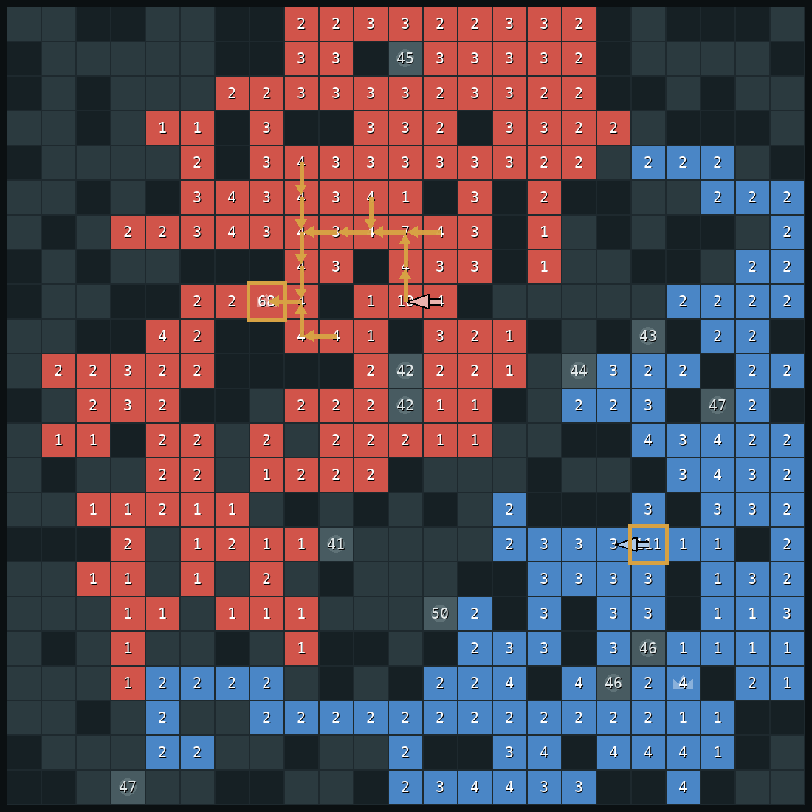
*(a) Tick 219: the 14-move Steiner-tree plan (gold arrows); general 68.*

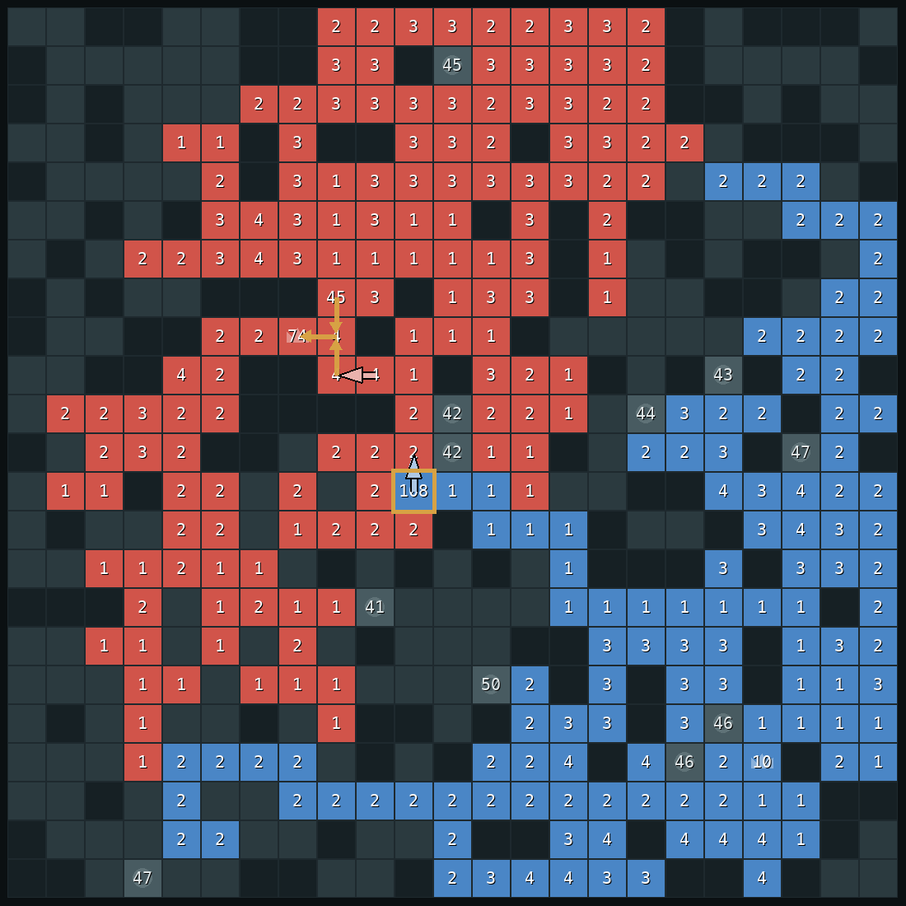
*(b) Tick 230: farthest stacks first; three moves of the plan left.*

*(c) Tick 235: general 124, attacker (90) right next to it.*

*(d) Tick 237: the attack lands with 88; the general keeps 38.*

**Figure 4:** Defence mode in the example game, ticks 219–237 (our bot red). The previous version, v46, lost this position at tick 237 with 77 soldiers against 82.

### 3.7 Castle economy

> **Key idea.** A castle is an **investment**: pay soldiers now, receive $\tfrac12$ soldier per tick later. Take it only if it pays back, if home stays safe, and if the income race says we need it.

**Aim.** A castle produces like 25 squares of land and wins long games, but capturing it costs soldiers now and leaves home weaker. The bot treats it as an **investment** and takes a castle only if it pays back, stays safe, and is needed; the paper by Churchill and Buro supplies the idea of projecting income forward.

**Income and the race.** Each player's income per tick is

$$
\text{inc}_p=\tfrac12\big(\#\text{generals}+\#\text{castles owned}\big)+\tfrac{1}{50}\,\text{land}_p. \tag{17}
$$

Projecting both armies to the end of the game gives the **income race**: with left ticks remaining,

$$
\text{lead}=(A_p-A_o)+(\text{inc}_p-\text{inc}_o)\cdot\text{left}, \tag{18}
$$

$$
\text{race won}\iff\text{lead}>0.25\max(50,A_o)\ \wedge\ \text{inc}_p\ge\text{inc}_o\ \wedge\ \text{land}_p>\text{land}_o, \tag{19}
$$

where $A$ is total army. If the race is not won (or the enemy holds castles), every castle is considered; otherwise only **cheap** castles (garrison plus walk $\le 30$, never sent from the general) are.

**Worth it?** For a castle with garrison $n$ (plus its growth if it is enemy-held), reached by a walk of length $d$, the investment pays if it produces more than it costs. A castle produces $\tfrac12$ soldier per tick, so it needs

$$
\tfrac12\,(\text{left}-d)\;>\;n+d, \tag{20}
$$

and we also cap the horizon at 400 ticks. **Example:** 200 ticks left, garrison 45, walk 10: it produces 95 and costs 55, so it is worth taking.

**Which castle, and from where?** We consider castles within 30 steps, and sources: the general, owned castles with at least 4 soldiers, and the largest stacks (sending half or all-but-one). A candidate is feasible only if the walk delivers more than $n+1$. Candidates are ranked by

$$
\text{key}=n+d-0.6\cdot(\text{steps the castle is closer to the enemy general than to us}) -15\cdot[\text{enemy-held}]+2\cdot[\text{all-in send}], \tag{21}
$$

so that nearby, forward and enemy castles come first, and the best four are tried.

**Safe?** The bot fast-forwards the board to the moment the stack has been spent on the castle, advances every hostile walk by the walk's length, and requires the safety margin to still hold with an extra buffer of 20% of the largest hostile stack: $M>\text{pad}+0.2\,a^{\text{hostile}}_{\max}$. If the source is the general, the reserve test of Section 3.3 also applies. Castle moves are only tried when the situation is not urgent, and the walk is re-checked at every step.

**In the plan.** The same logic appears inside the plan menu as the “take castle” plan, which banks soldiers at the best source until the walk wins.

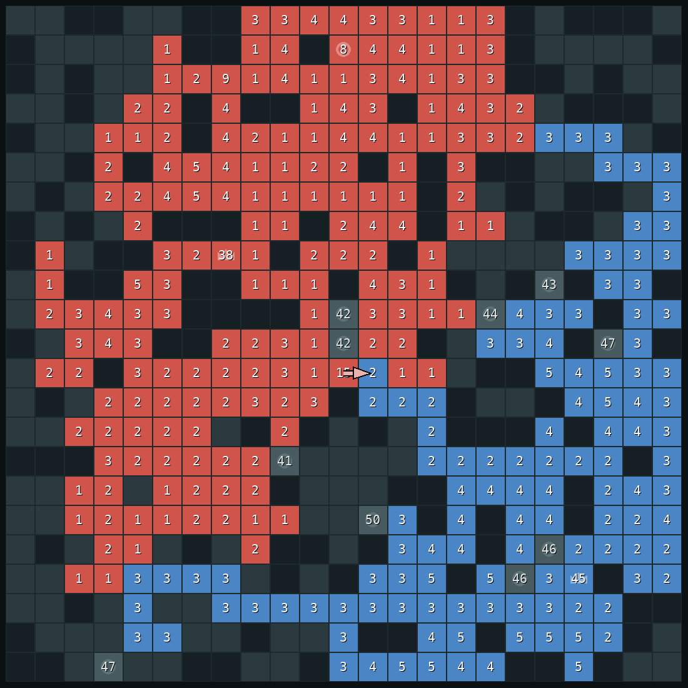

**Figure 5:** Tick 298 of the example game: after the attack has been beaten, the bot takes its first castle.

### 3.8 The arithmetic of an attack

> **Key idea.** Attacking a full general rarely works, because the attacker shrinks as it walks and the defender grows. Attack only when the arriving force provably beats the general, its growth and its reinforcements, and survives every reply.

**Aim.** Attacking a full general rarely works, because the attacker shrinks while walking and the defender grows. The bot attacks only when it can show that the attack works.

**When an attack works.** For a stack at distance $d$ along path $\pi$, the force that arrives is $A(\pi)$ (Section 3.1). The enemy general can have

$$
\text{defence}=a_{g'}+\gamma(d)+R(g',d-1), \tag{22}
$$

its present army, its growth during the walk, and $R(g',d-1)$, the largest single stack the enemy can walk home in $d-1$ ticks. The attack works if

$$
A(\pi)-\text{defence}>m_{\text{att}}\qquad(m_{\text{att}}=2). \tag{23}
$$

**Example:** a stack of 60 walks 10 squares through 5 enemy soldiers and arrives with 45; the enemy general has 2, grows by 5, and the enemy can bring 20 home; $45>27$, so the attack works.

**Three further conditions.** The bot launches an attack only if (1) the inequality holds for the best candidate among the 12 largest stacks, (2) our own general stays safe while the stack is away (the race check, with the marching stack not counted as home), and (3) the attack survives `verify`: it wins against all four replies. In practice this happens when the enemy has emptied its general. An attack that is immediately decisive is always played: if a stack next to the enemy general has more than its army plus one, it captures.

**Counter-strike.** If the safety margin is at most the pad and says our general will fall at tick $t_{\text{fall}}$ (the first $T$ with $M\le 0$), defending is hopeless but attacking may not be. A stack is launched at the enemy general if its walk length $d<t_{\text{fall}}$, and

$$
A(\pi)>a_{g'}+\gamma(d)+D_{\text{home}}(g',d-1)+3, \tag{24}
$$

and it passes `verify`.

**Weakness.** Against a careful opponent who never empties its general, the bot attacks late or not at all; it is a bot that is strongest on defence.

*(a) Tick 405: the enemy general (gold box) holds only 2 soldiers; the attack passes all four replies.*

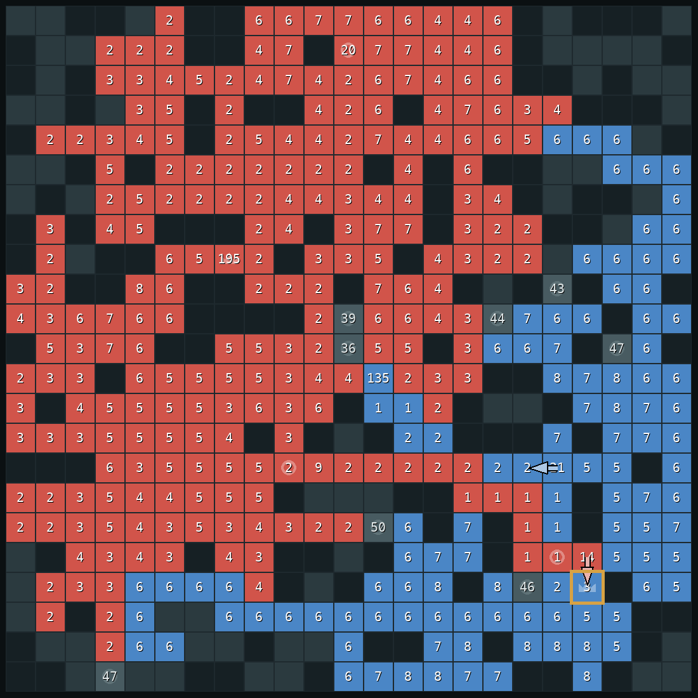
*(b) Tick 407: the general is captured.*

**Figure 6:** An attack that is proven before it is launched (example game, our bot red).

### 3.9 Summary of the ideas in brief (tl;dr)

| **Idea** | **In brief** |
|---|---|
| **1. Belief over the opponent** (3.2) | Four scripts and a ten-style neural classifier give a decayed Bayesian belief about how the opponent plays. It weights the plans. |
| **2. Stress test** (3.3) | AND-OR test: a move is played only if the general survives **every** enemy attack route. The general has a stricter reserve rule and never steps towards an adjacent attacker. |
| **3. Plans by expected value** (3.4) | Up to 8 scripted plans are simulated 24–60 ticks against 4 imagined opponents. A learned logistic model scores the end positions and the plan with the best mix of average and worst case is kept for $K$ ticks. |
| **4. Safety score** (3.5) | $M=\min_T[G+\gamma(T)+D_{\text{us}}-D_{\text{them}}]$: what each side can gather at the general within $T$ moves. If $M\le\text{pad}$, the bot switches to urgent play. |
| **5. Defence mode** (3.6) | An approaching stack is detected and the shortfall $N$ computed. If $N>0$ the bot commits: a prize-collecting Steiner tree pulls soldiers into the general, farthest first, until the attack is over. |
| **6. Castle economy** (3.7) | A castle is an investment: take it if $\tfrac12(\text{left}-d)>n+d$, if the general stays safe after the walk, and if the income race says it is needed. |
| **7. Attack arithmetic** (3.8) | Attack only if the arriving force beats the general, its growth and its reinforcements by a margin, home stays safe and `verify` passes. If defence is hopeless, counter-strike. |

### 3.10 Summary: the pipeline executed on every tick

> **Key idea.** Eight steps in a fixed order; the first step that produces a move decides the turn. Two rules never change: a move that fails the test is never played, and defence gets every move while an attack is coming.

Every 0.5 s the bot runs the steps below, in this order. The first step that produces a move decides the turn, and every plan, castle and rule-list move passes the stress test of Section 3.3; the capture, the fast-defence moves and the verified attacks and counter-strikes are checked by their own tests instead. The whole pipeline uses about 10 ms on average of the 500 ms available (a few ticks that verify an attack take longer).

1. **Read the board and update beliefs.** Copy the board into the simulator; compute the 14 opponent features; update the scripts' weights $w_k$ and the ten-style belief $P_t(y)$ (Sec. 3.2).
2. **Capture.** If one of our stacks next to the enemy general beats it, take it.
3. **Fast defence** (Sec. 3.6). Detect incoming stacks; if the general will be short ($N>0$), play the next Steiner-tree gathering move.
4. **Safety score** (Sec. 3.5). Compute $M$ and the pad. If $M\le$ pad: counter-strike or a proven attack (Sec. 3.8); otherwise continue.
5. **Castle economy** (Sec. 3.7). If a castle pays back, stays safe and is needed, continue or start the castle walk.
6. **Committed plan** (Sec. 3.4). If the plan expired or an event occurred, evaluate the plans against the four imagined opponents and pick $\pi^\star=\arg\max S(\pi)$; then take the plan's next move.
7. **Stress test** (Sec. 3.3) for plan, castle and rule-list moves. Margin after the move; if unclear, play it out against every attack route; reserve rule for general moves. If it fails, fall back to the defender script, or pass.
8. **Send the move** to the game (one cell and one direction, all-but-one or half).

The two rules that never change are: **a move that fails the test is never played**, and **when an attack is coming, defence gets every move until it is over**.

## 4 Trials and Error

The final bot is the result of about fifty versions and three changes of direction. This section records what we tried, why each attempt fell short, and what each failure taught us. We start with the five search papers on which our first two project presentations were built, because their failure is what pushed us towards the safety-first design of Section 3.

| **Version** | **What triggered it** | **What we changed** |
|---|---|---|
| up to v11 | plan: build the bot from five search papers | search-era bots; v11 was the best of them |
| v36 | v11 lost its general in 25 of 60 games to two simple rush bots | a safety rule before anything else |
| v37 | safety alone gives no long-term plan | phases, macro plans, simulated look-ahead, learned win model |
| v39 | replays of human wins | swap-safe defence, less over-defending (two-wave counting and counter-strike tried, kept off) |
| v42 | a human win by *collecting* the whole army | collection-race safety score; castle layer |
| v44 | another human win (general drained on castles) | every cell counted once, general reserve |
| v45–v46 | the bot treated every opponent alike | caution adapted to the opponent; belief-driven threat gate; income-race castle rule |
| v51 | v46 defended for one tick at a time and lost | committed fast defence; ten-style classifier |

### 4.1 The five papers we started with, and why we abandoned them

Our first plan was to treat Generals.io as a search problem: find the best move by looking ahead, and make that search faster, deeper or better informed. All five papers do one of these things. We implemented most of them and measured them on our own game. They worked as designed and the bot did not get stronger. The reasons differ from paper to paper.

#### 4.1.1 Minimax and alpha-beta: the game is not turn-based

The standard starting point, and the foundation of ProbCut, is minimax with alpha-beta pruning. It assumes that players move *in turn*: the second player sees the first player's move and answers it. In Generals.io both players commit their move in the same half-second and neither sees the other's choice, so each turn is a *simultaneous-move game*, closer to rock-paper-scissors than to chess. Three problems follow.

- **No pure best move exists.** Suppose our general may either keep its soldiers at home or send them out to expand, and the enemy may either charge or expand. Keeping the soldiers home is wasted if the enemy only expands, and sending them out loses the general if the enemy charges. Each choice is best against one reply and worst against the other, so the value of the position is a *mixed* (randomised) strategy, not a single maximum.
- **Serialising the turn biases the answer.** The usual repair is to pretend one player moves first. If we let the enemy answer *after* seeing our move, the enemy is assumed to know our move and the bot becomes absurdly timid, never expanding because a perfect reply always exists. If we assume we answer after the enemy, the bot is absurdly bold. The alternating, 1-2-2-1, or random orderings discussed in the literature [3] shift the bias around but never remove it.
- **The exact alternative is too expensive.** Solving each node as a matrix game needs the full table of joint moves. The action space is up to $H\times W\times 9=4{,}761$ slots per player on a $23\times 23$ board (a cell, a direction, all-but-one or half of the stack), typically hundreds of legal moves, so a joint move has tens of thousands of combinations, at every node of a tree that is many turns deep.

This does not mean game-tree ideas are useless. We kept them in the one place where simultaneity does not hurt: a yes/no test (AND-OR search, Section 3.3). There we do not ask “what is the best reply?” but “is there *any* reply that loses the general?”, which needs no equilibrium and no ordering of moves. For choosing the long-term direction we instead score plans against several imagined opponents and mix the average with the worst case (Section 3.4), a decision rule for simultaneous play.

#### 4.1.2 ProbCut: it did not look far enough

ProbCut speeds up alpha-beta by skipping branches that a shallow search already shows to be outside the window of interest. It rests on a statistical model: the deep value $v$ is predicted from the shallow value $v'$,

$$
v\approx a\,v'+b+\varepsilon, \tag{25}
$$

and a branch is cut when the predicted $v$ clearly falls outside the window. The saved time is spent on a deeper search elsewhere.

We fitted this model on 160 real positions and found that shallow search predicts deep search almost perfectly ($v=0.955\,v'+1.97$, residual deviation $\sigma=2.18$, correlation 0.996). For ProbCut this looks like good news, because pruning is safe. We took the opposite lesson from it: *if the shallow value already tells us what the deep value will be, searching deeper in the same range hardly ever changes a decision.* Combined with the horizon problem, this explains the result:

- The dangers in Generals.io unfold over 15–40 ticks: a charging stack walks 17 squares, a build-up takes 30 ticks, a castle pays back after 100 or more. A search of four plies, even with ProbCut's pruning, sees almost nothing of this. The pruning saves effort, but it does not lengthen the horizon enough, and it does not tell the search what to look for.
- The information that decides games is not in the leaves of a deeper tree: it is whether the general can still be reached by several stacks in time.

Every variant we tried (ProbCut, four-ply search, learned ProbCut) stayed at a coin flip or below in games against our best bot of the time, v11, while a bot built on a completely different idea, the safety rule of Section 3.3, won every game against it.

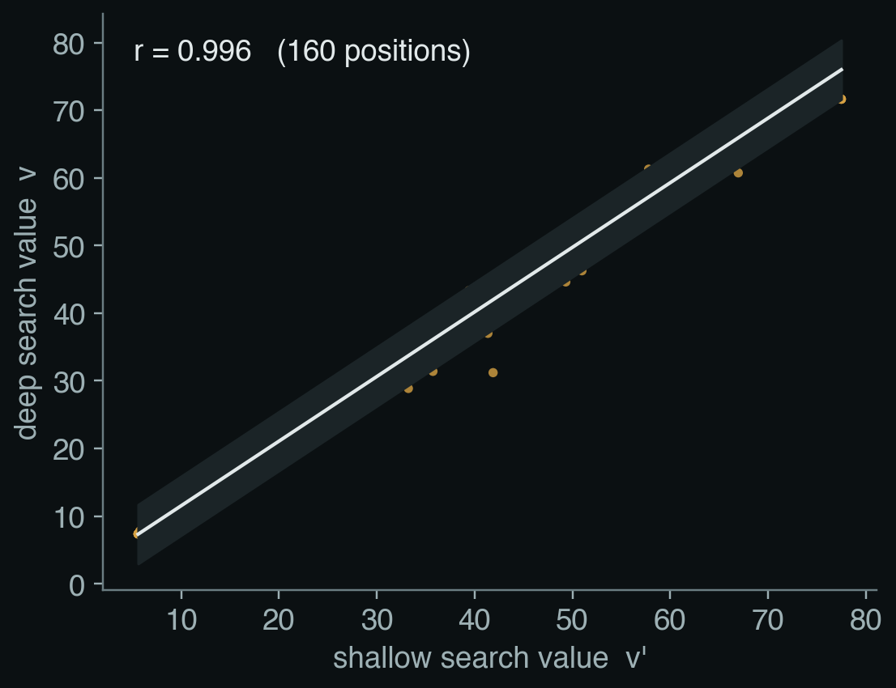
*(a) Shallow against deep search value on 160 positions ($r=0.996$).*

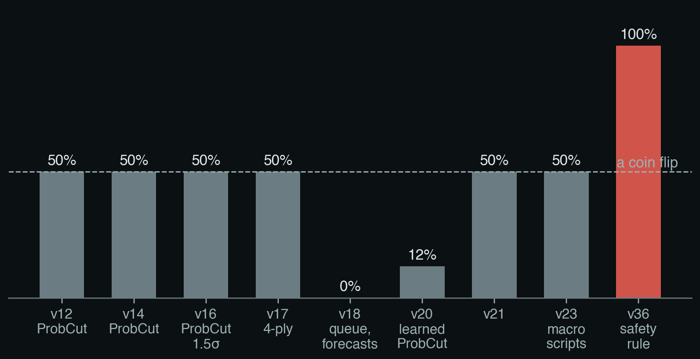
*(b) Win rate against v11 of the search-era bots (grey) and of v36, the first bot with the safety rule (red).*

**Figure 7:** ProbCut: the shallow search already predicts the deep one, and deeper search did not win more games.

#### 4.1.3 ARA\*, RTAA\* and depression avoidance: a stepping stone, not a solution

The three path-finding papers share one picture: an agent that must find a route through a map whose distances are costly to compute or unknown. *ARA\** finds a poor path quickly and improves it while time remains; *RTAA\** learns better distance estimates as the agent moves; *depression avoidance* escapes the local dead ends that a wrong estimate creates. Each addresses a real problem, but not ours.

- **Finding paths was never the hard part.** The whole map is visible, so a complete breadth-first distance map over all 529 squares costs about 0.04 ms. Anytime path improvement (ARA\*) has nothing to improve, and there are no unknown distances for RTAA\* to learn or wrong estimates for depression avoidance to escape.
- **Paths are not decisions.** A path answers “how do I get from A to B?”. The decisions that win or lose games are “which stack should move, and should the general leave at all?” The path-finding papers do not model an opponent, simultaneous moves or soldiers that are lost along the way.
- **They need an abstraction on top.** Path search gives no guarantee that a task is ever finished if the goal is re-chosen every turn: in a lost game, v11's stack circled the same four squares for 16 ticks while an enemy stack walked 17 squares straight to its general. Path search became useful only once something above it chose the goal, that is, once we had the plans of Section 3.4, in the spirit of Puppet Search [3].

These papers were therefore a stepping stone. The distance maps and the walk computation of Section 3.1 descend directly from this work: every “walk” in the bot is a shortest-path computation. But without abstraction (plans, commitment) and without safety they were not enough on their own.

#### 4.1.4 Metareasoning: thinking time was not scarce

Metareasoning decides how long to think before acting, assuming computation is the bottleneck. In our final bot a full decision uses about 10 ms on average of the 500 ms available, so there is almost no time pressure to manage. What survived is a cheap version of the idea: the expensive look-ahead (about 1,300 simulated turns) runs only when a plan has to be chosen, not every tick (Section 3.4).

#### 4.1.5 Summary of the five papers

| **Paper** | **Hidden assumption** | **What we found in our game** | **What survived** |
|---|---|---|---|
| Minimax / alpha-beta | players alternate | moves are simultaneous; no pure best move | AND-OR yes/no test |
| ProbCut | deeper search wins more | shallow $\approx$ deep ($r=0.996$); horizon too short | nothing |
| ARA\* | finding a path is hard | full distance map in 0.04 ms | shortest paths as a tool |
| RTAA\*, depression avoidance | distances are unknown or estimates wrong | distances are exact from tick 1 | nothing |
| Metareasoning | thinking time is scarce | about 10 of 500 ms used on average | plan only when needed |

All five make search faster or deeper. Our games were lost for another reason, which none of them looks at: a general left without enough soldiers.

### 4.2 Evidence from lost games: a safety rule before anything else (v36)

**The failure.** We played v11, our best search-era bot, against two simple rush bots on 60 maps. It lost its general in 25 of them. In a typical game, at tick 81 it moved 40 soldiers out of its general to expand; its stack then circled the same four squares for 16 ticks, re-deciding every tick, while the rusher walked straight in; at tick 99 the general, which had grown back to only 10 soldiers, fell to 21.

**Diagnosis.** Two separate weaknesses: (i) nothing in the bot asked “if I move these soldiers, can my general still be taken?”, and (ii) the bot changed its mind every tick, so no long task was ever finished. The search was not the problem.

**The fix.** For every enemy stack $s$ the general must still win if $s$ walks in: soldiers kept $+$ growth during the walk must exceed the force that would arrive. At tick 81, if the general keeps 1 soldier it has $1+9=10$ against a stack of 42, 18 squares away, that can arrive with up to 24, so the move is refused; if it keeps its 40, it has 49 against 24 and the move is safe. This is the principle of *constraint before optimisation*: rule out the moves that break a hard constraint, then choose among the rest.

**Result.** v36 won 24 of the 25 games that v11 lost on the same maps, and 20 of 20 games against the direct rusher, where the search-era bots had scored between 25% and 83% on small test sets. It was a change of mind rather than an improvement of search: from then on we modelled what loses games.

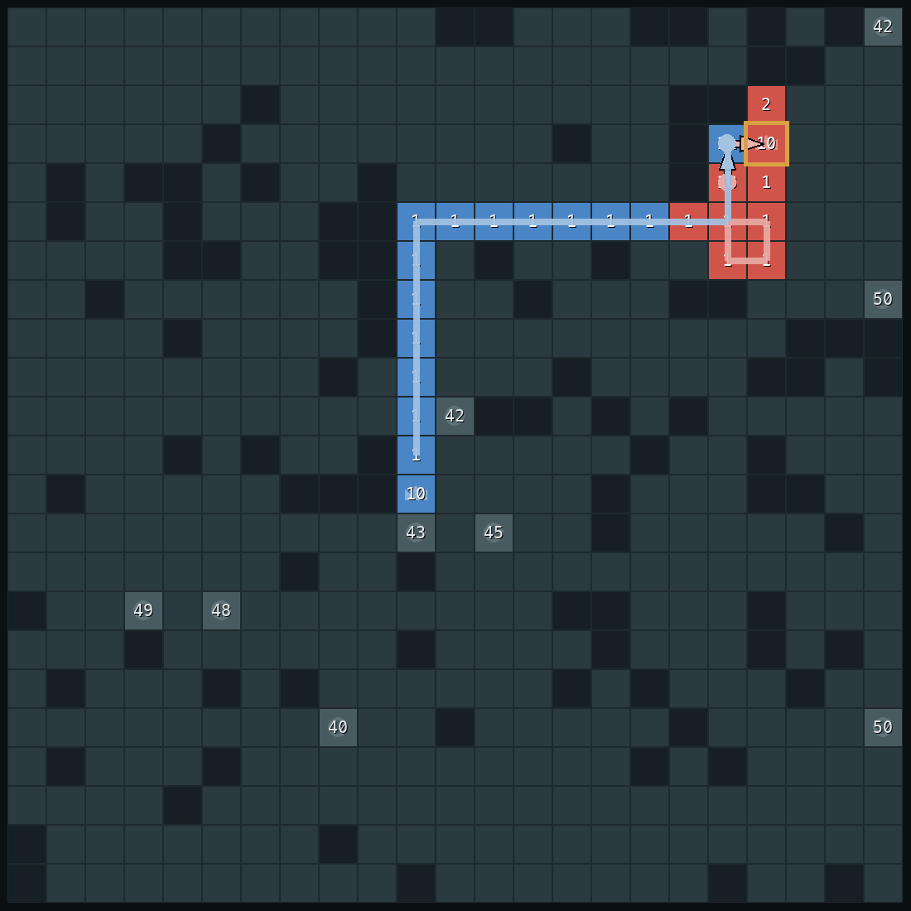
*(a) v11, tick 98: its 40 soldiers left the general at tick 81 and circled (light red); the rusher walked straight in (light blue).*

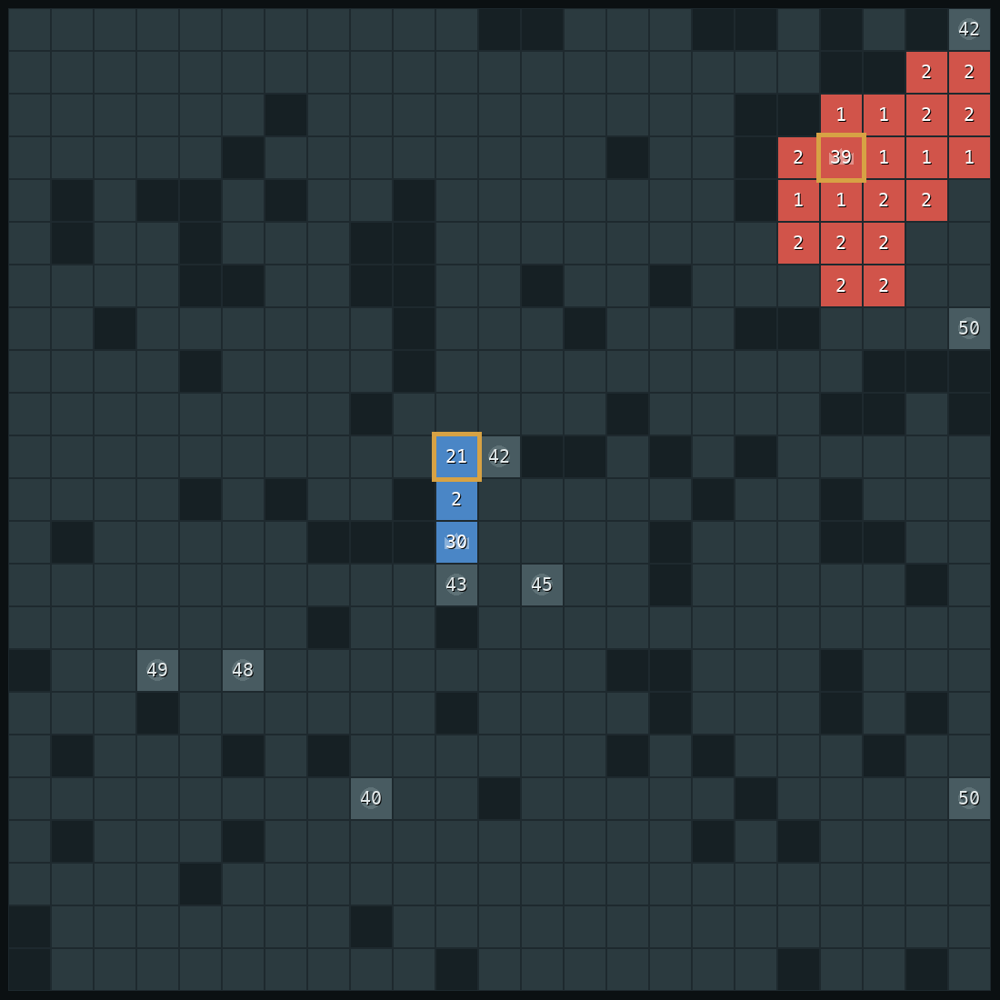
*(b) v36 on the same map, tick 98: 39 soldiers stay in the general; the rusher's 21 cannot break it.*

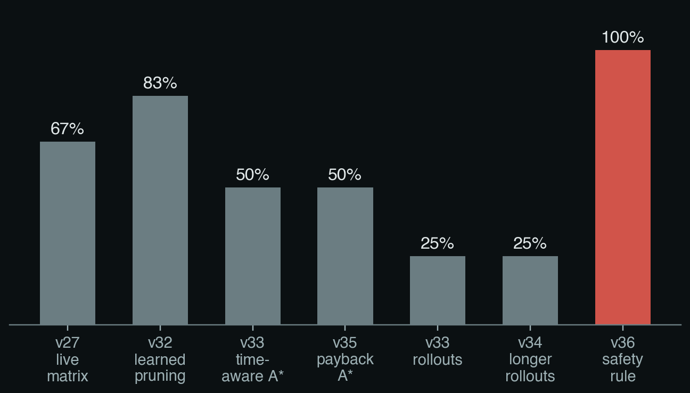
*(c) Win rate against the direct rusher: search-era bots (grey, 4–6 game sets) and v36 (red, 20 games).*

**Figure 8:** The loss that changed our direction, and the effect of the safety rule (our bot drawn red in both boards).

### 4.3 The pendulum: hoarding, then over-defending (v37–v39)

Safety alone only avoids defeat; it does not plan. v37 added the phase-aware planner of Section 3.4 (macro plans, rollouts, a learned win model) on top of the safety rule. Playing against it ourselves and analysing recorded human wins, we found a recurring pattern: each fix pushed the bot to the opposite weakness.

- **Hoarding.** Humans beat v37 because it kept everything banked in its general, took no castles, and did not see a spread-out enemy until that enemy had been collected into one stack.
- **Single-stack arithmetic.** The safety rule compared the general with one hostile stack at a time. Recorded human wins use *two waves*: one stack trades with the general, a second finishes it. v39 tried adding up arrivals in order of time and a counter-strike, but both stayed switched off; two-wave counting entered with v42 and the counter-strike with v44.
- **Over-defending.** Having become wary, v37 treated any 4-soldier hostile walk as contact and chose “gather home” for about 300 ticks, finishing a game with 27 squares against 63. v39's cure was to offer “gather home” only when the margin was actually low and a threat was at least a quarter of the general (in v51 only the low-margin condition remains, Section 3.4).

The lesson was that a safety rule must be calibrated: too weak and the bot is beaten, too strong and it is beaten more slowly.

### 4.4 Learning from human wins: collecting, reserve, counter-strike (v42–v44)

**v42: the whole army, not one stack.** In a recorded human win at tick 520 the human's largest single stack was 605, smaller than the bot's general (672), so the one-stack rule felt safe. But the human owned more castles (2 to 0, later 4 to 0) and more land (93 to 67), with soldiers over a large area; by tick 845 it had collected everything into one stack of 1,694 against a general of 1,323 and won. The fix is the collection-race safety score of Section 3.5, borrowed from the Steiner-tree paper: count everything each side can *collect* within $T$ moves. In the same version we added the castle layer of Section 3.7, because the same games showed that a bot that never takes castles falls behind in income.

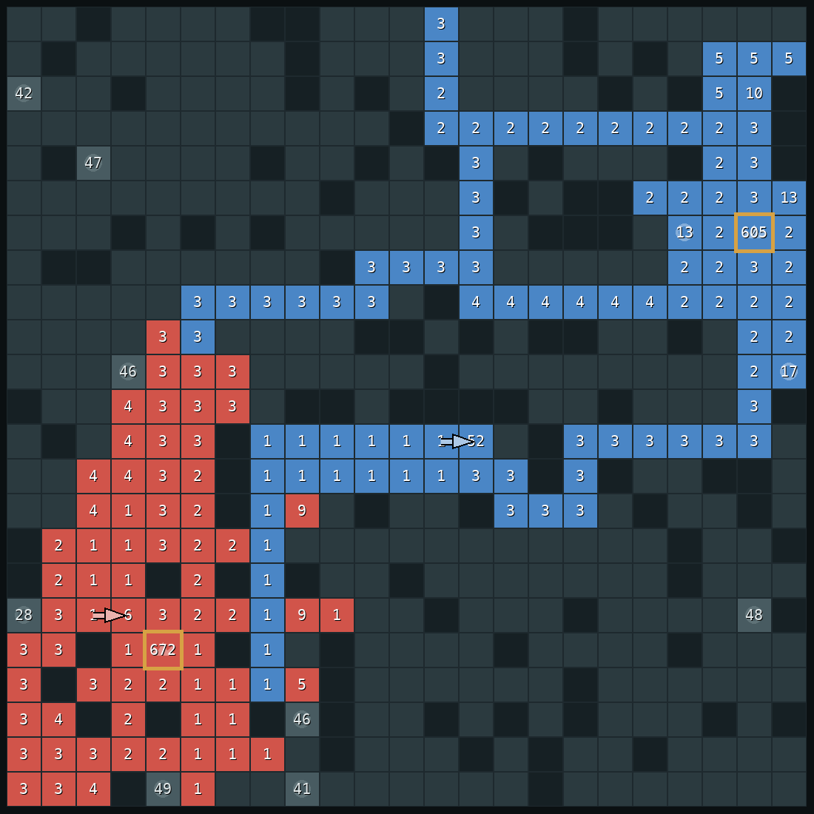
*(a) Tick 520: the human's largest stack (605) is smaller than the bot's general (672).*

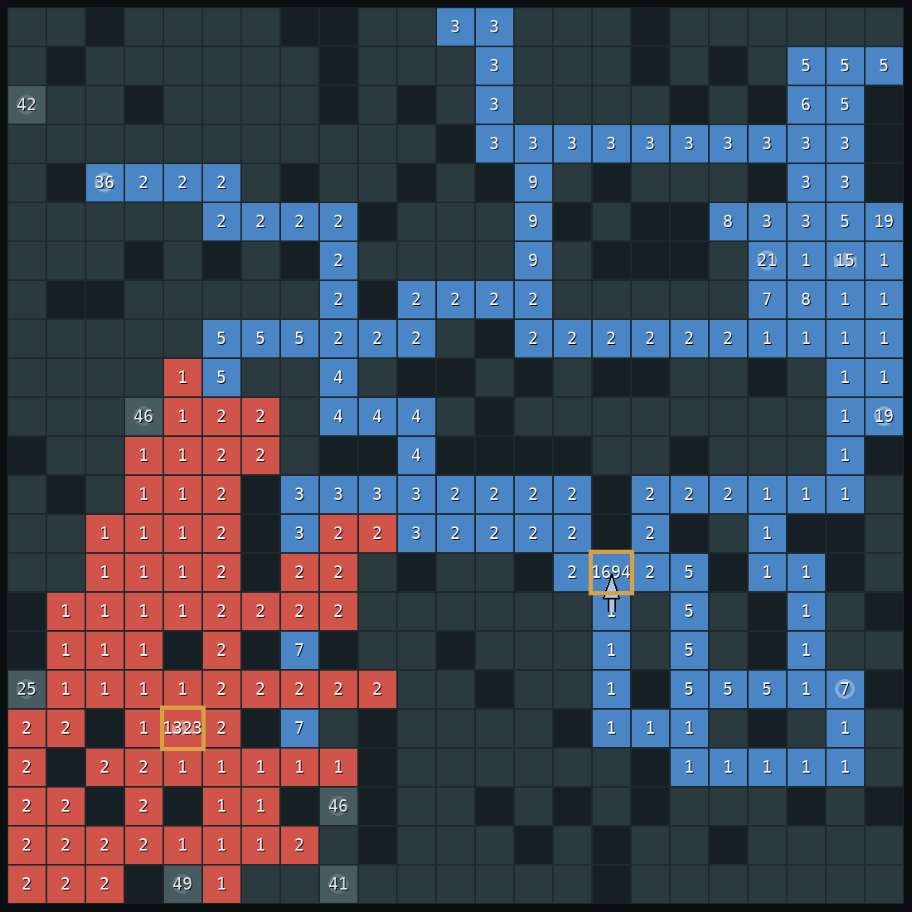
*(b) Tick 845: the human has collected 1,694 against a general of 1,323.*

**Figure 9:** A recorded human win against v37 (here the bot is red and the human blue; gold boxes mark the human's largest stack and the bot's general).

**v44: three fixes from one more human win.** In a 272-tick human win, v42 had drained its general to between 2 and 15 soldiers on castles and one strike; its army sat thinly over 105 cells; the human walked its own general 25 cells, collecting from 84 to 137 on the way; and v42's margin read $+10$ to $+40$ until two ticks before the end. We drew three conclusions:

1. **Count each cell once.** Home walks that shared a corridor each counted the soldiers on it, double-counting our defence. Now a later walk loses the soldiers an earlier walk already picks up.
2. **Keep a general reserve.** A move out of the general must leave enough behind that the general still holds a fraction of every hostile arrival, even if the enemy waits 30 or 60 ticks and grows (Section 3.3).
3. **Counter-strike.** When defence is already hopeless, a stack that provably reaches the enemy general first and beats it should attack (Section 3.8).

### 4.5 Reading the opponent: belief and classifier (v45–v46, v51)

**One caution for every opponent is too much.** Up to v44 the bot behaved the same way against everybody: a high reserve against a harmless land-grabber made it slow and lost income, while a low reserve lost to rushers. v45 made the bot's caution depend on what the opponent actually does: a higher reserve and counter-strikes only once a threat had been seen, and only cheap castles unless the enemy held castles. v46 let the **in-game Bayesian belief** over four scripts (kept since v37) open the threat gate, and added the income-race castle rule. We also implemented a cross-game strategy selector (a multi-armed bandit that picks one of four parameter “arms” per game and rewards it with the outcome), but left it optional and switched off in the final configuration: a bandit needs many games to learn, which does not fit the single games we evaluate.

**Four styles were too few.** The four-script belief was too coarse to separate opponents that collect and then charge, one of the very patterns that beat us. For v51 we trained the ten-style neural classifier of Section 3.2. Its mistakes are instructive.

- **From one board it is right only 25% of the time** early in a game, because at the beginning every player just grabs land. This is why we added the decayed filter: the belief reaches 39%, 66% and 70% at turns 100, 200 and 300.
- **A rusher is often read as a turtle (55%).** This is not a bug: both sit at home until the rusher launches. We therefore did not make safety depend on the classifier; the approach detector of Section 3.6 is purely geometric and catches the rusher the moment it moves.
- **Economy bot and planner bot are confused with each other.** They are our own older bots, play alike and map to the same imagined opponent, so the confusion costs nothing.

The classifier was trained on games in which our previous bot (v46) faced each of the ten styles, so it is only as general as those ten styles. This is a limitation (Section 4.9).

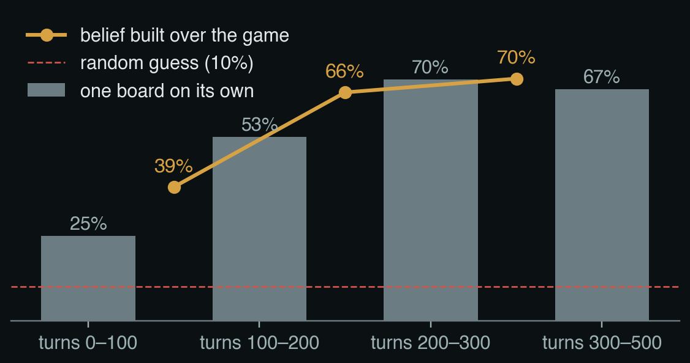
*(a) Accuracy on unseen maps: one board on its own (grey) and the filtered belief (gold); random guessing is 10%.*

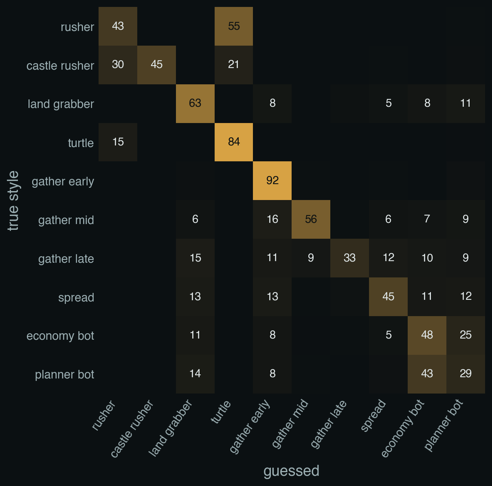
*(b) Confusion matrix on unseen maps (rows: true style, in %).*

**Figure 10:** The ten-style classifier.

### 4.6 Defend once, and keep defending (v51)

v46 still lost to one pattern: build up quietly, then charge with one big stack. We replayed such a game (same map, same opponent). The attacker builds from tick 200 and charges. v46 noticed the danger, defended for a tick, saw the safety score recover, went back to expanding, noticed again, and so on. It collected only from distance 4 and from one stack per tick; at tick 237 the general had 77 soldiers against 82, while 400 soldiers lay spread over the board and two stacks were only three squares away. The failure was a *flip-flop*: the decision to defend was taken tick by tick, so the work done in one tick was undone in the next.

The cure, in one sentence: *decide once, and keep defending while the attack is coming.* Once an attack is detected the bot commits: every move pulls soldiers into the general along a Steiner tree until the attacker has turned away or has been beaten (Section 3.6). In the same position v51's general rises to 124 and the attack fails, leaving 38 soldiers in the general and none in the attacker.

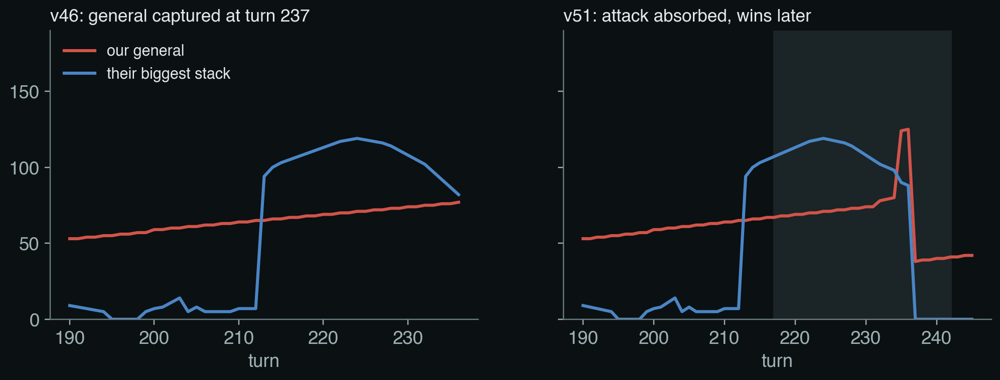

**Figure 11:** The same game played by v46 (left) and v51 (right): our general (red) and the attacker's largest stack (blue). v46's general grows only slowly, to 77, and falls at tick 237; v51 commits to defence (grey band), its general rises to 124 and the attack fails.

### 4.7 The learned win estimate: what worked and what did not

The logistic win model (Section 3.4) is deliberately simple, and testing it on held-out maps gave a mixed but honest picture.

- **Opening:** better than the land difference alone (75% against 71% correct; log-loss 0.473 against 0.522). Income times turns left carries a large weight (0.95, second only to land, 1.13), since early income compounds.
- **End game:** very good (98%), because the game is nearly decided by then.
- **Mid-game: no better than land alone** (log-loss 0.372 against 0.359). We interpret this as a limit of the nine features: the mid-game is decided by events such as a castle changing hands or a charge, which the features do not describe. We did not hide this: the plan score deliberately mixes this estimate with the worst case over opponents, so that a weak estimate cannot by itself pick a risky plan.
- **Two weights are exactly zero** (the constant and “turns left”). This is correct rather than a bug: every position is seen from both sides, so features that are equal for both sides cannot favour either.

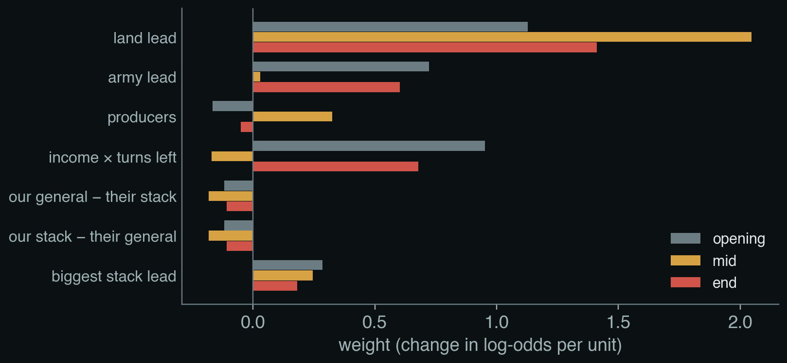
*(a) Learned weights per phase.*

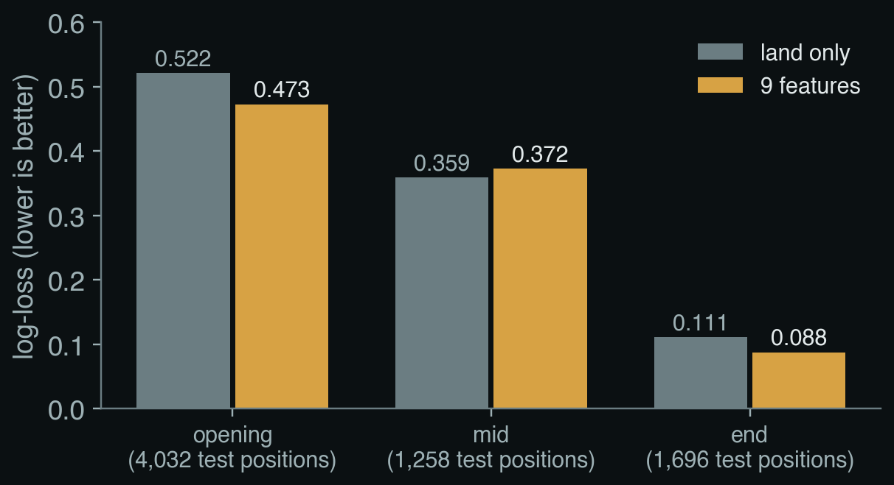
*(b) Held-out log-loss against a model that only uses the land difference (lower is better).*

**Figure 12:** The logistic win model.

### 4.8 Approaches we considered and did not pursue

We also weighed three alternatives and decided against them. These are design decisions rather than measured results.

- **Reinforcement learning.** The paper that documents the game [4] reaches superhuman play, but its final agent was trained for four days on four H200 GPUs (384 GPU-hours) after careful tuning, with only a win/loss signal at the end of each game. This was out of reach for a course project, and the result would also have been a black box. Our aim was the opposite: an agent that can be explained with formulas.
- **Monte-Carlo tree search with random playouts.** It needs no evaluation function, but random playouts in this game mostly consist of moves that lose the general at once, so most simulations would be wasted. Scripted rollouts (plans against imagined opponents) do the same job with a few dozen simulations.
- **Exact solution of the gathering problem.** The gathering of Section 3.1 is a knapsack with the extra constraint that walks may not share cells, which breaks the independence that exact dynamic programming relies on. The greedy rule is fast, and the pad of the safety score absorbs the small errors it can make.

### 4.9 Outcome, limitations and lessons

**Outcome.** In simulator games (20 per opponent, each side moving first equally often), v51 improves most against bots that collect and then charge: against the one that charges at tick 200 our win rate rose from 60% to 95%. Against a bot that spreads out and takes castles it is slightly worse, because while the bot is busy defending, that opponent takes castles. Head to head against our previous best bot the result is about even (32 wins to 28). The defence figures were measured with the fast defence but without the opponent classifier; the defence code is the same.

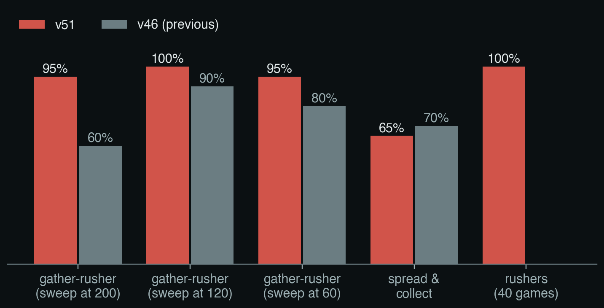
*(a) Win rate of v51's fast defence (red) and of v46 (grey), 20 simulator games per bar.*

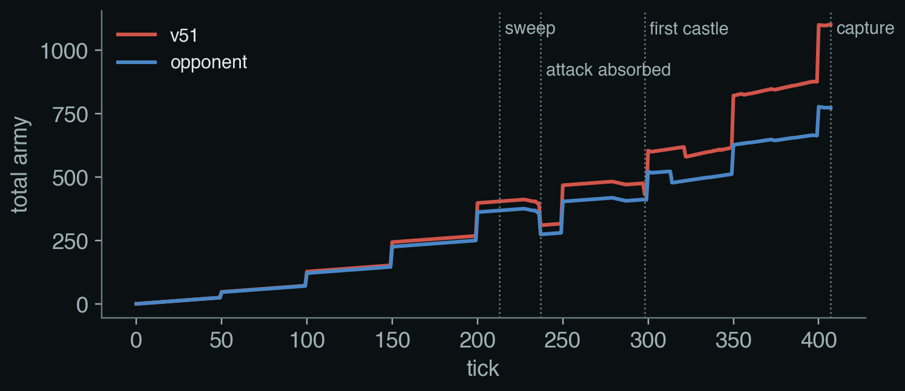
*(b) Total army in the example game: both sides grow together until the opponent charges; after its first castle v51 pulls away until the capture at tick 407.*

**Figure 13:** Results.

**Limitations.** 

- **Late attacker.** The bot attacks only when the attack is proven (Section 3.8), which in practice means when the enemy has emptied its general. Against a careful player who never does, it attacks late or never.
- **Weak against spreading and castles.** Defence has priority over castles, so the opponent that spreads out and takes castles gains income. The human advice we give to anyone who wants to beat the bot is exactly this.
- **Hand-set constants.** The pad ($3+0.08\cdot$ largest enemy stack), the reserve fractions (0.4 and 0.6), the incoming-stack threshold ($\max(15,0.2G)$) and the horizons were chosen by studying specific lost games, not by systematic tuning. A statistical search over these constants would be the next step.
- **A narrow opponent model.** The belief covers four scripts and ten styles; an opponent outside this family (for example one that deliberately feints) is simply forced into the nearest style, and only the safety layer protects us.
- **Full-board assumption and simulator.** The bot works from an exact model of the rules and reads the board state directly; deploying it where fog of war hides the opponent would require an additional inference layer (Synnaeve and Bessière's belief over hidden state is the natural starting point).

## References

1. G. Synnaeve and P. Bessière. A Bayesian model for plan recognition in RTS games applied to StarCraft. In *Proc. AIIDE*, pp. 79–84, 2011.
2. B. G. Weber and M. Mateas. A data mining approach to strategy prediction. In *IEEE Symposium on Computational Intelligence and Games (CIG)*, 2009.
3. N. A. Barriga, M. Stanescu, and M. Buro. Puppet Search: Enhancing scripted behavior by look-ahead search with applications to real-time strategy games. In *Proc. AIIDE*, 2015.
4. M. Straka, V. Lisý, and M. Schmid. Superhuman AI for Generals.io using self-play reinforcement learning. arXiv:2606.23348, 2026.
5. D. Churchill and M. Buro. Build order optimization in StarCraft. In *Proc. AIIDE*, pp. 14–19, 2011.
6. M. Likhachev, G. Gordon, and S. Thrun. ARA\*: Anytime A\* with provable bounds on sub-optimality. In *NIPS*, 2003.
7. S. Koenig and M. Likhachev. Real-time adaptive A\*. In *AAMAS*, 2006.
8. C. Hernández and J. A. Baier. Real-time adaptive A\* with depression avoidance. In *Proc. ICAPS*, 2011.
9. M. Buro. ProbCut: An effective selective extension of the alpha-beta algorithm. *ICCA Journal*, 1995.
10. S. Russell and E. Wefald. Principles of metareasoning. *Artificial Intelligence*, 1991.
11. S. Russell and P. Norvig. *Artificial Intelligence: A Modern Approach*, 4th ed. Pearson, 2020.
